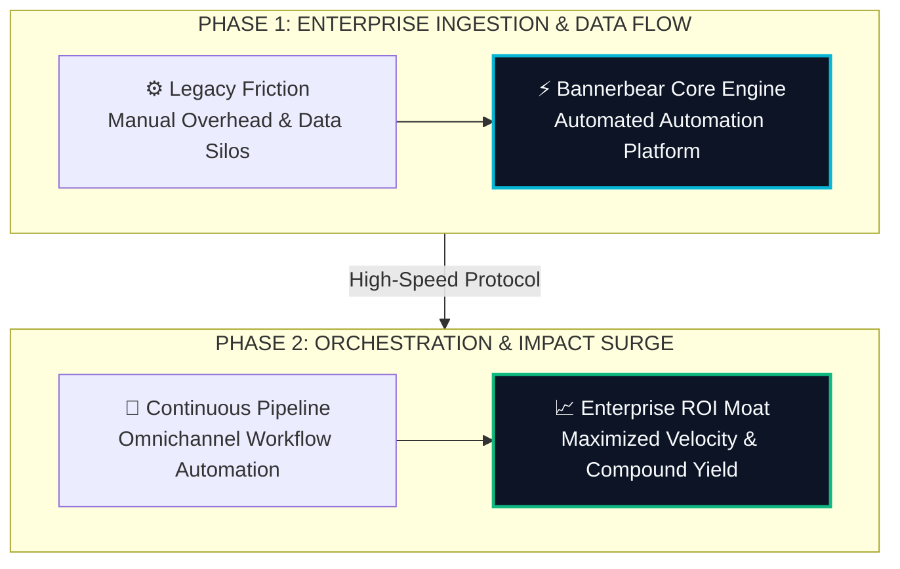

## The Bottleneck of Visual Scale

**B**efore the era of creative automation, marketing teams lived in a state of perpetual bottleneck. Every social media post, personalized email banner, or dynamic report cover required a human designer to open Adobe Creative Cloud, tweak a layer, export, and upload. For a startup scaling to thousands of users, this wasn't just inefficient—it was a growth-killing structural flaw. Enter Bannerbear, the engine that finally decoupled the design process from the manual labor of execution.

## 1. The Genesis & Evolution

Bannerbear emerged from a clear observation: developers were constantly reinventing the wheel to programmatically generate images. Founder Jon Yong recognized that while the tools for web development had matured, the tools for 'design-as-code' remained fragmented. By building a robust, template-based API, Bannerbear did for images and video what Stripe did for payments: it turned a complex, bespoke manual process into a simple, standardized utility.

## 2. Core Business Superpowers

* **API-First Infrastructure:** Seamless integration into your existing stack allows your backend to trigger image generation based on user events, database changes, or webhooks.
* **Smart Dynamic Templates:** The drag-and-drop editor allows designers to build the 'shell,' while developers define the 'data.' This separation of concerns ensures brand consistency without sacrificing speed.
* **Multi-Media Versatility:** It isn't just for images. The platform handles complex animated GIFs and MP4 video generation, making it a Swiss Army knife for modern B2B marketing.
* **Intelligent Auto-Processing:** Built-in features like face-detection and smart-cropping ensure that even when data is unpredictable, the final output looks professionally curated.

> [!NOTE]
> **Executive Takeaway:** "Creative automation is the silent engine behind the next generation of hyper-personalized B2B growth. If you are still manually exporting JPEGs in 2026, you are losing the race to the companies that have already automated their visual identity."

## 3. Hands-on Workshop: The 15-Minute Blueprint

1. **Define Your Template:** Navigate to the Bannerbear dashboard and create a new project. Use the drag-and-drop editor to set up your base layout (e.g., a personalized welcome card for a new user).
2. **Map the Data:** Identify the 'dynamic' fields—name, profile picture, company logo. Assign these as 'Text' or 'Image' layers.
3. **Connect the Trigger:** Use [Make](/reviews/make).com or [Zapier](/reviews/zapier) to connect your CRM (like HubSpot or Salesforce). Set a trigger: 'When a new contact is added, send data to Bannerbear.'
4. **Automate the Delivery:** Configure the webhook to push the generated image URL directly back into your email marketing platform, ensuring the user receives a personalized asset within seconds of signing up.

## 4. Critical Assessment & Trade-offs

| Feature | Strength | Limitation |
| :--- | :--- | :--- |
| **Integration** | Excellent API/No-Code support | Steep learning curve for complex logic |
| **Performance** | Rapid static image generation | Video processing is resource-intensive |
| **Cost** | Scalable utility | Credit-based pricing can surge at volume |

## 5. HeliaTech Final Verdict

Bannerbear is the definitive choice for B2B enterprises looking to reclaim their creative team's time. While high-volume video processing requires careful budget management, the ROI of replacing manual design hours with automated workflows is undeniable. We recommend starting with a static image pipeline to prove the concept, then scaling into dynamic video assets. 

[Claim Your Free Bannerbear Account ➔](/go/bannerbear)
