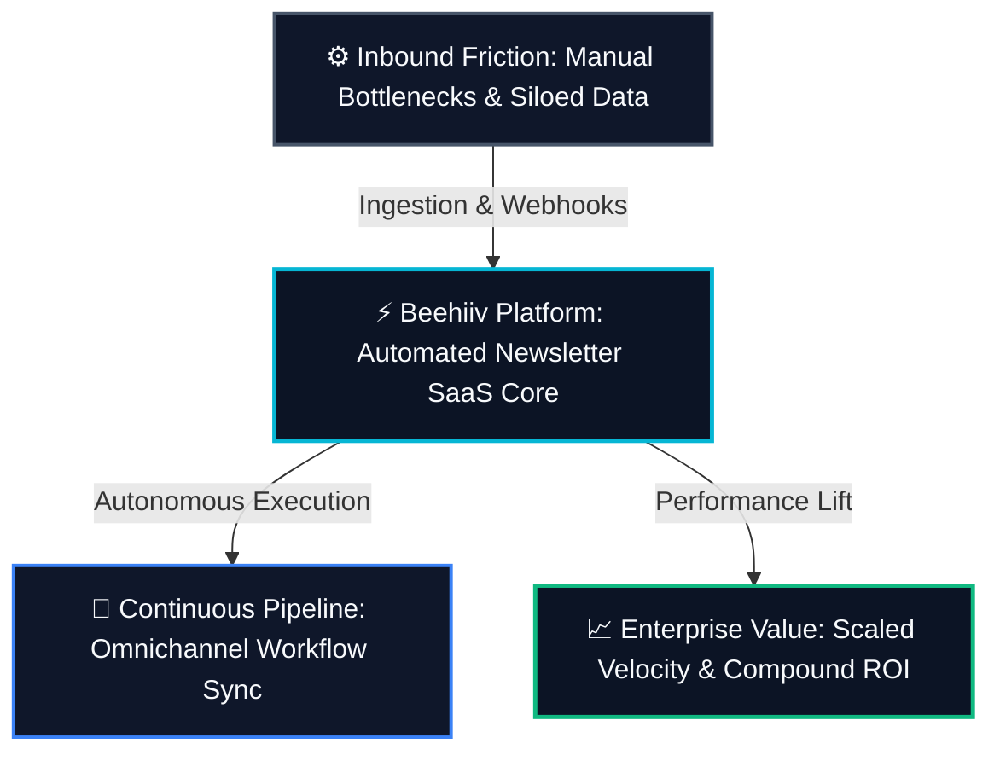

## The Newsletter Fragmentation Crisis

**B**efore the current wave of creator-led media, the newsletter industry was a digital graveyard of broken workflows. Enterprise marketing teams were forced to stitch together disparate CRM platforms, third-party analytics suites, and clunky ad-insertion plugins. The result? A 'fragmentation tax'—wasted hours, data silos, and a massive bottleneck in user growth. Enter Beehiiv: the infrastructure layer that finally treated the newsletter not as a simple email blast, but as a full-scale, scalable media business.

## 1. The Genesis & Evolution

Founded by the early team behind Morning Brew, Beehiiv was built with the DNA of a company that scaled from a dorm room project to a multi-million dollar media juggernaut. The founders realized that existing tools were either too simple (Substack) or too bloated (Salesforce/Mailchimp). They built Beehiiv to bridge the gap, prioritizing high-performance growth loops and monetization features that actually move the needle for modern creators and enterprises alike.

## 2. Core Business Superpowers

*   **Native Referral Engine:** Unlike legacy systems, Beehiiv includes an automated referral program that rewards subscribers for sharing the content, turning your audience into a growth engine.
*   **Integrated Monetization:** With a built-in ad network and seamless premium subscription billing, the platform eliminates the friction of managing third-party payment gateways.
*   **High-Fidelity Analytics:** Get granular, real-time insights into exactly how your audience discovers and engages with your content, allowing for data-driven editorial pivots.
*   **Superior Deliverability:** Built on a robust technical foundation, Beehiiv ensures your content bypasses the 'Promotions' tab, maximizing your open rates and ROI.

> [!NOTE]
> **Executive Takeaway:** "The most successful media companies of the next decade won't be defined by their content alone, but by the efficiency of their growth infrastructure. Beehiiv is that infrastructure."

> [!TIP]
> **HeliaTech Benchmark Access:** Test `Beehiiv` with our verified enterprise trial link at [/go/beehiiv](/go/beehiiv).

## 3. Hands-on Workshop: The 15-Minute Blueprint

1.  **Account Setup (Minutes 0-3):** Sign up and import your existing subscriber list via CSV. Beehiiv’s mapping tool ensures your custom fields are preserved.
2.  **Referral Logic Configuration (Minutes 3-7):** Navigate to the 'Referral Program' tab. Set up your milestones (e.g., 5 referrals = exclusive content, 10 referrals = branded merch). Enable the automated 'Referral Leaderboard' widget.
3.  **Monetization Activation (Minutes 7-12):** Connect your Stripe account to handle premium subscriptions and join the Beehiiv Ad Network to start receiving inbound sponsorship requests immediately.
4.  **First Blast (Minutes 12-15):** Utilize the 'Magic Link' feature to provide one-click login experiences for your subscribers, drastically increasing engagement rates.

## 4. Critical Assessment & Trade-offs

| Feature | Beehiiv | Legacy Alternatives |
| :--- | :--- | :--- |
| **Growth Tools** | Integrated Referral Engine | Manual/Expensive Plugins |
| **Monetization** | Native Ads & Subscriptions | Third-Party Dependent |
| **Learning Curve** | Moderate | Low (But Limited) |
| **CRM Integration** | API-First/Webhooks | Proprietary/Rigid |

**Limitations:** Users migrating from ultra-simple platforms may find the interface daunting initially. Furthermore, deep-tier automation is gated behind higher-tier subscription plans, and enterprise-grade CRM integration (like Salesforce) may require custom webhook development.

## 5. HeliaTech Final Verdict & Recommendation

For any business serious about media as a growth channel, Beehiiv is the current industry benchmark. It removes the technical friction that kills momentum. While the learning curve is steeper than basic email providers, the ROI—driven by the referral engine and ad network—is undeniable. We recommend Beehiiv for growth-stage startups and media-focused enterprises ready to scale their direct audience relationship.
