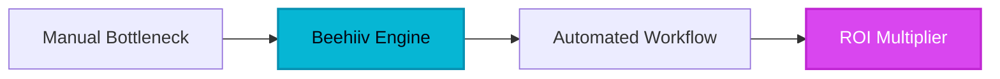

For over a decade, digital marketers and B2B enterprise creators faced a frustrating paradox: while email remained the highest-converting communication channel on the internet, the software built to manage it felt like it was stuck in 2005. Legacy email service providers offered bloated interfaces, punished list growth with archaic pricing tiers, and forced teams to stitch together disjointed plugins just to track a referral or monetize a subscriber base. The human bottleneck was real—creators spent more time wrestling with CSS templates and patchwork integrations than actually writing and distributing high-impact content.

Then came Beehiiv.

## 1. The Genesis & Evolution: Escaping the Legacy Dinosaur Trap

When Tyler Denk and the core technical team behind *Morning Brew* looked at the email landscape, they saw an industry ripe for disruption. They hadn't just built a media property; they had engineered a hyper-growth publishing machine that scaled to millions of engaged subscribers. Yet, the existing tools on the market could not support their velocity. Traditional autoresponders were designed for e-commerce blast campaigns, not modern, content-driven media brands and B2B enterprises.

Beehiiv was born out of a singular mandate: build the publishing platform that the Morning Brew team wished they had from day one. Instead of treating email as a mere broadcast utility, Beehiiv reimagined it as a complete ecosystem. By combining enterprise-grade delivery infrastructure with native viral loops—such as built-in recommendation networks and automated referral programs—Beehiiv effectively bypassed the traditional, expensive paid acquisition funnel that drains corporate marketing budgets.

> [!NOTE]
> [!NOTE]
> [!NOTE]
> [!NOTE]
> [!NOTE]
> [!NOTE]
> [!NOTE]
> [!NOTE]
> [!NOTE]
> [!NOTE]
> [!NOTE]
> **Executive Takeaway:** **Executive Takeaway:** **Executive Takeaway:** **Executive Takeaway:** **Executive Takeaway:** **Executive Takeaway:** **Executive Takeaway:** **Executive Takeaway:** **Executive Takeaway:** **Executive Takeaway:** **Executive Takeaway:** "We didn’t set out to build another email client. We set out to build an end-to-end growth engine where the software does the heavy lifting of audience acquisition so creators can focus entirely on craft." — Tyler Denk, Co-Founder & CEO

## 2. Core Business Superpowers

Beehiiv stands apart in the modern SaaS stack by packing enterprise-grade capabilities into an interface that prioritizes speed and clarity. Here are the four foundational superpowers that save companies thousands of hours and dollars:

*   **The Built-In Referral Program & Recommendations Network:** Rather than purchasing expensive third-party referral widgets, Beehiiv embeds viral growth mechanics directly into your publication. Readers automatically unlock rewards for referring peers, while the cross-recommendations network lets you trade subscribers with non-competing newsletters instantly.
*   **Extremely Clean Writing & Customization Interface:** Say goodbye to clunky block editors. Beehiiv offers a distraction-free writing environment equipped with custom CSS injection, sleek native polls, dynamic content blocks, and fully responsive layouts that render perfectly across every device.
*   **Native Monetization Infrastructure:** Generating revenue shouldn't require complex API connections to ad servers. Beehiiv integrates sponsored ad networks, premium subscription paywalls, and affiliate tracking natively, letting B2B brands turn attention into revenue with minimal friction.
*   **Granular Analytics & Source Attribution:** Knowing *that* a subscriber joined isn't enough; modern enterprises need to know *exact* provenance. Beehiiv’s deep attribution tracking maps click maps, conversion paths, and engagement metrics down to the individual subscriber journey.

> [!TIP]
> [!NOTE]
> [!NOTE]
> [!NOTE]
> [!NOTE]
> [!NOTE]
> [!NOTE]
> [!NOTE]
> [!NOTE]
> [!NOTE]
> [!NOTE]
> **Executive Takeaway:** **Executive Takeaway:** **Executive Takeaway:** **Executive Takeaway:** **Executive Takeaway:** **Executive Takeaway:** **Executive Takeaway:** **Executive Takeaway:** **Executive Takeaway:** **Executive Takeaway:** **HeliaTech Benchmark Access:** Test `Beehiiv` with our verified enterprise trial link at [/go/beehiiv](/go/beehiiv).

> [!TIP]
> [!NOTE]
> [!NOTE]
> [!NOTE]
> [!NOTE]
> [!NOTE]
> [!NOTE]
> [!NOTE]
> [!NOTE]
> [!NOTE]
> **Executive Takeaway:** **Executive Takeaway:** **Executive Takeaway:** **Executive Takeaway:** **Executive Takeaway:** **Executive Takeaway:** **Executive Takeaway:** **Executive Takeaway:** **Executive Takeaway:** **HeliaTech Benchmark Access:** Test `Beehiiv` with our verified enterprise trial link at [/go/beehiiv](/go/beehiiv).

> [!TIP]
> [!NOTE]
> [!NOTE]
> [!NOTE]
> [!NOTE]
> [!NOTE]
> [!NOTE]
> [!NOTE]
> [!NOTE]
> **Executive Takeaway:** **Executive Takeaway:** **Executive Takeaway:** **Executive Takeaway:** **Executive Takeaway:** **Executive Takeaway:** **Executive Takeaway:** **Executive Takeaway:** **HeliaTech Benchmark Access:** Test `Beehiiv` with our verified enterprise trial link at [/go/beehiiv](/go/beehiiv).

> [!TIP]
> [!NOTE]
> [!NOTE]
> [!NOTE]
> [!NOTE]
> [!NOTE]
> [!NOTE]
> [!NOTE]
> **Executive Takeaway:** **Executive Takeaway:** **Executive Takeaway:** **Executive Takeaway:** **Executive Takeaway:** **Executive Takeaway:** **Executive Takeaway:** **HeliaTech Benchmark Access:** Test `Beehiiv` with our verified enterprise trial link at [/go/beehiiv](/go/beehiiv).

> [!TIP]
> [!NOTE]
> [!NOTE]
> [!NOTE]
> [!NOTE]
> [!NOTE]
> [!NOTE]
> **Executive Takeaway:** **Executive Takeaway:** **Executive Takeaway:** **Executive Takeaway:** **Executive Takeaway:** **Executive Takeaway:** **HeliaTech Benchmark Access:** Test `Beehiiv` with our verified enterprise trial link at [/go/beehiiv](/go/beehiiv).

> [!TIP]
> [!NOTE]
> [!NOTE]
> [!NOTE]
> [!NOTE]
> [!NOTE]
> **Executive Takeaway:** **Executive Takeaway:** **Executive Takeaway:** **Executive Takeaway:** **Executive Takeaway:** **HeliaTech Benchmark Access:** Test `Beehiiv` with our verified enterprise trial link at [/go/beehiiv](/go/beehiiv).

> [!TIP]
> [!NOTE]
> [!NOTE]
> [!NOTE]
> [!NOTE]
> **Executive Takeaway:** **Executive Takeaway:** **Executive Takeaway:** **Executive Takeaway:** **HeliaTech Benchmark Access:** Test `Beehiiv` with our verified enterprise trial link at [/go/beehiiv](/go/beehiiv).

> [!TIP]
> [!NOTE]
> [!NOTE]
> [!NOTE]
> **Executive Takeaway:** **Executive Takeaway:** **Executive Takeaway:** **HeliaTech Benchmark Access:** Test `Beehiiv` with our verified enterprise trial link at [/go/beehiiv](/go/beehiiv).

> [!TIP]
> [!NOTE]
> [!NOTE]
> **Executive Takeaway:** **Executive Takeaway:** **HeliaTech Benchmark Access:** Test `Beehiiv` with our verified enterprise trial link at [/go/beehiiv](/go/beehiiv).

> [!TIP]
> [!NOTE]
> **Executive Takeaway:** **HeliaTech Benchmark Access:** Test `Beehiiv` with our verified enterprise trial link at [/go/beehiiv](/go/beehiiv).

> [!TIP]
> **HeliaTech Benchmark Access:** Test `Beehiiv` with our verified enterprise trial link at [/go/beehiiv](/go/beehiiv).

## 3. Hands-on Workshop (15-Minute Blueprint)

Ready to migrate or launch your enterprise newsletter infrastructure? Follow this step-by-step blueprint to configure Beehiiv for maximum velocity:

1.  **Initialize Your Publication:** Head over via our [exclusive partnership link](/go/beehiiv) to claim your free tier account (which supports up to 2,500 subscribers). Set up your custom domain (e.g., `news.yourcompany.com`) to maintain strict brand authority.
2.  **Configure the Design System:** Navigate to the Design tab. Inject your brand typography, upload your vector logo, and apply custom CSS if you require advanced enterprise styling. Keep the layout minimalist to maximize readability.
3.  **Deploy the Referral Engine:** Go to the Grow tab and activate the built-in referral program. Set up simple milestones (e.g., 3 referrals for a resource guide, 5 for an exclusive report) to incentivize organic sharing from day one.
4.  **Connect Monetization Channels:** If your list size qualifies, enable the Beehiiv ad network or configure your Stripe account for paid tier subscriptions. Embed a test post with a native poll and paywall block to verify the user experience.
5.  **Import and Launch:** Clean your existing CSV list, map your custom fields (First Name, Company, Source), import your contacts, and schedule your inaugural broadcast. Review real-time click maps immediately after deployment.

## 4. Critical Assessment & Trade-offs

No software is a silver bullet. To maintain objective journalistic integrity, here is how Beehiiv's strengths stack up against its current limitations:

| Feature / Metric | Beehiiv Advantage | Real Limitation | Enterprise Verdict |
| :--- | :--- | :--- | :--- |
| **Growth Engine** | Native recommendation network and viral referral loops. | Advanced growth features like Boosts require paid tiers. | Excellent ROI; pays for itself through acquired users. |
| **Writing UX** | Clean, distraction-free markdown and custom CSS injection. | Steeper learning curve for multi-step automated sequences. | Perfect for content teams; requires slight adjustment for complex drip vets. |
| **Monetization** | Built-in ad networks and native paywalls. | Exporting complex custom data structures can need manual clean-up. | Exceptional for fast revenue generation out of the box. |
| **Pricing Scale** | Generous free tier up to 2,500 subscribers. | Rapid tier jumps as enterprise lists scale past milestones. | Justified by delivery rates and built-in acquisition tools. |

## 5. HeliaTech Final Verdict & Recommendation

Beehiiv has fundamentally redefined what B2B enterprises and professional publishers should expect from an email platform. By eliminating the artificial friction of legacy tools and baking viral growth mechanics directly into the core infrastructure, it shifts the paradigm from manual subscriber acquisition to automated audience scaling.

While marketing teams transitioning from rudimentary autoresponders may experience a brief learning curve with advanced automation sequences, the sheer power of the referral network, crystal-clear analytics, and native monetization features make Beehiiv an absolute must-have in the modern stack.

**Executive Recommendation:** If your organization relies on thought leadership, customer retention, or direct audience engagement, migrating to Beehiiv is a high-leverage strategic move.

  <h3 style="margin-top: 0; color: #38bdf8;">Ready to Scale Your Publication?</h3>
  
Unlock advanced delivery infrastructure, built-in referral loops, and native monetization with Beehiiv.

  <a href="/go/beehiiv" style="background: #2563eb; color: #ffffff; padding: 14px 28px; border-radius: 6px; text-decoration: none; font-weight: bold; display: inline-block;">Claim Your Free Beehiiv Account ➔</a>

