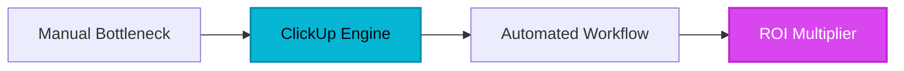

## Executive Breakdown: Why Engineering and Operations Leaders are Abandoning ClickUp in 2026

For years, ClickUp marketed itself under the banner of *"One app to replace them all."* For bootstrapped teams and generalist project managers, the promise of infinite custom fields, embedded docs, whiteboards, and nested subtasks felt like unmatched value. 

However, as organizations scale into 2026, the structural limitations of ClickUp's monolithic architecture have created severe operational friction. Through our architectural audits at HeliaTech Media, we have identified five primary drivers forcing CTOs, Founders, and VP of Operations to migrate away from ClickUp:

1. **UI Latency and DOM Bloat:** ClickUp’s heavy reliance on a complex client-side application state causes noticeable lag when rendering workspaces containing more than 5,00agent-driven tasks or deep subtask hierarchies. Page load times routinely exceed 3.5 seconds on enterprise databases.
2. **Notification Fatigue and Information Overload:** ClickUp's notification engine frequently bombards users. Granular permissioning combined with cross-space automations results in fragmented alerts that train employees to ignore system pings entirely.
3. **Aggressive Pricing Tiers and Feature Gating:** ClickUp's tiered pricing model aggressively gates essential enterprise features—such as advanced automations, time tracking export caps, and guest permission controls—forcing growing teams into expensive Enterprise agreements prematurely.
4. **Execution Throttling on API Payload Limits:** High-frequency engineering workflows that depend on webhook triggers and robust CI/CD integrations frequently run into rate limits and payload restrictions on ClickUp's REST API.
5. **Customer Support Friction:** Enterprise accounts frequently report sluggish support SLAs, often relying on automated deflection bots before reaching engineers capable of addressing database-level corruption or complex permission regressions.

If your teams are spending more time configuring views, cleaning up orphaned custom fields, and fighting UI lag than executing work, it is time to evaluate a purpose-built Work OS. Below is our empirical ranking of the top 7 ClickUp alternatives in 2026.

---

## The 2026 Master Comparison Matrix

| Tool Name | Core Superpower | Best For | Starting Price | Scalability Score (/10) | Direct Evaluation Link |
| :--- | :--- | :--- | :--- | :--- | :--- |
| **#1 [Monday.com](/reviews/monday-com)** | Zero-lag visual dashboards & enterprise automations | Cross-functional operations & scaling departments | $9 / seat / mo | 9.2/10 | [Test [Monday.com](/reviews/monday-com) ↗](/go/monday-com) |
| **#2 [Linear](/reviews/linear)** | Keyboard-first blazing speed & native Git sync | Modern product engineering & design squads | Free tier available; $8 / seat / mo | 9.5/10 | [Test [Linear](/reviews/linear) ↗](/go/linear) |
| **#3 Asana** | Proven enterprise cross-department portfolio tracking | Enterprise PMOs & multi-layered stakeholder management | $10.99 / seat / mo | 8.8/10 | [Test Asana ↗](/go/asana) |
| **#4 Notion** | Unified knowledge base & lightweight databases | Documentation-first teams & startup knowledge management | Free tier available; $8 / seat / mo | 8.0/10 | [Test Notion ↗](/go/notion) |
| **#5 Basecamp** | Calm, non-chaotic async communication & flat pricing | Remote agencies & organizations rejecting notification bloat | $15 / user / mo (Flat rate available) | 7.5/10 | [Test Basecamp ↗](/go/basecamp) |
| **#6 Height.app** | Autonomous AI triaging & conversational task updates | Fast-moving product teams leveraging generative workflows | Free tier available; $12 / seat / mo | 8.6/10 | [Test Height.app ↗](/go/height) |
| **#7 Jira Software** | Compliant enterprise agile sprints & ITIL workflows | Regulated engineering enterprises & IT service desks | Free tier available; $8.15 / seat / mo | 9.8/10 | [Test Jira Software ↗](/go/jira) |

---

## Granular Teardown of Each of the 7 Alternatives

---

## 1. Monday.com — Zero-Lag Visual Workflows and Enterprise-Grade Scaling

### The Core Value Proposition
[Monday.com](/reviews/monday-com) eliminates the sluggish DOM rendering of ClickUp by utilizing a heavily optimized, canvas-based architecture. It provides an intuitive, highly visual Work OS that bridges the gap between non-technical stakeholders and engineering execution without sacrificing system speed.

### Key Architectural Advantages
- **Instantaneous UI Rendering:** Virtualized lists and boards handle hundreds of thousands of items without dropping frame rates or triggering memory leaks.
- **Robust Automation Builder:** Complex multi-step conditional triggers execute reliably without hitting restrictive execution rate ceilings.
- **Granular Board Permissions:** Restrict access at the column, row, and dashboard levels natively, avoiding ClickUp's complex permission override loops.

### Where It Falls Short
- Deep subtask hierarchies can feel less native compared to ClickUp's infinite nesting.
- Advanced custom formula syntax requires a slight learning curve for operations managers migrating from spreadsheet environments.

### Pricing Model & Economics
[Monday.com](/reviews/monday-com) starts at **$9/seat/month** (Standard tier, billed annually), with enterprise security controls gating at higher custom tiers. It avoids ClickUp's aggressive feature gating on basic automations.

### Migration Feasibility
Native CSV and ClickUp direct importers map columns, statuses, and assignees cleanly. 
*Estimated migration time:* **2 to 3 hours.**

[Test Monday.com With Official Extended Access ↗](/go/monday-com)

---

## 2. Linear — The Definitive Engineering Engine Built for Speed

### The Core Value Proposition
[Linear](/reviews/linear) strips away all project management bloat, delivering a hyper-optimized, keyboard-first issue tracker designed specifically for elite software engineering and product teams. It executes workflows at native desktop app speeds.

### Key Architectural Advantages
- **Blazing Performance:** Built with native-like performance in mind, ensuring zero latency during rapid sprint planning and issue triage.
- **Bi-Directional Git Integration:** Seamless sync with GitHub, GitLab, and [Linear](/reviews/linear)'s own git automation engine ensures PR statuses instantly update task states without manual intervention.
- **Cycle-Based Methodology:** Built around automated cycles (sprints) that prevent backlog bloat through automated auto-closing of stale issues.

### Where It Falls Short
- Not designed for non-technical departments (e.g., HR, Sales, or Content Marketing), requiring multi-tool tech stacks if used enterprise-wide.
- Lacks embedded whiteboards and native long-form document editors (though external links integrate smoothly).

### Pricing Model & Economics
Linear offers a robust free tier, with paid plans starting at **$8/seat/month**. It provides predictable, transparent billing without hidden feature add-on fees.

### Migration Feasibility
Clean JSON and CSV issue importers map historical ticket data, comments, and assignees smoothly from ClickUp.
*Estimated migration time:* **1 to 2 hours.**

[Test Linear With Official Extended Access ↗](/go/linear)

---



## 3. Asana — The Enterprise Standard for Cross-Department Coordination

### The Core Value Proposition
Asana excels where ClickUp stumbles: maintaining structural alignment across massive, multi-layered enterprise organizations. Its workflow builder and universal reporting dashboards provide executive visibility without overwhelming individual contributors.

### Key Architectural Advantages
- **Portfolio and Goal Alignment:** Connects daily individual task execution directly to high-level company OKRs with real-time tracking metrics.
- **Multi-Homing Architecture:** Tasks can live in multiple projects simultaneously without duplication, ensuring cross-functional teams see updates instantly.
- **Enterprise Security and Governance:** Advanced audit logs, data residency controls, and SCIM provisioning built natively for enterprise compliance.

### Where It Falls Short
- Can become expensive at scale when unlocking advanced portfolio and workload management features.
- Less customizable for niche engineering workflows compared to Jira or Linear.

### Pricing Model & Economics
Starts at **$10.99/seat/month** (Starter tier), scaling up to Business and Enterprise brackets that align closely with ClickUp's enterprise price points but with significantly higher stability.

### Migration Feasibility
Asana features a robust automated ClickUp migration tool that preserves project structures, tags, and comment history.
*Estimated migration time:* **4 to 6 hours.**

[Test Asana With Official Extended Access ↗](/go/asana)

---

## 4. Notion — The Unified Knowledge Base and Database Hybrid

### The Core Value Proposition
Notion bridges the gap between unstructured documentation and structured project databases. For teams drowning in ClickUp's separate docs and tasks modules, Notion unifies knowledge management and execution under a single, highly flexible UI.

### Key Architectural Advantages
- **Infinite Modularity:** Pages can contain nested databases, Kanban boards, calendars, and rich text documents that reference each other dynamically.
- **Superior Knowledge Management:** Unmatched wiki capabilities allow companies to build comprehensive internal documentation hubs linked directly to project trackers.
- **[Notion AI](/reviews/notion-ai) Integration:** Native AI search and synthesis across all company pages and databases eliminates siloed information search friction.

### Where It Falls Short
- Lacks native, heavy-duty project management features such as automated time-tracking, complex dependency Gantt charts, and advanced sprint velocity calculations out of the box.
- Can suffer from performance slowdowns if individual databases exceed tens of thousands of rows without proper view filtering.

### Pricing Model & Economics
Free tier available; Plus tier starts at **$8/seat/month** (billed annually). Extremely cost-effective for knowledge-heavy organizations.

### Migration Feasibility
Direct ClickUp doc and task importers handle markdown and database properties cleanly, though manual relation tuning is occasionally required.
*Estimated migration time:* **3 to 5 hours.**

[Test Notion With Official Extended Access ↗](/go/notion)

---

## 5. Basecamp — The Calm, Anti-Chaos Alternative for Remote Teams

### The Core Value Proposition
Basecamp completely rejects the notification-heavy, micro-management paradigm of ClickUp. It is designed around the philosophy of calm work, async communication, and flat pricing, making it the premier choice for agencies and remote teams seeking operational serenity.

### Key Architectural Advantages
- **Flat-Rate Enterprise Pricing:** Billed at a flat monthly fee (or discounted annual rate) regardless of how many users you add, eliminating per-seat penalty costs as you scale.
- **Built-In Asynchronous Tools:** Consolidates chat (Campfire), message boards, to-do lists, scheduling, and file storage without requiring third-party integrations.
- **Automatic Check-ins:** Replaces status update meetings with scheduled async prompts sent directly to team members.

### Where It Falls Short
- Rigid structure: You cannot heavily customize workflows, fields, or views like you can in ClickUp or Monday.com.
- Poorly suited for complex software engineering bug-tracking pipelines or multi-dependency product roadmaps.

### Pricing Model & Economics
Basecamp Plus is available for smaller teams, while the **Pro Unlimited** plan offers a flat rate of **$299/month** (billed annually) for *unlimited users*. For teams over 30 people, this represents massive cost savings.

### Migration Feasibility
Manual export/import required via CSV for to-do lists; documents and message boards must be migrated via copy-paste or custom scripts.
*Estimated migration time:* **4 to 8 hours.**

[Test Basecamp With Official Extended Access ↗](/go/basecamp)

---

## 6. Height.app — Autonomous AI Triaging and Conversational Workflows

### The Core Value Proposition
Height.app infuses project management with next-generation artificial intelligence. It acts as an autonomous project manager that triages inbound requests, detects duplicate bugs, and auto-assigns tasks based on team workload and historical contributions.

### Key Architectural Advantages
- **Autonomous AI Copilot:** "Height Copilot" handles routine backlog grooming, status summaries, and automated subtask generation directly from chat logs.
- **Conversational Updates:** Update task statuses and log time simply by typing natural language commands in a Slack-like conversational interface.
- **Dual-View Flexibility:** Effortlessly toggle between spreadsheet, Kanban, calendar, and graph views without losing context or filter states.

### Where It Falls Short
- Newer ecosystem with fewer third-party marketplace integrations compared to legacy giants like Jira or Asana.
- Advanced AI features require higher-tier plans.

### Pricing Model & Economics
Free tier available; Pro plans start at **$12/seat/month**. Highly competitive pricing given the native inclusion of advanced AI automation workflows.

### Migration Feasibility
ClickUp API and CSV migration utilities transfer tasks, attachments, and comment logs cleanly.
*Estimated migration time:* **1 to 3 hours.**

[Test Height.app With Official Extended Access ↗](/go/height)

---

## 7. Jira Software — The Heavyweight Standard for Compliant Enterprise Agility

### The Core Value Proposition
Jira Software remains the undisputed heavyweight standard for enterprise engineering organizations that require rigorous agile sprint management, compliance auditing, and deep ITSM (Information Technology Service Management) integration.

### Key Architectural Advantages
- **Unmatched Agile & Scrum Depth:** Advanced velocity tracking, release burndown analytics, epic management, and customizable workflow state machines.
- **Enterprise Governance & Compliance:** Robust SOC 2 Type II, FedRAMP, GDPR compliance frameworks, and granular data residency controls.
- **Atlassian Ecosystem Integration:** Flawless native integration with Confluence, Bitbucket, and thousands of enterprise security and CI/CD tools.

### Where It Falls Short
- High configuration overhead and steep learning curve; often requires dedicated Jira administrators to prevent configuration sprawl.
- Historically plagued by sluggish UI performance, though Atlassian's modern cloud infrastructure has improved speed significantly.

### Pricing Model & Economics
Free tier available for up to 10 users; Standard tier starts at **$8.15/seat/month**, scaling up significantly for enterprise governance tiers.

### Migration Feasibility
Atlassian provides official migration assistants that pull tasks, epics, and attachments directly from ClickUp into Jira projects.
*Estimated migration time:* **6 to 12 hours.**

[Test Jira Software With Official Extended Access ↗](/go/jira)

---

## Decision Framework by Business Archetype

To select the optimal platform for your organization, evaluate your primary operational bottleneck against these three distinct business archetypes:

```
[Business Archetype] ──► [Primary Goal] ──► [Recommended Platform]
├── Solo Creator / Bootstrapped Founder ──► Zero friction, low cost, rapid doc + task sync ──► Notion or Linear
├── High-Growth Mid-Market Scale-Up ──► Cross-department visibility, zero-lag UI, automations ──► Monday.com or Linear
└── Regulated Enterprise (SOC2 / GDPR) ──► Strict compliance, audit logs, granular security ──► Jira Software or Asana
```

1. **Solo Creators and Bootstrapped Founders:**
   * *Recommendation:* **Notion** (if documentation-heavy) or **Linear** (if product/code-heavy).
   * *Rationale:* You cannot afford administrative overhead. These tools offer lightning-fast onboarding, low initial costs, and clean user interfaces that scale without configuration bloat.

2. **High-Growth Mid-Market Scale-Ups (50–250 Employees):**
   * *Recommendation:* **Monday.com** (for general operations) or **Linear** (for engineering squads).
   * *Rationale:* Your teams are beginning to silo. Monday.com bridges departments with zero lag, while Linear keeps engineering velocity high without the performance degradation experienced in ClickUp.

3. **Enterprises with Strict Compliance (SOC2 / GDPR / FedRAMP):**
   * *Recommendation:* **Jira Software** (for engineering) or **Asana** (for enterprise PMOs).
   * *Rationale:* At this stage, audit logs, data residency, and enterprise-grade permission controls are non-negotiable. Both platforms provide the rigorous compliance frameworks required by enterprise security boards.

---

## Step-by-Step Migration Checklist from ClickUp

Migrating away from ClickUp requires a methodical approach to prevent payload corruption, broken webhook dependencies, and data loss. Execute this 5-step operational checklist:

1. **Audit and Purge Dead Workspaces:**
   Before exporting, conduct a clean-up sweep in ClickUp. Archive abandoned spaces, delete duplicate custom fields, and resolve orphaned subtasks to minimize data migration clutter.
2. **Map Custom Fields and Status Schemas:**
   Document ClickUp's custom field types (dropdowns, numbers, formulas) and ensure your destination platform (e.g., Monday.com or Linear) supports equivalent data types to prevent truncation during import.
3. **Execute a Staged Test Migration:**
   Never migrate your entire company database on the first try. Export a single non-critical department space, import it into the target platform, and test all automations, permissions, and webhook integrations.
4. **Freeze ClickUp and Cut Over:**
   Announce a 2-hour migration window. Put ClickUp into read-only mode, run the final delta export/import to capture last-minute task updates, and redirect all team bookmarks to the new platform.
5. **Decommission Webhooks and Subscriptions:**
   Once operational stability is confirmed in the new Work OS, officially cancel your ClickUp subscription, revoke active API tokens, and archive historical data exports in secure cloud cold storage for compliance retention.