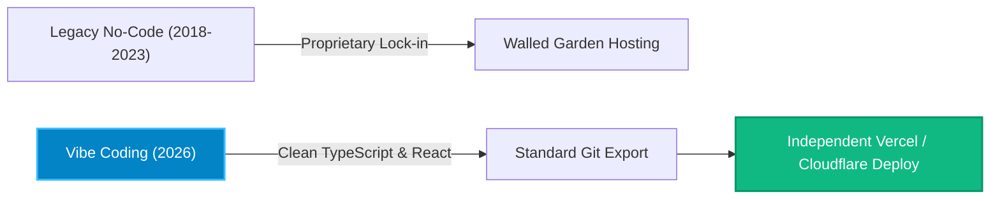
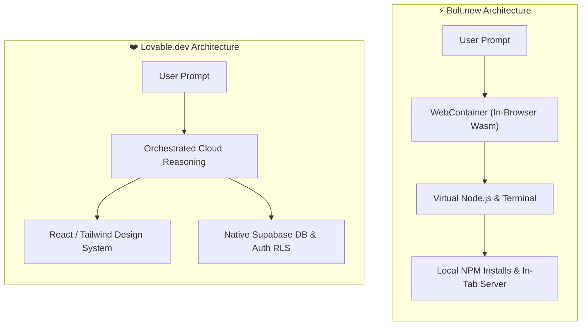
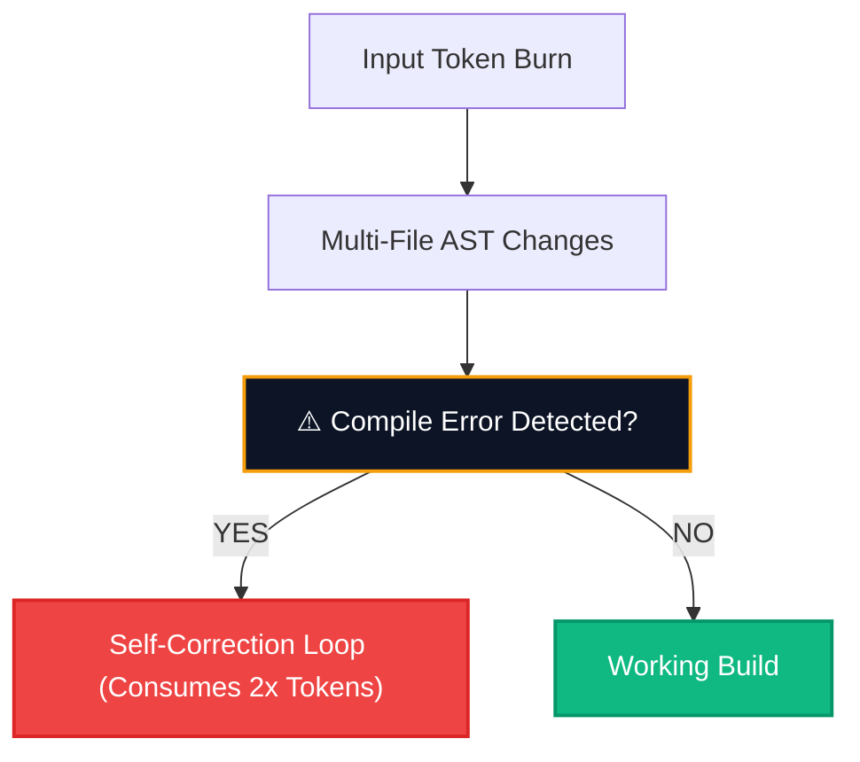

**The barrier to building software has experienced a catastrophic collapse in 2026.** What previously required an engineering lead, three sprint planning sessions, and a full-stack developer can now be brought into existence through an afternoon of conversation. This shift—colloquially celebrated across developer communities as *"vibe coding"*—has crowned two definitive heavyweights: **Bolt.new (engineered by StackBlitz)** and **Lovable.dev (the commercial evolution of GPT Engineer)**.

While both platforms promise to convert plain-English prompts into production-grade web applications, their underlying computational philosophies could not be more divergent. One operates as a full-blown operating system inside your browser tab; the other functions as an elite architectural studio paired with cloud database guarantees.

In this comprehensive technical teardown, HeliaTech benchmarks both platforms on code quality, database security, token burn rates, and total cost of ownership (TCO).

---

## 1. The Vibe Coding Revolution: Why Prompt-to-App Exploded in 2026

For decades, low-code and no-code tools like Bubble or Webflow offered visual abstractions at the cost of proprietary lock-in. If you built a high-scale product on legacy no-code, you did not own real TypeScript code; you owned a proprietary database schema that was impossible to export into a standard Git repository.



Bolt.new and Lovable inverted this paradigm by adopting a strict **Code-Ownership-First** doctrine:
1. **Zero Walled Gardens:** Every change made by the AI writes readable, idiomatic TypeScript, React, and CSS.
2. **Instant Git Interoperability:** A single button syncs your project directly to GitHub.
3. **Model Autonomy:** Both platforms deploy frontier reasoning models (such as Claude 3.5 Sonnet and Claude 3.7) fine-tuned for recursive error resolution and multi-file dependency trees.

> [!NOTE]
> **Executive Definition:** *"Vibe coding is not the absence of software engineering; it is the elevation of the founder from a line-by-line typist to an architectural creative director who orchestrates autonomous agents."*

---

## 2. Core Architectural Divergence: WebContainers vs Cloud Agent

To choose the right platform, you must understand where your code physically compiles and executes.

### Bolt.new: The In-Browser WebContainer Powerhouse
Powered by StackBlitz’s proprietary **WebContainers technology**, Bolt.new executes a full Node.js runtime directly inside your browser's WebAssembly environment. 

* **How it works:** When you prompt Bolt to build an app, it literally executes `npm install`, runs local development servers (Vite, Next.js, Remix, Astro), and opens terminal TCP sockets right in your browser tab.
* **Key Advantage:** If your application requires obscure npm libraries (e.g., custom charting engines, WebAssembly audio processors, or mathematical utilities), Bolt can install and run them on the fly.
* **The Catch:** Running an entire virtual machine in browser memory can choke on low-spec laptops, and complex persistent database state requires manual external API wiring.

### Lovable.dev: The Supabase-Native Full-Stack Studio
Lovable approaches the problem from a product-engineering mindset. Rather than turning your browser into a compiler, Lovable runs an orchestrated cloud agent that specializes in **React, Tailwind, and Supabase**.

* **How it works:** Lovable constructs your user interface with precision design standards while orchestrating backend migrations in a sandboxed Supabase environment.
* **Key Advantage:** Authentication (OAuth, Magic Links), PostgreSQL tables, and strict **Row Level Security (RLS)** policies are generated automatically without requiring the user to write raw SQL.
* **The Catch:** It is heavily optimized for modern React/Vite frontends; if you require an obscure Python or Rust microservice inside the sandbox, you must integrate it via external webhooks.



---

## 3. Hands-on Feature Matrix & Benchmark Scores

We tested both platforms with an identical prompt: *"Build a multi-tenant B2B customer feedback portal with user authentication, upvoting, CSV export, and a dark-mode analytics dashboard."*

| Feature Dimension | Bolt.new (StackBlitz) | Lovable.dev | Winner & Impact |
| :--- | :---: | :---: | :--- |
| **Execution Environment** | In-Browser WebContainer (Node.js) | Cloud Container + Sandboxed Preview | **Bolt.new** (More flexible runtime) |
| **Database & Auth Integration** | Manual / External API connectors | Native 1-Click [Supabase](/blog/supabase-evolution-guide-2026/) RLS | **Lovable** (Far superior security) |
| **Visual Design Quality** | 8.4 / 10 (Functional Tailwind) | 9.6 / 10 (Polished Apple-Grade UI) | **Lovable** (Higher visual fidelity) |
| **Error Self-Healing** | Terminal stack-trace loop parsing | Component visual feedback loop | **Tie** (Both recover well) |
| **Arbitrary NPM Packages** | Unrestricted (installs anything) | Curated modern web packages | **Bolt.new** (Unrestricted freedom) |
| **Mobile & Responsive Polish** | Requires manual prompt nudging | Native responsive preview toggle | **Lovable** (Responsive by default) |
| **GitHub Synchronization** | Bi-directional Git push/pull | Bi-directional Git repository sync | **Tie** (Clean commits on both) |

---

## 4. Database, Authentication & Production Readiness

The critical flaw of early AI code generators was security amnesia: they would generate beautiful user interfaces that stored plain-text passwords or left API endpoints completely unauthenticated.

### How Lovable Handles Security
Lovable enforces **PostgreSQL Row Level Security (RLS)** by default. When the prompt calls for user data, Lovable generates the exact SQL migration script:
```sql
-- Generated automatically by Lovable Cloud Agent
CREATE POLICY "Users can only view their own feedback"
ON public.feedback
FOR SELECT
USING (auth.uid() = user_id);
```
This guarantees that even if a junior founder deploys the app to thousands of users, Tenant A cannot query Tenant B's data via browser console inspection. You can read more about secure database architecture in our [Supabase Evolution Guide](/blog/supabase-evolution-guide-2026/).

### How Bolt.new Handles Security
Bolt.new relies on mock state or client-side storage (`localStorage`) until you explicitly connect an external backend (Supabase, Firebase, or an Express API). While this makes initial prototyping ultra-fast, the founder must actively audit the code to ensure sensitive credentials are not bundled into the client-side JavaScript.

> [!IMPORTANT]
> **Security Audit Warning:** Never ship a Bolt.new application directly to commercial paying users without verifying that database secrets are stored in secure environment variables rather than client-exposed bundles.

---

## 5. Pricing, Token Burn Rates & TCO Analysis

Understanding how both tools charge for compute is vital to avoiding billing shock.



### Bolt.new Pricing Structure
* **Free Tier:** Limited daily token allowance (sufficient for a landing page or basic single-page script).
* **Pro Tier ($20/month):** 10 Million monthly tokens. Tokens are consumed on prompt submission, file generation, and WebContainer background rebuilds.
* **Token Burn Reality:** A complex application with 20+ components can burn 500,000 to 1,000,000 tokens during an intensive debugging session. Heavy users frequently require token top-ups ($10 to $20 additional per month).

### Lovable.dev Pricing Structure
* **Starter / Free:** Limited daily message credits.
* **Pro Tier ($20/month):** ~100 daily message credits (or monthly equivalent), with prioritized reasoning and native Supabase cloud deployments.
* **Scale / Team Tier ($50 - $100/month):** For multi-seat agencies building client MVPs continuously.
* **Credit Consumption Reality:** Lovable charges per conversational cycle rather than raw token arithmetic, which makes cost estimation more predictable for non-technical creators.

> [!TIP]
> Calculate your projected infrastructure and developer tooling costs using our interactive [HeliaTech SaaS Pricing Calculator](/calculator/).

---

## 6. The Verdict: When to Choose Bolt.new vs Lovable

Neither tool is a silver bullet, but each excels in distinct operational scenarios.

### Choose Bolt.new If:
* You are building a complex web utility that requires **arbitrary npm dependencies** (audio manipulation, WebAssembly, specialized canvas tools).
* You want to inspect the **virtual terminal** and run raw bash or npm commands during development.
* You already have an established backend API and just need an intelligent browser environment to build a rapid frontend client.

### Choose Lovable.dev If:
* You are a **non-technical founder, product designer, or solopreneur** who needs a stunning, venture-ready SaaS MVP in under 2 hours.
* Your application demands real **user accounts, authentication, and secure database storage** right out of the box.
* You care deeply about **aesthetic perfection, micro-interactions, and mobile responsiveness** without spending hours writing custom CSS.

### The Elite Hybrid Playbook (The 2026 Founder Stack)
Many high-velocity teams reviewed by HeliaTech do not choose just one:
1. **Ideation & UI Polish:** Spin up the initial prototype and database schema in **Lovable.dev** in 45 minutes.
2. **Git Sync:** Push the verified codebase to a private GitHub repository.
3. **Advanced Engineering:** Open the repository in [Cursor Composer](/blog/cursor-evolution-guide-2026/) or **Bolt.new** to write specialized backend webhooks, third-party Stripe billing logic, and custom API routes.

This hybrid workflow compresses months of traditional agency development into a single working weekend, unlocking unprecedented development velocity for modern software companies.
