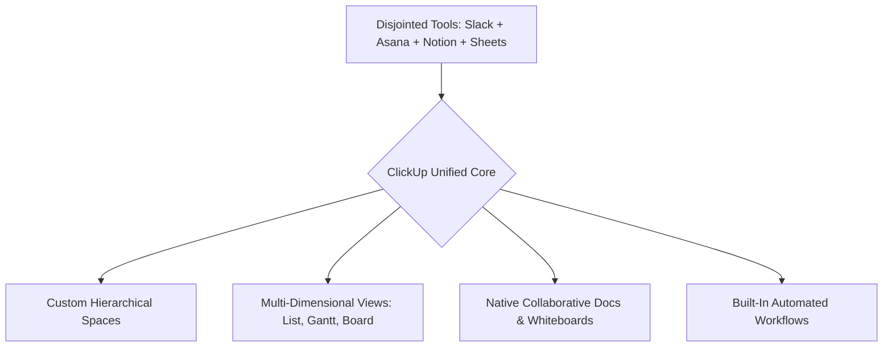

Digital cognitive exhaustion is a silent epidemic across modern enterprises. Between flashing Slack notifications, isolated Trello boards, disjointed Google Docs, and sprawling spreadsheets, knowledge workers now spend more time searching for status updates than delivering tangible value. This is the penalty of tool fragmentation—a multi-billion dollar friction layer eating away at team productivity.

What if the remedy was not adding another point-solution integration, but unifying the entire stack into a single, cohesive operating system?

That was the radical premise behind **ClickUp**.

Founded by Zeb Evans and Alex Yurkowski, ClickUp launched with an audacious pledge: *“The one app to replace them all.”* By refusing to force teams into rigid project templates, ClickUp pioneered the **Workspace OS** category—transforming the market from single-purpose kanban boards into deeply customizable command centers.

Here is the story of this evolution and a hands-on masterclass to eliminate project chaos for your team.

---

## 1. The Genesis: Dismantling the Tyranny of the Multi-Tab Stack

Before ClickUp emerged, project management software was hopelessly compartmentalized. Asana focused strictly on tasks; Trello owned simple kanban boards; Notion emerged for documents; and Harvest handled time tracking. Every department forced its own favorite tool upon colleagues, creating disconnected silos.

Zeb Evans recognized that human psychology requires different perspectives on the same underlying information. A developer wants a kanban board with sprint points; an executive wants a high-level timeline; and an accountant requires a tabular financial ledger.

Rather than forcing users to export CSV files between tools, ClickUp architected a **single source of truth** where the exact same underlying tasks can be rendered instantly across any visual dimension.

> [!NOTE]
> [!NOTE]
> [!NOTE]
> **Executive Takeaway:** **Executive Takeaway:** **Executive Takeaway:** *"True operational velocity is not about working more hours. It is about eradicating the friction of tool-switching so high-impact focus can flourish."*

---

## 2. The 3 Superpowers Fueling Enterprise Adoption

Why do hyper-growth startups and enterprise teams migrate their operational backbones to ClickUp?

### 1. The Five-Tier Hierarchical Framework
ClickUp structures work into a logical, scalable architecture: **Workspace > Spaces > Folders > Lists > Tasks > Subtasks & Checklists**. This gives leadership comprehensive portfolio oversight while giving individual contributors clean, clutter-free daily task views.

### 2. Multi-Dimensional Dynamic Views
Every list can be viewed as:
* **List View**: Rapid inline editing with keyboard shortcuts.
* **Board View**: Agile kanban drag-and-drop progression.
* **Gantt & Timeline**: Dependency mapping with automated critical path calculation.
* **Mind Maps**: Brainstorming sessions where nodes convert directly into live actionable tasks with single-click ease.

### 3. Native Whiteboards, Docs, and Real-Time Chat
Why pay separate subscriptions for Miro, Confluence, and team messaging? ClickUp bundles collaborative document creation, flowcharts, and comment threads directly within the task hierarchy. You can highlight a line in a meeting note and instantly spin it out into an assigned task with a due date.

---

> [!TIP]
> [!NOTE]
> [!NOTE]
> **Executive Takeaway:** **Executive Takeaway:** **HeliaTech Benchmark Access:** Test `ClickUp` with our verified enterprise trial link at [/go/clickup](/go/clickup).

> [!TIP]
> [!NOTE]
> **Executive Takeaway:** **HeliaTech Benchmark Access:** Test `ClickUp` with our verified enterprise trial link at [/go/clickup](/go/clickup).

> [!TIP]
> **HeliaTech Benchmark Access:** Test `ClickUp` with our verified enterprise trial link at [/go/clickup](/go/clickup).

## 3. Hands-on Workshop: Architect a High-Velocity Workspace in 15 Minutes

Here is how to set up an airtight operational workspace for your marketing or product engineering team.

### Step 1: Define the Space and Custom Statuses
1. Create a new Space called **Q4 Operations**.
2. Avoid generic *To Do / Done* statuses. Configure a realistic workflow: *Backlog ➔ In Progress ➔ Internal Review ➔ Blocked ➔ Approved ➔ Shipped*.

### Step 2: Establish the Three Indispensable Views
1. **List View**: Group by Assignee to inspect workload balance across team members.
2. **Gantt View**: Toggle dependencies (*Task B cannot start until Task A finishes*) to safeguard against scheduling bottlenecks.
3. **Board View**: Group by Priority (*Urgent, High, Normal, Low*) to ensure team focus stays locked on revenue-generating deliverables.

### Step 3: Implement Zero-Effort Automations
1. Click **Automate** in the upper-right corner.
2. Add the rule: *When Status changes to 'Internal Review', automatically reassign to Team Lead and post a Slack alert.*
3. Add a second rule: *When Due Date is overdue by 1 day, bump Priority to 'Urgent' and flag in the daily executive summary.*

In just 15 minutes, you have built an autonomous accountability engine that prevents valuable deliverables from slipping through the cracks.

---

## 4. Strengths vs. Trade-offs: An Objective Analysis

| Verified Advantages | Observed Trade-offs |
| :--- | :--- |
| **All-in-one consolidation** eliminates redundant software subscriptions. | **Feature density** can cause initial onboarding overwhelm if not configured properly. |
| **Deep custom fields & formulas** adapt to virtually any industry vertical. | Mobile applications have historically been slower than desktop equivalents. |
| **Generous free plan** and competitive commercial tiers. | Demands an internal champion to establish naming conventions and permissions. |
| **Native AI assistant** summarizes threads and drafts update briefs automatically. | Occasional sync latency on extremely dense workspaces containing 10,000+ items. |

---

## 5. HeliaTech Final Verdict

ClickUp successfully realized its foundational promise: providing an elastic, multi-faceted Workspace OS that scales from solo freelancers to thousands of enterprise users.

If your organization is bleeding productivity across a tangled web of disjointed apps, consolidating onto ClickUp is one of the highest-leverage operational decisions you can make.

---

  

  

    ✦ VERIFIED PARTNER ACCESS
  

  <h3 class="text-2xl sm:text-3xl font-black text-white mb-3">
    Ready to Simplify Your Operations?
  </h3>
  

    Test ClickUp's complete feature suite for free and see how a unified workspace transforms your team's execution speed.
  

  <a 
    href="/go/clickup" 
    target="_blank" 
    rel="noopener sponsored"
    class="inline-flex items-center gap-2 px-8 py-3.5 rounded-full bg-gradient-to-r from-cyan-500 to-fuchsia-500 hover:from-cyan-400 hover:to-fuchsia-400 text-slate-950 font-black text-sm tracking-wide shadow-lg hover:shadow-cyan-500/30 transition-all duration-300 transform hover:-translate-y-0.5"
  >
    Claim Your Free ClickUp Workspace
    ➔
  </a>
  

    Free forever plan available • Instant setup in under 2 minutes
  

