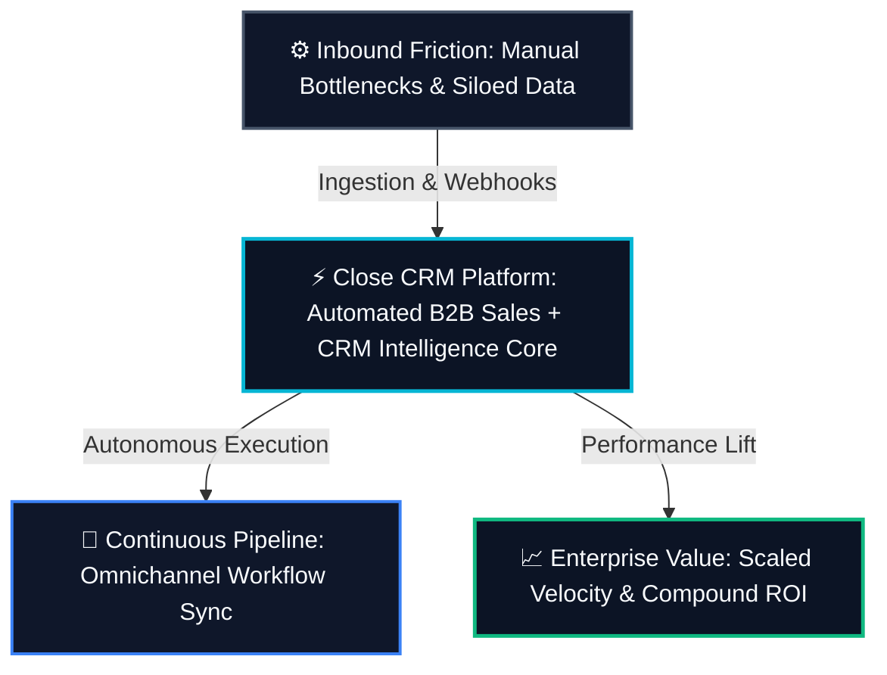

## The Friction Tax

**I**n the modern B2B landscape, the greatest enemy of a sales team isn't the competition—it's the 'tab-switching tax.' For years, sales reps have been forced to navigate a fragmented ecosystem: one tool for the CRM, another for the dialer, a third for email sequencing, and a spreadsheet to track the fallout. This administrative overhead turns high-potential hunters into glorified data entry clerks. Before Close, the industry accepted this as the cost of doing business. Close arrived to prove that sales isn't about managing a database; it’s about having a conversation.

## 1. The Genesis & Evolution

Close didn't emerge from a boardroom of legacy software giants. It was built by Steli Efti and his team at Elastic, a sales-focused consultancy that lived in the trenches of high-velocity inside sales. They were tired of the clunky, enterprise-bloated interfaces that required a PhD to configure. They needed a tool that matched the speed of a phone call. By stripping away the bloat and focusing on a 'communication-first' architecture, Close disrupted the market by forcing the CRM to serve the rep, rather than forcing the rep to serve the CRM.

## 2. Core Business Superpowers

Close transforms the sales floor through three distinct pillars:

*   **Native Communication Hub:** By embedding telephony and SMS directly into the CRM, Close removes the need for third-party integrations like RingCentral or Twilio. When a lead calls, the record opens instantly. No lag, no sync errors.
*   **Intentional Automation:** The email sequencing engine is designed for personalization at scale. It doesn't just blast templates; it tracks engagement and triggers workflows based on real-time prospect behavior.
*   **Velocity-First UI:** The interface is built on a philosophy of 'zero-click' navigation. Every essential function is reachable in one or two gestures, allowing reps to maintain a flow state throughout the day.

> [!NOTE]
> **Executive Takeaway:** "The secret to high-velocity sales isn't working harder; it's about removing the friction between the rep and the prospect. If your CRM doesn't help you call faster, it's holding you back."

## 3. Hands-on Workshop: The 15-Minute Velocity Blueprint

If you are ready to overhaul your outreach, follow this 15-minute setup:

1.  **Configure Your Power Dialer (5 mins):** Navigate to 'Settings' > 'Calling' and map your local presence numbers. This ensures you are always calling from a number relevant to your prospect's geography.
2.  **Architect Your First Sequence (5 mins):** Go to 'Workflows' and create a 3-step cadence: Day 1 (Call + Email), Day 3 (Follow-up Email), Day 5 (Final SMS). Use placeholders for custom variables to keep it human.
3.  **Smart View Setup (5 mins):** Create a 'High-Intent Leads' Smart View. Filter by 'Leads with recent email open' and 'Not contacted in 24 hours.' This creates a dynamic, daily to-do list for your team.

## 4. Critical Assessment & Trade-offs

| Feature | Close CRM | Legacy Enterprise CRM | 
| :--- | :--- | :--- | 
| **Setup Time** | < 1 Hour | Days/Weeks | 
| **Native Calling** | Included | Third-party only | 
| **Customization** | Moderate | High (Complex) | 
| **Cost Structure** | Predictable/Scaling | Aggressive/Hidden | 

**Limitations:** It is important to note that Close is not a 'do-everything' platform. If you require deep, ERP-level customization or highly complex multi-departmental workflows, you may find the platform's focus on speed to be a limitation compared to Salesforce.

## 5. HeliaTech Final Verdict & Recommendation

Close CRM is the definitive choice for teams that live and die by the outbound motion. It is not for the 'slow-growth' enterprise, but it is the gold standard for the 'growth-at-all-costs' startup and the mid-market sales organization. If you want to stop managing software and start closing deals, the transition to Close is a strategic imperative.

[Claim Your Free Close CRM Account ➔](/go/close-crm)
