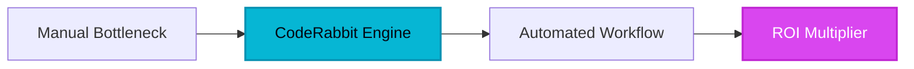

# CodeRabbit: The AI Architect Revolutionizing Pull Requests and Developer Velocity

**D**eveloper burnout isn't usually born from coding; it’s born from the waiting game. In the current enterprise landscape, the bottleneck of software delivery is rarely the keyboard—it’s the Pull Request (PR) queue. Senior engineers spend hours acting as glorified spellcheckers, while junior devs sit idle, waiting for feedback that moves at the speed of human fatigue. Enter CodeRabbit, the AI-powered disruption that turns the stagnant PR review process into a real-time, context-aware engine of quality.

## 1. The Genesis & Evolution
Before CodeRabbit, the industry relied on static analysis tools—rigid, rule-based dinosaurs that flagged syntax errors but lacked any semblance of "understanding." You could catch a missing semicolon, but you couldn't catch a architectural flaw that defied business logic. CodeRabbit was born from the realization that LLMs could finally be trained to understand the *intent* of code rather than just the structure. By moving away from simple regex-based linting to repository-wide semantic analysis, CodeRabbit has successfully positioned itself as the first true AI peer reviewer.

> [!NOTE]
> **Executive Takeaway:** "The goal of the modern engineering organization isn't to write more code; it's to ship better code faster. CodeRabbit acts as the force multiplier that allows human developers to focus on architecture while the AI handles the rigor of consistency."

## 2. Core Business Superpowers

*   **Context-Aware Repository Analysis:** Unlike standard plugins that look at a single file, CodeRabbit maps the entire repository. It understands how your new function impacts a legacy module three directories away.
*   **Automated PR Summarization:** It generates high-level summaries for stakeholders, saving engineers from writing tedious change-logs and allowing leads to scan changes in seconds.
*   **Customizable Prompt Engineering:** Every organization has its own 'coding flavor.' CodeRabbit allows for bespoke prompt configurations, ensuring the AI enforces your specific team standards, not just generic industry best practices.
*   **Workflow Integration:** It lives where you live—GitHub, GitLab, or Bitbucket—eliminating the need for engineers to jump into a separate dashboard to review feedback.

## 3. Hands-on Workshop (15-Minute Blueprint)

Getting started with CodeRabbit is an exercise in efficiency. Follow this path to deployment:

1.  **Authorization:** Connect your VCS (GitHub/GitLab/Bitbucket) through the official dashboard. Grant read-access to your target repositories.
2.  **Configuration:** Navigate to the `.coderabbit.yaml` file generation. This is where you set the 'persona' of your AI. Define whether it should be a 'Concise Reviewer' or a 'Strict Architect.'
3.  **Threshold Setting:** Set your PR size limits. For high-velocity teams, focus on high-impact code blocks to avoid noise.
4.  **Feedback Loop:** Enable the 'Chat' feature. Once the AI leaves a comment, your team can reply directly in the PR thread: *"@coderabbit explain why this refactor is necessary,"* and receive an immediate justification.

## 4. Critical Assessment & Trade-offs

| Feature | Strength | Limitation |
| :--- | :--- | :--- |
| **Analysis Scope** | Deep repository context | Can be verbose on massive PRs |
| **Integration** | Zero-friction Git flow | Requires initial tuning to avoid noise |
| **Customization** | Tailored to team style | False positives in complex patterns |
| **Pricing** | High-value ROI | Scales quickly with high PR volume |

## 5. HeliaTech Final Verdict & Recommendation

CodeRabbit is no longer a 'nice-to-have' for forward-thinking engineering teams; it is a fundamental tool for managing the complexity of modern, distributed codebases. While it requires a brief period of 'prompt-tuning' to match your team’s specific communication style, the reduction in PR cycle time is immediate and measurable. 

We recommend starting with a pilot on a single high-traffic squad. If your organization is hemorrhaging time in the review cycle, the ROI on CodeRabbit becomes clear within the first sprint. 

[Claim Your Free CodeRabbit Account ➔](/go/coderabbit)
