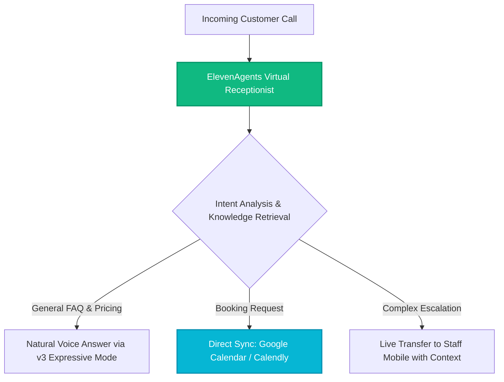

*Affiliate Disclosure: This article contains verified partner links. #ad #ElevenAgentsPartner*

If you operate a service business, medical clinic, law practice, consulting firm, or real estate agency, you already know the cost of the phone ringing at the wrong moment.

You are in a client consultation, on a job site, or simply unavailable. The call rings out and diverts to voicemail. The caller hears a generic automated tone, hangs up, and immediately calls your competitor. That is not a hypothetical risk—it is the everyday reality for thousands of growing businesses.

Traditional fixes have always been flawed:
* **Hiring a full-time receptionist** is costly ($35,000 to $50,000 annually), covers only 40 hours per week, and takes vacations or sick leave.
* **Traditional answering call centers** merely take flat, disjointed messages. They cannot answer detailed questions, check your calendar, or qualify leads.

Enter **ElevenAgents by [ElevenLabs](/reviews/elevenlabs)**: an intelligent, real-time conversational voice agent that operates 24/7, sounds completely natural, and handles full business conversations without a single line of code.

---

## 1. What Makes ElevenAgents Fundamentally Different?

Unlike older interactive voice response (IVR) phone menus that frustrate callers with robotic prompts (*"Press 1 for sales, press 2 for billing"*), ElevenAgents conducts fluid, low-latency, two-way conversations.

1. **Human-Sounding Acoustic Quality:** Built on ElevenLabs' conversational speech synthesis engine, the agent uses natural pacing, realistic breathing pauses, and contextual intonation across 70+ languages.
2. **Expressive Mode & Emotional Tone Control:** Using advanced tone guidance, the agent can de-escalate frustrated callers, remain empathetic, and sound reassuring rather than transactional.
3. **Domain Knowledge Integration:** The agent does not hallucinate. It derives answers strictly from your uploaded company documentation, pricing sheets, standard operating procedures (SOPs), and website pages.
4. **Action-Oriented Integrations:** Beyond talking, ElevenAgents takes action: checking appointment availability, booking calendar slots, logging support tickets, or routing calls to team members.

---

## 2. Head-to-Head: Human Receptionist vs. ElevenAgents

| Dimension | Part-Time Human Receptionist | Traditional Call Center | **ElevenAgents AI Receptionist** |
| :--- | :--- | :--- | :--- |
| **Weekly Coverage** | ~20 to 35 hours / week | Business hours + on-call surcharge | **168 hours / week (24/7/365)** |
| **After-Hours & Weekends** | ❌ Goes to voicemail | ⚠️ Flat message taking | **✅ Full interactive answering** |
| **Response Latency** | Variable (often busy) | Multiple rings | **Instantaneous (sub-second)** |
| **Appointment Booking** | Manual entry | Rarely supported | **Live bidirectional calendar sync** |
| **Multilingual Support** | Typically 1 language | Extra fee per language | **70+ native languages built in** |
| **Monthly Cost** | $1,500 - $3,500 / month | $400 - $1,200 / month | **Fraction of traditional cost** |

---

## 3. Step-by-Step Blueprint: Deploying Your Agent in Under an Hour

Setting up ElevenAgents requires zero engineering resources or coding experience. Here is the exact implementation process:

### Step 1: Create Your Agent Profile
Inside your [ElevenLabs Dashboard](/go/elevenlabs), navigate to **Agents** and click **Create Agent**. Choose a voice profile that reflects your brand identity from the curated library of over 10,000 options, or use a custom cloned voice.

### Step 2: Ingest Your Business Knowledge Base
Upload your company's operating materials:
* Website URLs (the agent automatically crawls your service pages)
* PDF documents (service menus, rate cards, warranty policies)
* Structured text FAQs (cancellation policies, parking instructions, office hours)

### Step 3: Connect Your Calendar & CRM Stack
ElevenAgents features native integrations with the business tools you already use:
* **Calendars:** Google Calendar, Outlook, Calendly, Cal.com
* **Automation:** [Make](/reviews/make), [Zapier](/reviews/zapier), n8n
* **CRMs & Support:** HubSpot, Salesforce, [Monday.com](/reviews/monday-com), Zendesk, Intercom
* **Messaging:** Direct WhatsApp phone answering and messaging support

### Step 4: Define Call Handling & Escalation Rules
Configure how you want specific scenarios handled:
* Standard inquiries: The agent resolves them independently.
* Appointment bookings: The agent checks live slots and confirms reservations.
* Urgent inquiries or VIP clients: The agent automatically transfers the call to your personal mobile number with a summarized text brief.

### Step 5: Assign Your Phone Number & Go Live
ElevenLabs assigns a dedicated local or toll-free telephone number. You can either use it as your primary advertised business line or set up call forwarding from your existing carrier (Twilio, Vodafone, AT&T, Orange).

---

## 4. Key Industry Verticals Benefiting Today

### Healthcare & Dental Practices
Medical offices manage high call volumes for appointment scheduling, prescription refills, and intake verification. ElevenAgents handles after-hours patient inquiries, books clinic slots, and reduces front-desk wait times without compromising sensitive information (SOC 2 and HIPAA compliant).

### Real Estate Agencies & Solo Brokers
Brokers often miss incoming buyer inquiries while hosting open houses or property viewings. ElevenAgents answers instantly, pre-screens buyer budgets and criteria, and schedules property viewings directly onto the agent's calendar.

### Home Services, Contractors & Plumbers
For plumbers, electricians, and HVAC specialists on active job sites, stopping work to answer phone calls risks losing jobs or causing delays. ElevenAgents acts as a virtual dispatcher, capturing project details, assessing urgency, and securing bookings.

---

## 5. Frequently Asked Questions (FAQ)

### What is the difference between an AI receptionist and a voicemail service?
A voicemail service simply records a message and requires you to manually call the customer back hours later—often after they have booked with a competitor. ElevenAgents conducts a full conversation in real time, answers questions, checks your schedule, and books appointments on the spot.

### Can ElevenAgents de-escalate difficult customer conversations?
Yes. Thanks to ElevenLabs' Expressive Mode, the agent monitors conversational context and adapts its vocal tone, speaking more calmly, empathetically, and reassuringly when dealing with stressed or frustrated customers.

### How quickly can a business get up and running?
Most businesses complete setup and testing in 30 to 45 minutes. The intuitive visual builder allows uploading documents and connecting calendars in minutes with no developers required.

---

## The Bottom Line

Every missed phone call is an invisible leak in your company's revenue. With ElevenAgents, you gain the responsiveness of a 24/7 enterprise call center at a tiny fraction of the overhead.

> [!NOTE]
> **Executive Takeaway:** **Get Started Today:** Configure your custom AI voice receptionist and test the platform with full partner benefits at [Launch ElevenAgents on ElevenLabs](/go/elevenlabs).
