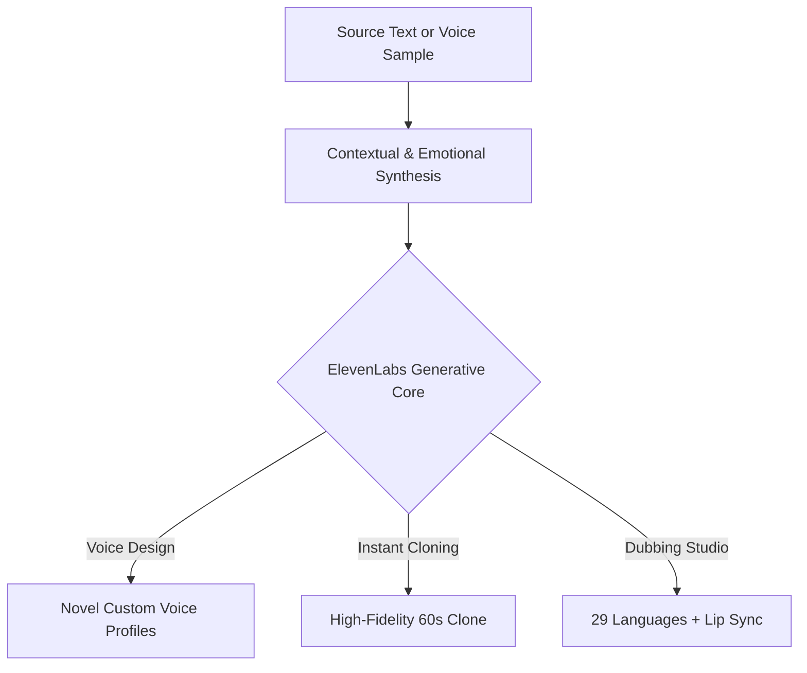

For nearly three decades, synthetic speech—commonly known as Text-to-Speech (TTS)—was characterized by mechanical monotony. Early voices sounded metallic, flat, and entirely incapable of capturing nuance, humor, hesitation, or emotional intensity. Whether on GPS navigation devices or early smartphone assistants, automated voices unmistakably exposed their robotic origins.

Then, in early 2023, a quiet research startup fundamentally disrupted the global audio industry: **ElevenLabs**.

By deploying deep transformer neural networks engineered to understand the semantic and emotional context of an entire sentence before rendering acoustic sound waves, ElevenLabs obliterated the uncanny valley. Today, Hollywood production houses, indie content creators, AAA game developers, and Fortune 500 enterprises rely on its generative audio engine.

Here is the story behind this technological triumph and a practical guide to scaling your media pipeline globally.

---

## 1. The Genesis: Two Polish Childhood Friends vs. Robotic Dubbing

The ElevenLabs journey began in Poland with two lifelong friends: **Mati Staniszewski** (former Palantir strategist) and **Piotr Dabkowski** (machine learning engineer at Google).

Their core frustration was relatable: in Poland, foreign films and television shows were historically localized through a monotone "voice-over" style where a single male narrator read all dialogue over the original audio track. Why was it impossible to preserve the genuine emotion, pacing, and pitch of an actor while translating their performance into English, Spanish, or Japanese?



By engineering a proprietary model that analyzes syntactic phrasing and emotional subtext, ElevenLabs achieved what Big Tech giants had struggled with for years: rendering **subtle pauses, natural intakes of breath, conversational inflections, and acoustic warmth** that make speech unmistakably human.

---

## 2. The 3 Breakthrough Innovations That Crossed the Uncanny Valley

To understand why ElevenLabs leads the market by a wide margin, we need to inspect what is happening under the hood.

### 1. Semantic-Aware Contextual Phrasing
Legacy TTS systems read words sequentially from left to right like a typewriter. ElevenLabs analyzes whole paragraphs at a time:
* When a sentence concludes with an exclamation point preceded by high-tension vocabulary, the model naturally increases vocal projection and cadence.
* When dialogue appears inside quotation marks in a storytelling context, the engine automatically softens the timbre to match narrative intimacy.

### 2. Instant Voice Cloning in 60 Seconds
Creating a synthetic voice clone once required hours of recording inside soundproof isolation booths. With ElevenLabs:
* **A clean 60-second audio sample** is sufficient to capture pitch, timbre, and accent.
* **Professional Voice Cloning (PVC)**, trained on 30 minutes of high-fidelity studio reference audio, produces a clone acoustically indistinguishable from the human original, capable of whispering, laughing, or shouting with exact mannerisms.

### 3. The Autonomous Dubbing Studio
For global content creators and enterprise marketing teams, the Dubbing Studio is transformative. It ingests an existing video (a webinar, YouTube tutorial, or key speech) and automatically:
1. Isolates the vocal track from background music and ambient Foley sound.
2. Translates the spoken dialogue into 29 languages with idiomatic precision.
3. Generates the translated speech **using the original speaker's cloned voice**.
4. Time-stretches and synchronizes cadence to match lip movements.

---

> [!TIP]
> [!NOTE]
> **Executive Takeaway:** **HeliaTech Benchmark Access:** Test `ElevenLabs` with our verified enterprise trial link at [/go/elevenlabs](/go/elevenlabs).

> [!TIP]
> **HeliaTech Benchmark Access:** Test `ElevenLabs` with our verified enterprise trial link at [/go/elevenlabs](/go/elevenlabs).

## 3. Practical Masterclass: Globalize Your Media in 3 Steps

If you produce a podcast, video series, or corporate training material, here is how to expand into international markets without recording additional audio.

```
[Original English / Source Media] ➔ [1. Upload to ElevenLabs Studio]
                                              │
                                              ▼
                             [2. Voice Isolation & Translation]
                                              │
                                              ▼
                 ┌────────────────────────────┼────────────────────────────┐
                 ▼                            ▼                            ▼
          [Spanish Track]               [German Track]               [Japanese Track]
     (Your exact voice speaking    (Your exact voice speaking   (Your exact voice speaking
      fluent, native Spanish)       accurate, natural German)    flawless, native Japanese)
```

### Step 1: Voice Calibration & Clone Creation
1. Inside your ElevenLabs dashboard, navigate to **Voices > Add Generative or Cloned Voice**.
2. Select **Instant Voice Cloning**.
3. Upload a 1-to-2 minute WAV/MP3 recording of your voice (recorded with a clear microphone, free of reverb, echo, or background music).
4. Label the profile with descriptive acoustic tags (e.g., *Authoritative, Narrative, Technical*).

### Step 2: Mastering Synthesis Parameters
When generating speech in the Studio, three key sliders dictate the acoustic realism:
* **Stability**: Set between 40% and 55%. Lower values introduce expressive dynamic variability; higher values maintain a structured, consistent delivery.
* **Clarity / Similarity Enhancement**: Keep around 75% to preserve your exact vocal timbre without introducing metallic artifacts.
* **Style Exaggeration**: Keep minimal (10% to 20%) to add natural emotional color without sounding theatrical.

### Step 3: Multi-Platform Global Distribution
Within seconds, export high-bitrate studio audio in Spanish, French, German, or Japanese. You can drop the localized audio into your video editor or syndicate foreign-language RSS podcast feeds instantly.

---

## 4. Architectural Comparison: Strengths and Trade-offs

| Standout Strengths | Operational Considerations |
| :--- | :--- |
| **Industry-leading acoustic realism** and emotional inflection. | **Credit consumption** scales rapidly when processing hours of video. |
| **Native multilingual dubbing** with voice fingerprint retention. | Requires pristine source audio for clean voice cloning. |
| **Sub-150ms ultra-low latency API** ideal for conversational AI agents. | Commercial rights for select voice library personas require specific tiers. |
| **Mobile Reader ecosystem** turns any article or PDF into an audiobook. | Demands strict ethical guardrails to prevent voice identity misuse. |

---

## 5. HeliaTech Final Verdict

ElevenLabs is not just an entertaining novelty: it is an indispensable **force multiplier** for creators, media companies, and global software organizations. It empowers a team of two to produce localized multimedia content with the polish and reach of a multinational localization agency.

If voice is a strategic pillar of your brand, ElevenLabs is the most impactful media investment you can make this year.

---

<div class="not-prose my-12 p-8 rounded-3xl bg-gradient-to-br from-slate-900 via-slate-900/90 to-slate-950 border border-fuchsia-500/30 shadow-glow-fuchsia text-center relative overflow-hidden">
  <div class="absolute -right-10 -bottom-10 w-48 h-48 bg-fuchsia-500/10 rounded-full blur-2xl pointer-events-none"></div>
  <div class="inline-flex items-center gap-2 px-3 py-1 rounded-full bg-fuchsia-500/10 border border-fuchsia-500/20 text-fuchsia-300 text-xs font-mono font-semibold mb-4">
    ✦ FREE TIER INCLUDED
  </div>
  <h3 class="text-2xl sm:text-3xl font-black text-white mb-3">
    Empower Your Media with Next-Gen Voices
  </h3>
  <p class="text-slate-400 text-sm max-w-lg mx-auto mb-6">
    Join millions of creators and enterprises using ElevenLabs to clone their voice, localize content worldwide, and build immersive auditory experiences.
  </p>
  <a 
    href="/go/elevenlabs" 
    target="_blank" 
    rel="noopener sponsored"
    class="inline-flex items-center gap-2 px-8 py-3.5 rounded-full bg-gradient-to-r from-cyan-500 to-fuchsia-500 hover:from-cyan-400 hover:to-fuchsia-400 text-slate-950 font-black text-sm tracking-wide shadow-lg hover:shadow-fuchsia-500/30 transition-all duration-300 transform hover:-translate-y-0.5"
  >
    <span>Start with ElevenLabs for Free</span>
    <span class="text-xs">➔</span>
  </a>
  <p class="text-[11px] font-mono text-slate-500 mt-4">
    10,000 monthly characters included on free tier • Instant voice cloning enabled
  </p>
</div>
