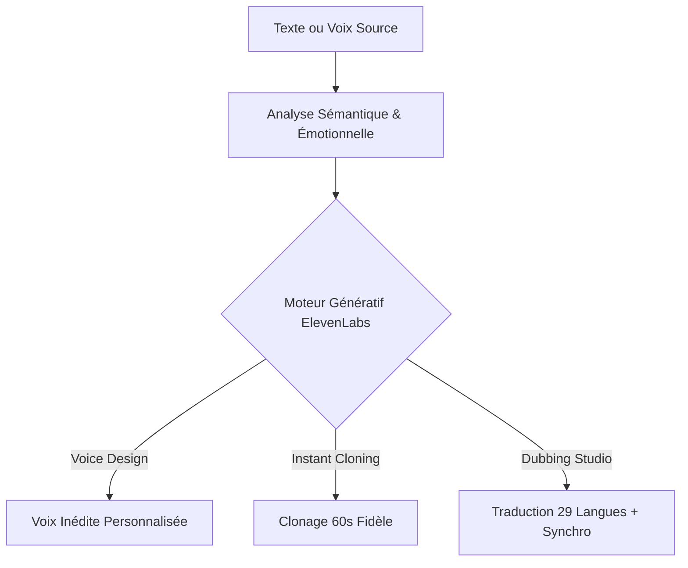

Pendant près de trois décennies, la synthèse vocale informatique (le fameux *Text-to-Speech*) était synonyme de frustration : des voix métalliques, monocordes, incapables de marquer une hésitation, de rire ou d'adapter leur intonation au sous-texte d'une phrase. Les voix des GPS et des assistants vocaux des années 2010 trahissaient immédiatement leur nature artificielle.

Puis, au début de l'année 2023, une jeune entreprise discrète a bouleversé l'industrie mondiale de l'audio : **ElevenLabs**.

En introduisant des modèles d'apprentissage profond capables de comprendre le sens émotionnel d'un texte avant d'en moduler la restitution acoustique, ElevenLabs a instantanément rendu obsolète tout ce qui existait auparavant. Aujourd'hui, studios de cinéma, créateurs de contenu, éditeurs de jeux vidéo et multinationales s'arrachent cette technologie.

Plongeons dans l'histoire de cette révolution et découvrons comment transformer vos créations audio en une machine industrielle mondiale.

---

## 1. La Genèse : Deux amis d'enfance polonais contre la voix mécanique

L'histoire d'ElevenLabs commence en Pologne avec deux amis d'enfance : **Mati Staniszewski** (passé par Palantir) et **Piotr Dabkowski** (ingénieur en apprentissage automatique chez Google).

Leur frustration originelle était simple et universelle : en Pologne, les films et documentaires étrangers étaient systématiquement doublés par un « voice-over » monotone où une seule voix masculine lisait tous les dialogues par-dessus la version originale. Pourquoi était-il impossible de préserver l'émotion originelle d'un acteur tout en le faisant parler polonais, français ou espagnol de manière fluide ?



En combinant une architecture de transformeurs adaptée au spectre vocal et un système de modélisation contextuelle, ElevenLabs a réussi ce qu'Amazon, Microsoft et Google n'avaient pas osé : intégrer **les micro-pauses, les respirations naturelles, les hésitations et les variations de tonalité** qui font l'essence même de la voix humaine.

---

## 2. Les 3 Innovations qui ont Brisé la Vallée de l'Étrange

Pour comprendre pourquoi ElevenLabs domine le marché mondial, il faut regarder ce qui se passe sous le capot.

### 1. La Compréhension Contextuelle du Texte
Les anciens moteurs lisaient les mots de gauche à droite sans comprendre la phrase. ElevenLabs analyse l'intégralité du paragraphe :
* Si une phrase se termine par un point d'exclamation précédé de mots exprimant l'urgence, le modèle accélère le rythme et augmente la pression acoustique.
* Si un passage est narré entre guillemets sous forme de confidence, le moteur adopte naturellement une texture de voix feutrée et intime.

### 2. Le Clonage Instantané (Instant Voice Cloning)
Il fallait autrefois des heures d'enregistrement en chambre sourde pour créer une réplique vocale acceptable. Avec ElevenLabs :
* **Un échantillon propre de 60 secondes** suffit pour capturer l'empreinte vocale d'un individu.
* **Le clonage professionnel (Professional Voice Cloning)**, basé sur 30 minutes de voix de référence, crée un clone acoustiquement indiscernable de la réalité, capable de chuchoter, de crier ou de déclamer avec les tics de langage exacts de la personne.

### 3. Le Dubbing Studio : La Fin des Barrières Linguistiques
C'est sans doute la fonctionnalité la plus spectaculaire pour les entreprises et les médias. Le studio de doublage prend une vidéo existante (par exemple un webinaire en français ou une formation sur YouTube) et :
1. Isole la piste vocale du fond musical.
2. Traduit le texte dans 29 langues avec une précision idiomatique impressionnante.
3. Synthétise la traduction **avec la propre voix de l'orateur originel**.
4. Synchronise le tempo pour correspondre au mouvement des lèvres.

---

## 3. Tutoriel Pratique : Internationaliser Votre Média en 3 Étapes

Imaginons que vous produisiez un podcast ou une chaîne de tutoriels vidéo. Voici comment décupler votre audience internationale sans enregistrer une seule minute supplémentaire.

```
[Votre Audio / Vidéo FR] ➔ [1. Upload ElevenLabs Studio]
                                     │
                                     ▼
                        [2. Détection Voix & Traduction]
                                     │
                                     ▼
               ┌─────────────────────┼─────────────────────┐
               ▼                     ▼                     ▼
          [Piste US/EN]        [Piste Espagnole]     [Piste Allemande]
         (Votre propre voix   (Votre propre voix    (Votre propre voix
          en anglais fluide)   en espagnol natif)    en allemand parfait)
```

### Étape 1 : Le Paramétrage du Clone Vocal
1. Dans le tableau de bord ElevenLabs, ouvrez l'onglet **Voices > Add Generative or Cloned Voice**.
2. Sélectionnez **Instant Voice Cloning**.
3. Déposez un fichier MP3 de 1 à 2 minutes (enregistrement de votre voix sans bruit de fond, sans écho et sans musique).
4. Nommez la voix et cochez les étiquettes de style (ex: *Warm, Narrative, Corporate*).

### Étape 2 : La Génération avec Maîtrise des Paramètres
Dans l'éditeur de synthèse vocale, trois curseurs essentiels gouvernent le résultat :
* **Stability (Stabilité)** : Réglez entre 40% et 60%. Plus la valeur est basse, plus la voix est expressive et vivante ; plus elle est haute, plus elle est posée et régulière.
* **Clarity / Similarity (Fidélité au clone)** : Réglez autour de 75% pour préserver le grain de votre voix sans introduire d'artefacts sonores.
* **Style Exaggeration** : À doser avec parcimonie (10% à 20%) pour ajouter du relief sans forcer le trait.

### Étape 3 : L'Export et la Diffusion Multi-Plateformes
En quelques secondes, vous générez vos fichiers audio en anglais, espagnol ou japonais avec une clarté broadcast. Vous pouvez directement les intégrer dans votre monteur vidéo préféré ou les publier comme flux de podcast distincts.

---

## 4. Tableau Comparatif : Forces et Limites

| Points Forts Exceptionnels | Limites et Considérations |
| :--- | :--- |
| **Réalisme acoustique inégalé** sur le marché mondial. | **Consommation de crédits** rapide lors du traitement vidéo lourd. |
| **Génération multilingue native** sans perte de timbre. | Nécessite des enregistrements source propres pour un clonage optimal. |
| **API ultra-rapide** (latence inférieure à 150ms pour les agents IA). | Les licences commerciales de certaines voix de la bibliothèque nécessitent des forfaits spécifiques. |
| **Écosystème Reader** sur mobile pour transformer n'importe quel texte en livre audio. | Nécessite une modération stricte pour éviter l'usurpation d'identité vocale. |

---

## 5. Le Bilan HeliaTech

ElevenLabs ne se contente pas d'être un gadget amusant : c'est un multiplicateur de force sans précédent pour les créateurs de contenu, les formateurs et les entreprises mondiales. Il permet à une équipe de deux personnes de produire des contenus avec la même envergure qu'un studio international de localisation.

Si la voix fait partie de votre stratégie de croissance, ElevenLabs est l'investissement technologique le plus évident de cette décennie.

---

<div class="not-prose my-12 p-8 rounded-3xl bg-gradient-to-br from-slate-900 via-slate-900/90 to-slate-950 border border-fuchsia-500/30 shadow-glow-fuchsia text-center relative overflow-hidden">
  <div class="absolute -right-10 -bottom-10 w-48 h-48 bg-fuchsia-500/10 rounded-full blur-2xl pointer-events-none"></div>
  <div class="inline-flex items-center gap-2 px-3 py-1 rounded-full bg-fuchsia-500/10 border border-fuchsia-500/20 text-fuchsia-300 text-xs font-mono font-semibold mb-4">
    ✦ ESSAI GRATUIT DISPONIBLE
  </div>
  <h3 class="text-2xl sm:text-3xl font-black text-white mb-3">
    Donnez une voix d'exception à vos projets
  </h3>
  <p class="text-slate-400 text-sm max-w-lg mx-auto mb-6">
    Rejoignez les millions de créateurs qui utilisent ElevenLabs pour cloner leur voix, doubler des vidéos et créer des expériences immersives.
  </p>
  <a 
    href="/go/elevenlabs" 
    target="_blank" 
    rel="noopener sponsored"
    class="inline-flex items-center gap-2 px-8 py-3.5 rounded-full bg-gradient-to-r from-cyan-500 to-fuchsia-500 hover:from-cyan-400 hover:to-fuchsia-400 text-slate-950 font-black text-sm tracking-wide shadow-lg hover:shadow-fuchsia-500/30 transition-all duration-300 transform hover:-translate-y-0.5"
  >
    <span>Commencer avec ElevenLabs gratuitement</span>
    <span class="text-xs">➔</span>
  </a>
  <p class="text-[11px] font-mono text-slate-500 mt-4">
    10 000 caractères offerts chaque mois • Clonage vocal instantané inclus
  </p>
</div>
