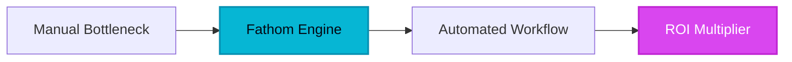

For decades, the boardroom—and eventually the Zoom room—was a graveyard of lost ideas. Executives and sales professionals were forced into a binary choice: participate fully in the conversation and lose the details, or scribble notes frantically and lose the human connection. This cognitive load created a massive bottleneck in the enterprise, where the 'meeting after the meeting'—the manual task of summarizing, emailing, and updating CRMs—consumed more time than the actual strategy sessions. The market was saturated with clunky, expensive legacy transcription services that delivered 'word soup' rather than actionable intelligence. Then came Fathom.

## 1. The Genesis & Evolution

Fathom didn't just enter the market; it identified a fundamental flaw in how B2B professionals interact with video conferencing. While incumbents like Otter and Rev focused on the 'what' of transcription, Fathom’s founders focused on the 'why.' They recognized that a transcript is useless if it doesn't trigger a business outcome. 

By launching as a Zoom-native app during the height of the remote work revolution, Fathom bypassed the friction of traditional bot-based recording. It wasn't just a recorder; it was a silent, intelligent observer designed to automate the most loathed part of the sales cycle: data entry. This disruption was fueled by a radical 'free-forever' tier for individuals, forcing legacy dinosaurs to justify their high-priced, low-utility subscriptions. Fathom shifted the narrative from 'recording calls' to 'capturing intelligence.'

> [!NOTE]
> **Executive Takeaway:** "The most valuable asset in any organization is the insight buried within its conversations. Fathom is the shovel that unearths that gold in real-time."

## 2. Core Business Superpowers

Fathom’s dominance in the B2B sector is built on three pillars of high-value automation that save companies thousands of annual labor hours.

*   **Automated CRM Synchronization:** For sales leaders, Fathom is a force multiplier. It doesn't just summarize a call; it maps key insights directly to Salesforce, HubSpot, or Close. This eliminates the 'Friday afternoon CRM catch-up' and ensures that every stakeholder has a crystal-clear view of the deal's pulse without manual input.
*   **High-Fidelity Speaker Identification:** Unlike generic AI tools, Fathom’s engine excels at distinguishing between multiple stakeholders in complex enterprise calls. This precision ensures that action items are attributed to the correct owner, preventing the 'who said what' ambiguity that plagues project management.
*   **Instant Snippet Architecture:** Fathom allows users to 'highlight' moments during a live call. These highlights are instantly converted into shareable video snippets. Instead of sending a 60-minute recording to a VP, a manager can send a 30-second clip of the client expressing a specific pain point. This radical transparency accelerates the feedback loop across the entire organization.

> [!TIP]
> **HeliaTech Benchmark Access:** Test `Fathom` with our verified enterprise trial link at [/go/fathom](/go/fathom).

## 3. Hands-on Workshop (15-Minute Blueprint)

Follow this blueprint to move from manual note-taking to automated executive recall in under 15 minutes.

### Phase 1: The Integration (Minutes 1-5)
1.  **Sign Up:** Connect your primary business calendar (Google or Outlook) via the [Fathom Portal](https://fathom.video/?via=heliatech).
2.  **CRM Handshake:** Navigate to Settings > Integrations and authorize your CRM (HubSpot/Salesforce). Map your 'Meeting Type' fields to ensure Fathom knows where to push the data.
3.  **Desktop Installation:** Download the Fathom desktop app. This is crucial for the 'Sidekick' feature, which provides a real-time control panel during your calls.

### Phase 2: The Live Execution (Minutes 6-12)
1.  **The Auto-Join:** Start your next Zoom or Teams call. Fathom will automatically join as your assistant.
2.  **Active Highlighting:** During the call, use the Fathom Sidekick or keyboard shortcuts to click 'Action Item,' 'Insight,' or 'Positive.' This trains the AI on what matters most in your specific context.
3.  **The Wrap-Up:** Once the call ends, Fathom generates the transcript and summary within seconds.

### Phase 3: The Velocity Loop (Minutes 13-15)
1.  **Review & Sync:** Open the Fathom dashboard, review the AI-generated summary, and click 'Sync to CRM.'
2.  **Share the Win:** Copy the link to a 'Highlight' snippet and drop it into your team’s Slack or Microsoft Teams channel to keep everyone aligned.

## 4. Critical Assessment & Trade-offs

| Feature | Strength | Limitation |
| :--- | :--- | :--- |
| **Cost Structure** | Generous free tier with unlimited recording/transcription. | Advanced team-wide analytics are gated behind paid plans. |
| **Accuracy** | Exceptional speaker ID and technical terminology handling. | Occasional struggles with heavy accents or overlapping speech. |
| **Integration** | Deep, native hooks into major CRMs and Slack. | Requires a desktop app for the best experience; browser-only is limited. |
| **Editing** | Excellent for creating short 'highlight' clips. | Not a substitute for dedicated podcast or video editing software. |
| **Privacy** | SOC2 compliant; robust permissions for recording. | Some corporate firewalls require IT whitelisting for the desktop app. |

## 5. HeliaTech Final Verdict & Recommendation

Fathom is no longer a 'nice-to-have' productivity hack; it is a fundamental requirement for the modern, high-velocity enterprise. By removing the administrative friction from human communication, it allows teams to focus on what they do best: building relationships and solving problems. 

**Executive Recommendation:** If you are a sales leader, founder, or project manager still taking manual notes in 2026, you are operating at a competitive disadvantage. We recommend deploying Fathom across your entire customer-facing team immediately to capture the institutional knowledge that is currently evaporating the moment you click 'End Meeting.'

**[Claim Your Free Fathom Account ➔](https://fathom.video/?via=heliatech)**
