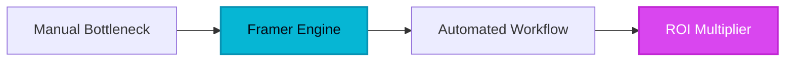

For over a decade, the digital product lifecycle has suffered from an invisible tax: translation loss. Designers would meticulously craft high-fidelity prototypes in tools like Figma, only to throw them over a digital wall to engineering teams. What came back weeks later—after endless Jira tickets, alignment squabbles, and compromised CSS implementations—rarely matched the original vision. This handoff bottleneck cost companies millions in engineering hours and crippled marketing agility. Then came the shift toward visual canvas builders that refused to compromise on code quality. Framer didn't just enter this arena; it fundamentally redrew the boundary lines between graphic design and production-ready web development.

## 1. The Genesis & Evolution: From Prototyping Toy to Production Heavyweight

Founded by Koen Bok and Jorn van Dijk, Framer began its life as a robust interactive prototyping tool for macOS, beloved by interface designers who wanted to code animations without writing boilerplate JavaScript. Early iterations were avant-garde, leaning heavily into coffeescript and code-driven design. However, the leadership team recognized a massive structural shift in how the internet was being built: marketing teams and startups were tired of gluing together fragile WordPress plugins or waiting months for React engineers to push simple landing page updates.

By pivoting aggressively toward a web-native, canvas-first platform backed by React under the hood, Framer disrupted legacy dinosaurs. It bypassed the rigid box models of traditional website builders and replaced them with layout engines that felt entirely native to modern UI designers. By combining absolute positioning, flexbox, and semantic HTML generation, Framer evolved from a boutique prototyping playground into a mission-critical publishing engine utilized by fast-scaling tech enterprises worldwide.

> [!NOTE]
> [!NOTE]
> [!NOTE]
> **Executive Takeaway:** **Executive Takeaway:** **Executive Takeaway:** "The future of software is not about choosing between visual creativity and programmatic power; it is about building interfaces where the canvas and the code are the exact same thing." — HELIA TECH Enterprise Insights

## 2. Core Business Superpowers

Modern digital enterprises demand speed, security, and scalability. Framer delivers on these fronts by fundamentally altering how web assets are engineered and deployed.

*   **Unrivaled Visual Fluidity:** Unlike rigid template systems, Framer’s layout engine offers absolute freedom combined with intelligent responsive constraints. Designers can craft complex, fluid grid systems that scale gracefully across viewport sizes without breaking.
*   **Integrated Native CMS:** External database plugins and messy API integrations are relics of the past. Framer includes a robust, lightning-fast CMS that allows marketing teams to publish structured blogs, case studies, and dynamic resource centers directly within the design canvas.
*   **Instant Core Web Vitals Dominance:** Powered by global CDNs and optimized server-side rendering, Framer websites routinely score near-perfect marks on Google’s Core Web Vitals, driving superior SEO performance and bounce-rate reduction.
*   **Extensible Component Ecosystem:** A thriving marketplace of community-built components, scroll effects, and template overrides means teams can deploy interactive pricing calculators, 3D canvases, and localized translation widgets in minutes rather than weeks.

> [!TIP]
> [!NOTE]
> [!NOTE]
> **Executive Takeaway:** **Executive Takeaway:** **HeliaTech Benchmark Access:** Test `Framer` with our verified enterprise trial link at [/go/framer](/go/framer).

> [!TIP]
> [!NOTE]
> **Executive Takeaway:** **HeliaTech Benchmark Access:** Test `Framer` with our verified enterprise trial link at [/go/framer](/go/framer).

> [!TIP]
> **HeliaTech Benchmark Access:** Test `Framer` with our verified enterprise trial link at [/go/framer](/go/framer).

## 3. Hands-on Workshop (15-Minute Blueprint)

Deploying a high-converting B2B landing page no longer requires a three-tier engineering sprint. Follow this actionable framework to launch your next project today:

1.  **Initialize and Configure Grid Systems:** Open Framer, select a blank canvas, and establish your core breakpoints (Desktop, Tablet, Mobile). Set up global style tokens for typography, primary brand colors, and spacing scales to ensure enterprise-wide consistency.
2.  **Construct the Hero Section:** Utilize the Stack and Grid features to anchor your primary value proposition. Insert a compelling headline, subheadline, and a high-contrast CTA button tied to your conversion funnel.
3.  **Integrate Dynamic CMS Content:** Link a collection list to your customer testimonials or recent press highlights. Map your dynamic fields to visual layers so content updates instantly propagate across all views.
4.  **Inject Micro-Interactions:** Apply scroll-triggered entrance animations and hover states directly inside the inspector panel to elevate perceived software quality.
5.  **Publish and Connect Domain:** Hit the publish button to deploy your site instantly to a global CDN, connect your custom DNS records, and verify your responsive states across active devices.

## 4. Critical Assessment & Trade-offs

No enterprise software platform is a silver bullet. To make an objective procurement decision, evaluate Framer through the lens of your team's operational composition.

| Feature / Metric | Framer Advantage | Enterprise Limitation | Verdict |
| :--- | :--- | :--- | :--- |
| **Learning Curve** | Extremely intuitive for Figma and design-first creators. | Steeper transition for developers accustomed to raw code files or legacy CMS platforms. | **Designers win; devs adapt quickly.** |
| **Custom Logic** | Rich component marketplace and visual triggers cover 90% of use cases. | Highly complex business logic requires React code overrides or external API hooks. | **Great for marketing; limited for complex web apps.** |
| **Pricing & Scaling** | Flat-rate publishing tiers remove server maintenance overhead. | Per-site pricing scales linearly for enterprise portfolios with dozens of client subdomains. | **High ROI for high-converting revenue pages.** |

## 5. HeliaTech Final Verdict & Recommendation

Framer represents a paradigm shift in how digital experiences are brought to market. By eliminating the friction between design software and production code, it empowers creative and marketing teams to operate with unprecedented velocity. While highly complex SaaS applications still require dedicated full-stack engineering, for marketing sites, product launches, and brand properties, Framer is an absolute tour de force.

If your organization is bleeding capital through prolonged development cycles and fragmented design handoffs, migrating your web presence to Framer is not just an upgrade—it is a competitive necessity.
