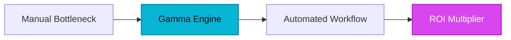

D
eath by PowerPoint is not just a corporate cliché; it is a measurable drain on global productivity. For three decades, the business world has been trapped in a 4:3 or 16:9 box, forcing professionals to spend 20% of their time on content and 80% on the soul-crushing logistics of alignment, font consistency, and image cropping. The friction between a brilliant idea and a shareable deck has historically been a graveyard for innovation. We have been using digital versions of physical transparencies, ignoring the fact that the modern workforce consumes information on everything from ultrawide monitors to smartphones. This is the fragmentation that Gamma set out to solve.

## 1. The Genesis & Evolution: Breaking the Slide Paradigm

Gamma was born out of a fundamental realization by its founders—Jon Gheller, Grant Lee, and James Fox—that the "slide" as a unit of information was broken. While the rest of the software world moved toward collaborative, fluid, and web-native architectures (think Notion or Figma), presentations remained stuck in the file-based, static-layout era of the 1990s.

Gamma didn't just add an AI layer to a legacy interface. They reimagined the medium entirely, moving away from the rigid 'canvas' and toward a 'fluid card' system. This disruption was aimed directly at the legacy dinosaurs. Instead of asking a user to drag a text box to pixel 450, Gamma asks for the intent. By treating presentations as responsive webpages rather than static images, Gamma allows ideas to breathe across devices. Since its launch, it has evolved from a simple generator into a sophisticated workspace where the AI acts as a creative partner, not just a template filler.

## 2. Core Business Superpowers

For the enterprise, Gamma represents a significant shift in ROI. It isn't just about making things look 'pretty'; it's about compressing the time-to-market for ideas.

*   **Instant AI-Driven Content Architecture:** Unlike traditional tools where you start with a blank white rectangle, Gamma’s AI generates a structured, themed, and populated deck from a single sentence. It understands hierarchy, logical flow, and narrative arc, saving executives hours of drafting time.
*   **The Fluid Card System:** Gamma uses a responsive layout engine. If you add more text, the card expands. If you view it on a phone, the layout stacks vertically. This eliminates the need for 'mobile versions' of presentations, ensuring your pitch looks professional whether it's viewed in a boardroom or on a train.
*   **One-Click Aesthetic Restyling:** Branding pivots usually require manual updates to every single slide. In Gamma, a single click applies a new theme—complete with font pairings, color palettes, and button styles—across the entire project without ever breaking the content alignment.
*   **Interactive Living Embeds:** Gamma turns presentations into functional tools. You can embed live Google Sheets, Typeforms, YouTube videos, or even Figma prototypes. Your presentation is no longer a snapshot of data; it is a live dashboard.

> [!NOTE]
> **Executive Takeaway:** "The presentation of the future isn't a file you send; it's a living environment you invite people into. Gamma is the first tool to understand that the medium is the message."

## 3. Hands-on Workshop: The 15-Minute Blueprint

To master Gamma, you must unlearn the habit of manual formatting. Follow this blueprint to create a high-impact project today.

1.  **The Seed Prompt (Minutes 0-2):** Navigate to the 'Create with AI' dashboard. Select 'Presentation' and input a high-level prompt. *Example: 'A quarterly business review for a SaaS company focusing on 15% churn reduction and new expansion revenue.'*
2.  **The Outline Refinement (Minutes 2-5):** Gamma will provide a suggested outline. Don't skip this. Reorder the cards, add a specific section for 'Market Risks,' and let the AI know the tone should be 'Professional yet Visionary.'
3.  **The Visual Explosion (Minutes 5-8):** Choose a theme. Watch as Gamma populates the cards with relevant imagery and layouts. Use the 'Edit with AI' sidebar to say, "Change this list into a three-column layout with icons."
4.  **Deep Integration (Minutes 8-12):** Use the '/' command to embed a live data source. Replace a static chart with a live Google Sheet or a Loom video walkthrough to provide context for remote viewers.
5.  **The Polish & Share (Minutes 12-15):** Hit the 'Theme' button to try a dark mode vs. light mode look. Once satisfied, use the 'Share' link. Unlike a PDF, you can track views and engagement on each specific card.

## 4. Critical Assessment & Trade-offs

While Gamma is a powerhouse, it is a specialized tool. It is not a 1:1 replacement for PowerPoint in every scenario.

| Feature | Strength | Limitation |
| :--- | :--- | :--- |
| **Design Speed** | Unmatched; AI handles 90% of the heavy lifting. | Limited granular control; you can't move elements to specific X/Y coordinates. |
| **Responsiveness** | Perfect layouts on mobile, tablet, and desktop. | The 'card' structure can feel restrictive for non-linear storytelling. |
| **Interactivity** | Supports live embeds (YouTube, Sheets, Typeform). | Exporting to PPTX/PDF often breaks the interactive elements and shifts layouts. |
| **Consistency** | One-click themes ensure 100% brand alignment. | Complex custom animations and transitions are currently unavailable. |

## 5. HeliaTech Final Verdict & Recommendation

Gamma is the definitive choice for the modern professional who values speed and impact over pixel-perfection. It is particularly lethal for sales teams, startup founders pitching for seed rounds, and internal project managers who need to communicate complex ideas without spending a weekend in design hell.

**Executive Recommendation:** If your work is consumed on screens (which is 99% of modern business), Gamma is your new standard. Reserve PowerPoint for high-stakes, offline keynote stages where custom animations are a requirement. For everything else, Gamma is the future.

**Ready to transform your ideas into reality?**
[Claim Your Free Gamma Account ➔](/go/gamma-app)
