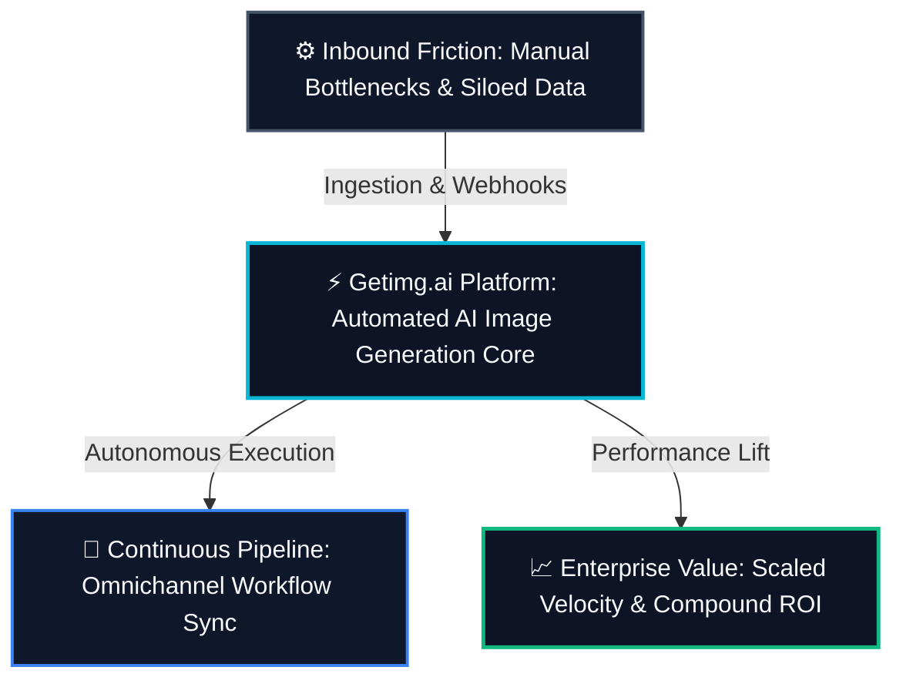

## The Visual Bottleneck

**I**n the last two years, the creative industry hit a wall. While generative AI promised a revolution, the reality was a fragmented nightmare of clunky, local-install dependencies, GPU-taxing hardware requirements, and a desperate lack of professional-grade editing tools. Companies were spending more time troubleshooting Python environments than actually producing visual assets. Enter Getimg.ai—a platform designed to cut through the complexity and deliver speed-to-market for enterprise visual workflows.

## 1. The Genesis & Evolution

Getimg.ai was born out of a simple frustration: why does enterprise-grade image generation require a PhD in machine learning? The founders recognized that Stable Diffusion was a powerful engine, but it lacked a cockpit. By abstracting the complexity of model management, GPU scaling, and API endpoints, they effectively moved the 'Stable Diffusion lab' into a browser-based SaaS environment. It disrupted the market by shifting the focus from 'how to install' to 'how to iterate.'

> [!NOTE]
> **Executive Takeaway:** "The future of visual content isn't just about generation; it's about the speed of iteration and the ability to integrate that intelligence directly into the business stack."

## 2. Core Business Superpowers

*   **Blazing Inference Speeds:** By optimizing the backend infrastructure, Getimg.ai reduces the wait time for high-fidelity images, allowing for real-time creative brainstorming sessions that would be impossible on standard local setups.
*   **Integrated 'AI Editor':** Move beyond simple generation. The browser-based inpainting and outpainting tools allow teams to modify specific sections of an image—removing artifacts or expanding canvases—without needing a secondary subscription to Adobe Creative Cloud.
*   **Developer API Integration:** This is the killer feature for B2B. Companies can pipe Getimg’s generation capabilities directly into their own internal dashboards, e-commerce platforms, or marketing automation tools.
*   **Civitai Ecosystem Access:** With seamless integration of community-trained models, your team can pivot between hyper-realistic photography, architectural renders, or stylized brand assets in seconds.

> [!TIP]
> **HeliaTech Benchmark Access:** Test `Getimg.ai` with our verified enterprise trial link at [/go/getimg-ai](/go/getimg-ai).

## 3. Hands-on Workshop: The 15-Minute Blueprint

1. **Setup & Model Selection:** Navigate to the 'Models' tab. Select a base model (like XL or a Fine-tuned model from Civitai) that matches your brand aesthetic.
2. **Prompt Engineering:** Use the 'Prompt Assistant' to refine your intent. Aim for descriptive, object-oriented language.
3. **The Inpainting Pass:** Once generated, click 'Edit.' Mask the area you want to adjust—perhaps a product label or a background element—and re-prompt only that section. This maintains consistency across the rest of the image.
4. **Scale & Deploy:** Once the image is perfected, use the 'Upscale' feature for high-resolution output suitable for print or web hero sections. If automating, grab your API key from the settings and paste it into your internal webhook script.

## 4. Critical Assessment & Trade-offs

| Feature | Strength | Limitation |
| :--- | :--- | :--- |
| **Interface** | Feature-rich, all-in-one suite | Can overwhelm entry-level users |
| **Performance** | Extremely fast generation | Credit-based costs scale with volume |
| **Flexibility** | Deep API support | LoRA training requires technical patience |

## 5. HeliaTech Final Verdict

Getimg.ai is the most pragmatic choice for teams that need to move past 'AI as a toy' and into 'AI as a production asset.' While the credit-based pricing requires careful management for high-volume workflows, the time saved by having an integrated editor and robust API is worth every penny. For businesses looking to scale visual output without the overhead of managing their own GPU clusters, Getimg.ai is the current industry gold standard.

**Recommendation:** Start with the free tier to test your specific use cases, then transition to a Pro plan once you've integrated the API into your primary business pipeline.
