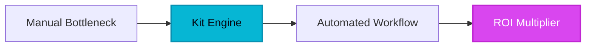

The creator economy once suffered from an invisible bottleneck: digital operators were forced to choose between rigid, corporate email monoliths designed for traditional e-commerce catalogs or clunky blogging tools that buckled under the weight of automated sales funnels. Subscribers were trapped inside duplicate lists, racking up inflated software bills while advanced targeting remained an elusive engineering dream. Enter Kit—formerly known as ConvertKit—a platform engineered from the ground up to solve the operational friction of modern newsletter businesses and independent creators.

## 1. The Genesis & Evolution

Founded by Nathan Barry in 2013, ConvertKit (now Kit) was born out of frustration with existing email service providers that treated professional bloggers and creators like corporate marketers pushing discount codes. Barry realized that independent authors, course creators, and newsletter operators did not need multi-column product grids or complex retail templates; they needed plain-text, high-deliverability emails backed by bulletproof subscriber management.

By pioneering a flat-file, subscriber-centric architecture rather than a legacy list-based model, Kit disrupted the status quo. You could finally have a single subscriber exist on your database once—regardless of how many lead magnets they downloaded or courses they purchased—drastically lowering overhead while dramatically improving behavioral segmentation. Over the years, the platform expanded into a powerhouse ecosystem, culminating in its rebrand to Kit to reflect its evolution into a full-stack audience-building engine.

> [!NOTE]
> **Executive Takeaway:** "Kit treats your audience like human relationships, not disposable leads in a rigid marketing spreadsheet."

## 2. Core Business Superpowers

For enterprise-grade newsletter businesses and high-revenue creators, Kit deploys four essential capabilities that save thousands of operational hours and drive predictable top-line growth:

* **Subscriber-Centric Tagging Architecture:** Forget managing the same lead across five different lists. Kit uses a unified database where tags and custom fields dictate behavior, ensuring you only pay for a subscriber once.
* **Visual Automation Builder:** Construct complex, multi-branching funnels with an intuitive drag-and-drop canvas. Automatically route subscribers down different educational paths based on link clicks or purchase events.
* **High-Deliverability Plain-Text Optimization:** Engineered to land in the primary inbox, Kit’s clean HTML structure and emphasis on conversational writing protect sender reputation across major mailbox providers.
* **Built-in Commerce Engine:** Sell digital downloads, presets, coaching, and recurring paid newsletters directly inside the platform without wrestling with disjointed third-party checkout integrations.

## 3. Hands-on Workshop (15-Minute Blueprint)

Deploy a high-converting lead magnet and automated onboarding sequence in 15 minutes using Kit's core primitives:

1. **Establish Your Landing Page:** Navigate to **Grow > Landing Pages & Forms**, select a minimalist template optimized for conversion, and connect your custom domain.
2. **Configure Incentive Delivery:** Set up the automated download link directly within the landing page settings so your lead magnet delivers instantly upon subscription.
3. **Build the Visual Automation:** Go to **Automate > Visual Automations**, create a new workflow triggered by the landing page submission, and add a tag named `Lead Magnet Downloaded`.
4. **Draft the Sequence:** Attach a 3-part email sequence to the automation path. Space each email 48 hours apart, delivering high-value educational content before introducing your flagship product.
5. **Launch and Test:** Preview the subscriber journey in test mode, verify your DKIM and SPF records for deliverability, and publish your funnel live to the web.

## 4. Critical Assessment & Trade-offs

| Strengths | Limitations | Strategic Impact |
| :--- | :--- | :--- |
| Powerful visual automation engine | Steeper learning curve for advanced logic | Enables sophisticated behavioral segmentation at scale |
| Subscriber-centric pricing model | Costs scale rapidly past major tiers | Eliminates duplicate list bloat while rewarding clean lists |
| Exceptional inbox deliverability | Intentionally limited visual templates | Focuses readers on high-converting copywriting over design |
| Native digital commerce integration | Less robust than dedicated e-commerce suites | Perfect for info-products, courses, and paid newsletters |

## 5. HeliaTech Final Verdict & Recommendation

Kit is the definitive operating system for professional creators, newsletter syndicates, and digital educators who prioritize relationship-driven marketing over bloated corporate templates. While its pricing tiers scale alongside your business and advanced automation requires initial configuration, the ROI in saved time, pristine inbox placement, and streamlined monetization is unmatched.

If you are serious about transforming your audience into a sustainable, high-margin business, [Claim Your Free Kit Account ➔](/go/kit) and build your first automated funnel today.
