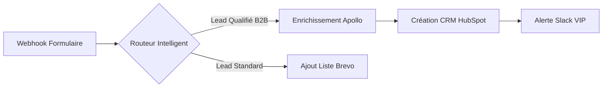

Il y a dix ans, automatiser deux logiciels entre eux relevait soit du calvaire d'ingénierie logicielle, soit d'un compromis frustrant. D'un côté, il fallait embaucher des développeurs pour coder des connecteurs d'API sur-mesure, fragiles et coûteux à maintenir. De l'autre, les premières plateformes comme Zapier imposaient une logique strictement linéaire : *« Si ceci arrive, fais cela »*. Dès qu'un processus nécessitait un embranchement conditionnel, un filtre dynamique ou le traitement d'une liste de 100 contacts, les outils traditionnels s'effondraient ou facturaient des sommes astronomiques.

C'est dans ce vide technologique qu'une équipe d'ingénieurs basée à Prague a conçu **Integromat**, rebaptisé depuis **Make**. En refusant la simplicité réductrice pour embrasser une véritable logique d'orchestration visuelle, Make est devenu l'arme secrète des agences les plus rentables du monde et des équipes produit d'élite.

Voici l'histoire de cette métamorphose, l'anatomie de sa supériorité technique, et un exercice pratique concret pour transformer votre entreprise en machine autonome.

---

## 1. La Genèse : Pourquoi Integromat devait réinventer la roue

Pour comprendre la domination actuelle de Make, il faut remonter aux origines d'Integromat en 2012. À cette époque, le leader incontesté Zapier traitait chaque automatisation comme une ligne droite. Mais dans la réalité d'une entreprise, les flux d'informations ne sont jamais linéaires.

Une commande e-commerce n'est pas juste un email de confirmation :
* Elle contient une liste d'articles (`array`) qui doit être éclatée pour décompter les stocks.
* Elle nécessite de vérifier si le client existe déjà dans le CRM (branche A) ou s'il faut le créer (branche B).
* Elle exige une gestion d'erreur si la passerelle de paiement a un temps de latence de 3 secondes.

Integromat a été pensé dès le premier jour comme un **ordinateur visuel**. Plutôt que d'enchaîner des formulaires verticaux austères, ils ont inventé le canevas infini avec des bulles interactives (les modules), reliées par des faisceaux lumineux animés lors de l'exécution.



En 2022, après le rachat par le groupe Celonis (géant du *Process Mining* pour les entreprises du Fortune 500), Integromat s'est transformé en **Make**. L'interface a été entièrement modernisée, les performances de scalabilité ont été multipliées par 10, et la plateforme a ouvert son marketplace d'applications à des milliers de connecteurs communautaires.

---

## 2. Les 4 Super-Pouvoirs qui écrasent la concurrence

Pourquoi les architectes de systèmes et les directeurs des opérations préfèrent-ils systématiquement Make à ses rivaux ? La réponse tient en quatre piliers architecturaux.

### 1. Le Routeur Visuel et les Filtres Chirurgicaux
Dans Make, vous n'êtes pas enfermé dans un entonnoir unique. Le module **Router** permet de diviser un flux en autant de routes parallèles que nécessaire. Chaque branche peut avoir ses propres conditions logiques strictes (ex: *Montant > 500 € ET Pays = "FR"*). Si une condition n'est pas remplie, la branche s'ignore silencieusement sans consommer vos opérations inutilement.

### 2. Les Itérateurs et Agrégateurs de Données
C'est le cauchemar de Zapier et la gloire de Make. Lorsque vous recevez un tableau de données (par exemple, 15 factures PDF ou 20 lignes dans Google Sheets), Make dispose de deux outils natifs surpuissants :
* **Iterator** : Découpe une liste d'éléments pour exécuter une action individuelle sur chacun d'eux.
* **Aggregator** : Fusionne plusieurs flux distincts en un seul bloc formaté (JSON, texte, tableau) avant de l'envoyer par exemple dans un unique message Slack récapitulatif.

> *"La capacité de Make à manipuler des objets JSON complexes et des tableaux imbriqués sans coder place cet outil dans une catégorie à part : celle des véritables environnements de développement visuel."*

### 3. La Gestion des Erreurs Temps Réel (Error Handlers)
Que se passe-t-il si un serveur externe tombe en panne pendant l'exécution d'un script ? Chez les concurrents, le scénario plante et s'arrête. 

Sur Make, chaque module peut être affublé d'une directive d'erreur :
* **Resume** : Fournir une valeur de remplacement et continuer la suite du flux.
* **Commit** : Valider l'étape et ignorer la ligne défectueuse.
* **Rollback** : Annuler toutes les écritures précédentes pour préserver l'intégrité de votre base de données.
* **Break** : Mettre en pause la requête et réessayer automatiquement dans 15 minutes, 1 heure ou 24 heures.

### 4. Une Équation Économique Sans Commune Mesure
Le nerf de la guerre reste le coût par exécution. Là où Zapier facture souvent des centaines d'euros pour quelques milliers de "Zaps", Make propose un modèle ultra-généreux basé sur le nombre exact d'opérations exécutées. Les entreprises constatent en moyenne une **réduction de 60% à 80% de leur facture d'automatisation** lors de leur migration vers Make.

---

## 3. Atelier Pratique : Bâtir un Répondeur Intelligent & CRM en 15 Minutes

Passons à la pratique. Voici un exercice concret que vous pouvez reproduire dès aujourd'hui pour votre entreprise ou vos clients.

### L'Objectif
Capturer chaque demande entrante sur votre site, analyser la solvabilité de l'entreprise via une API de données, créer la fiche client dans votre CRM, et alerter l'équipe commerciale sur Telegram ou Slack en cas de prospect à forte valeur.

```
[Visiteur soumet formulaire]
           │
           ▼
  [1. Webhook Make Instantané]
           │
           ▼
[2. Filtre Anti-Spam (Regex email)]
           │
           ▼
 [3. Routeur de Qualification]
   ├── Route A (Prospect Entreprise) ➔ [HubSpot / ClickUp] + [Notification Slack Push]
   └── Route B (Prospect Particulier) ➔ [Séquence Emailing Automatisée]
```

### Étape 1 : Le Déclencheur Instantané (Custom Webhook)
1. Créez un nouveau scénario dans votre tableau de bord Make.
2. Ajoutez un module **Custom Webhook** de la suite *Webhooks*.
3. Copiez l'URL unique générée par Make et collez-la dans votre outil de formulaire (Typeform, Tally ou Webflow Form).
4. Soumettez une réponse test : Make capture immédiatement la structure des données en temps réel.

### Étape 2 : Le Formatage et Nettoyage
1. Ajoutez un module **Tools > Set Variable**.
2. Nettoyez le nom et prénom grâce aux fonctions intégrées : `capitalize(trim(1.prenom))`.
3. Validez que le domaine de l'email ne provient pas d'une boîte jetable grâce à la fonction `contains()`.

### Étape 3 : L'Embranchement Stratégique
1. Connectez un module **Router**.
2. Sur la première branche, appliquez le filtre : *Entreprise Existe* et *Budget >= 2000*.
3. Ajoutez le module **Slack > Create a Message** pour envoyer une alerte richement formatée avec bouton de rappel direct.
4. Sur la seconde branche, ajoutez le module **Brevo (Sendinblue)** pour inscrire automatiquement le contact à une séquence de bienvenue pré-programmée.

En seulement 4 modules et 15 minutes de configuration, vous venez de remplacer une tâche manuelle qui coûtait 2 heures quotidiennes à votre équipe commerciale.

---

## 4. Analyse Critique : Forces et Limites de Make

Pour rester parfaitement objectifs, Make n'est pas exempt de contraintes que tout décideur doit connaître.

| Atouts Majeurs | Points de Vigilance |
| :--- | :--- |
| **Rapport qualité/prix imbattable** par rapport à Zapier et Workato. | **Courbe d'apprentissage initiale** plus exigeante pour les profils non-techniques. |
| **Interface visuelle nodale** ultra-claire et agréable à manipuler. | **Temps d'exécution** parfois limité sur les très gros volumes (fichiers > 50 Mo). |
| **Précision extrême des filtres** et des manipulations de variables. | Nécessite de comprendre la notion de tableaux JSON (`arrays`) pour les cas avancés. |
| **Historique d'exécution complet** avec inspection paquet par paquet. | Documentation parfois dense lors de l'utilisation de webhooks sécurisés. |

---

## 5. Le Verdict HeliaTech & Recommandation

Make n'est pas simplement un outil de productivité parmi d'autres : c'est le **système nerveux central** de toute entreprise moderne qui refuse de gaspiller du capital humain dans la saisie répétitive de données. 

Que vous soyez solopreneur souhaitant gérer un empire avec 0 employé ou directeur des systèmes d'information cherchant à désengorger vos équipes de développement, Make offre le juste équilibre entre simplicité visuelle et puissance brute.

> **Conseil d'expert HeliaTech :** Commencez par auditer les 3 actions que vous effectuez le plus souvent chaque semaine (copier un lead, envoyer une facture, archiver un fichier). Automatisez-en une seule ce week-end sur Make : vous ne reviendrez jamais en arrière.

---

<div class="not-prose my-12 p-8 rounded-3xl bg-gradient-to-br from-slate-900 via-slate-900/90 to-slate-950 border border-cyan-500/30 shadow-glow-cyan text-center relative overflow-hidden">
  <div class="absolute -right-10 -bottom-10 w-48 h-48 bg-cyan-500/10 rounded-full blur-2xl pointer-events-none"></div>
  <div class="inline-flex items-center gap-2 px-3 py-1 rounded-full bg-cyan-500/10 border border-cyan-500/20 text-cyan-300 text-xs font-mono font-semibold mb-4">
    ✦ PARTENARIAT OFFICIEL HELIATECH
  </div>
  <h3 class="text-2xl sm:text-3xl font-black text-white mb-3">
    Prêt à passer à la vitesse supérieure ?
  </h3>
  <p class="text-slate-400 text-sm max-w-lg mx-auto mb-6">
    Démarrez gratuitement sur Make avec notre lien d'accès privilégié et découvrez pourquoi plus de 500 000 organisations automatisent leur futur sur cette plateforme.
  </p>
  <a 
    href="/go/make" 
    target="_blank" 
    rel="noopener sponsored"
    class="inline-flex items-center gap-2 px-8 py-3.5 rounded-full bg-gradient-to-r from-cyan-500 to-fuchsia-500 hover:from-cyan-400 hover:to-fuchsia-400 text-slate-950 font-black text-sm tracking-wide shadow-lg hover:shadow-cyan-500/30 transition-all duration-300 transform hover:-translate-y-0.5"
  >
    <span>Créer mon compte Make gratuitement</span>
    <span class="text-xs">➔</span>
  </a>
  <p class="text-[11px] font-mono text-slate-500 mt-4">
    Aucune carte bancaire requise pour débuter • Plan gratuit à vie inclus
  </p>
</div>
