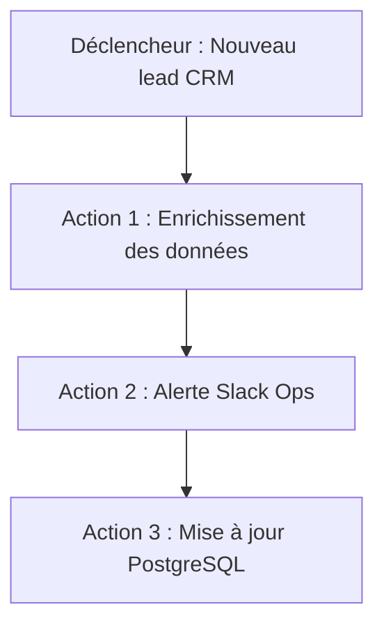
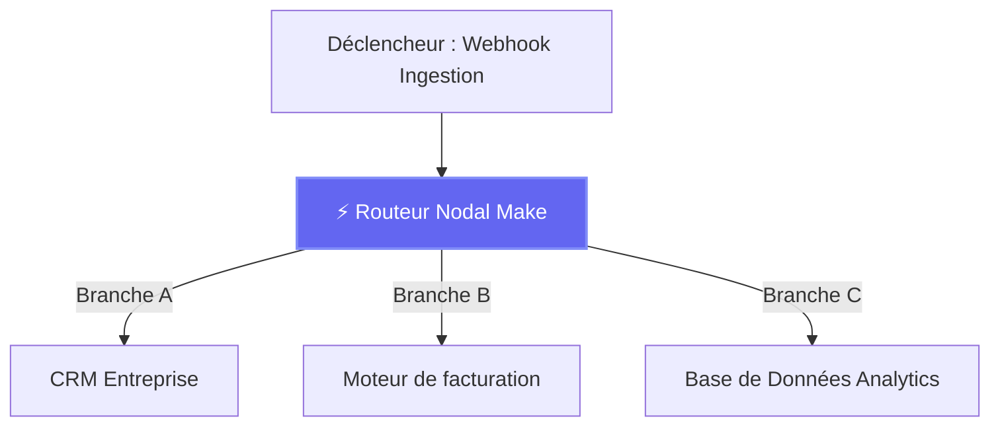

# Duel : Make vs Zapier : L'audit technique des automatisations d'entreprise en 2026

En tant qu'architecte systèmes et responsable technique senior pour HeliaTech Media, j'évalué chaque année des centaines de pipelines logiciels d'entreprise. Dans l'écosystème de l'intégration sans code, la dichotomie opérationnelle entre **Make** et **Zapier** a dépassé la simple check-list de fonctionnalités. Nous ne débattrons plus de la possibilité d'automatiser des workflows, mais de l'efficacité avec laquelle les systèmes passent à l'échelle sous de fortes volumétudes, des transformations JSON complexes et des contraintes budgétaires strictes.

Cet audit propose une analyse empirique, sans filtre marketing, des deux architectures, soutenue par des calculs de rentabilité financière et une évaluation de l'ergonomie développeur en conditions réelles d'entreprise.

---

## Verdict exécutif (Le résumé en 30 secondes)

*   **Choisissez Make ([/go/make](/go/make)) si :** Votre infrastructure exige des branchements multi-chemins complexes, des boucles itératives sur des tableaux (arrays), un mapping de données personnalisé sans stockage intermédiaire, et un traitement à haut volume où l'efficacité opérationnelle impacte directement vos marges brutes. Make s'adresse aux ingénieurs en automatisation, aux leads Ops et aux développeurs qui traitent les flux de travail comme de l'architecture système.
*   **Choisissez Zapier ([/go/zapier](/go/zapier)) si :** Votre vitesse de déploiement repose sur des départements métiers (marketing, sales, RH) capables de créer leurs propres connexions point à point sans formation préalable. Zapier s'impose lorsque vous avez besoin d'accéder à l'écosystème le plus large possible d'outils SaaS obscurs, d'agents IA conversationnels pré-intégrés et de garde-fous de conformité gérés par une DSI centralisée.

---

## Matrice comparative côte à côte

| Critères empiriques | Make ([/go/make](/go/make)) | Zapier ([/go/zapier](/go/zapier)) |
| :--- | :--- | :--- |
| **Architecture de base** | Canevas nodal visuel (DAG - Graphe orienté acyclique) | Pipelines séquentiels [linéaires](/reviews/linear) ("Zaps") |
| **Coût à l'échelle (50k+ ops)** | Très économique ; opérations facturées strictement par exécution de module | Tarification premium ; s'envole rapidement selon le nombre de tâches multi-étapes |
| **Courbe d'apprentissage** | Modérée à raide (Compréhension de base requise : JSON, tableaux, itérateurs) | Douce (Interface intuitive en mode assistant form-based) |
| **API & Webhooks** | Module HTTP natif supportant en-têtes personnalisés, OAuth et payloads bruts | Webhooks natifs limités ; forte dépendance aux déclencheurs d'applications prédéfinis |
| **Écosystème & Nombre d'apps** | 1 500+ apps + connecteurs universels HTTP/GraphQL | 6 000+ applications natives pré-intégrées |
| **Transformation de données** | Fonctions avancées intégrées, regex, mapping de tableaux et parsing JSON | Analyse de texte basique, formateurs et gestion limitée des lignes de commande |
| **Gestion des erreurs & Reprise** | Chemins de routage d'erreurs granulaires, rollbacks automatisés et options de pause sur échec | E-mails d'erreur [linéaires](/reviews/linear), désactivation auto après échecs consécutifs |
| **Sécurité & Conformité** | SOC 2 Type II, RGPD, ISO 27001, contrôles de souveraineté des données (data residency) | SOC 2 Type II, SSO SAML d'entreprise, contrôles admin avancés |
| **Idéal pour** | Manipulation complexe de données, charges à haut volume, logique multi-branches | Intégration rapide d'apps, équipes non techniques, synchronisation SaaS prête à l'emploi |

---

## Round 1 : Architecture et paradigmes de workflow (Audit technique)

La divergence fondamentale entre Make et Zapier réside dans leur mode d'exécution des instructions. Cette conception architecturale dicte tout, de la gestion des payloads à l'atténuation des erreurs.

### Zapier : Le pipeline séquentiel
Zapier fonctionne selon un paradigme strictement linéaire. Un "Zap" est fondamentalement une file d'attente séquentielle : **Déclencheur $\rightarrow$ Action 1 $\rightarrow$ Action 2 $\rightarrow$ Action *N***.

*   **Le goulet d'étranglement architectural :** Bien que Zapier ait introduit des chemins (paths) et des sous-étapes, le traitement de données nécessitant une logique conditionnelle complexe, des boucles ou l'agrégation de payloads JSON hétérogènes entraîne des acrobaties structurelles. Si vous devez évaluer un tableau de 50 lignes d'une facture e-commerce, appliquer des remises conditionnelles à chacune et les écrire dans des tables relationnelles distinctes, un pipeline Zapier linéaire devient lourd, difficile à déboguer et enclin à casser sur les cas limites.
*   **L'avantage ergonomique :** Pour 80 % des tâches métiers — comme pousser un profil client Stripe vers HubSpot et envoyer un e-mail de confirmation — ce modèle linéaire minimise la charge cognitive.

### Make : Le canevas nodal visuel (DAG)
Make utilise un canevas de type Graphe Orienté Acyclic (DAG). Les workflows sont cartographiés spatialement, permettant aux données de circuler simultanément à travers des nœuds de routage complexes, des agrégateurs, des filtres et des itérateurs.

*   **Le triomphe architectural :** Make traite les données sous forme de "paquets" (bundles) circulant dans les chemins d'exécution. Vous pouvez ingérer un payload JSON profondément imbriqué et le manipuler avec une précision chirurgicale sans saturer la mémoire.