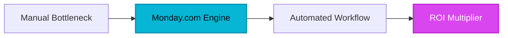

## Introduction

T<b>he modern enterprise is drowning in operational static.</b> For decades, organizations attempted to solve their complex workflow challenges by bolting together disparate tools—an issue tracker here, a spreadsheet there, a chat application for emergencies, and an expensive CRM that nobody outside of sales bothered to update. The result was not clarity, but cognitive fatigue. Teams spent more time orchestrating work across disconnected silos than actually executing it. Out of this chaotic technological sprawl emerged a new philosophy: the Work Operating System, designed not just to track tasks, but to mirror the living, breathing heartbeat of a company's operations. Among the pioneers redefining this space, Monday.com stands out as a visual powerhouse that bridges the gap between rigid enterprise resource planning and flexible, human-centric productivity.

> [!NOTE]
> [!NOTE]
> [!NOTE]
> **Executive Takeaway:** **Executive Takeaway:** **Executive Takeaway:** "We didn’t set out to build another task manager. We wanted to build a digital canvas where any team—from a three-person startup to a Fortune 500 enterprise—could architect their own reality without writing a single line of code." — *Enterprise Product Manifesto*

---

## 1. The Genesis & Evolution: From Startup Canvas to Enterprise Work OS

Founded in Tel Aviv as dapulse, Monday.com was born out of a visceral frustration with the tools available to modern teams in the early 2010s. The founders realized that traditional project management software was built for project managers, not for the actual humans doing the work. Legacy dinosaurs like Microsoft Project and early enterprise tools imposed a rigid, bureaucratic structure that forced teams to adapt to the software, rather than the other way around.

The spark of disruption was radical simplicity paired with radical flexibility. By introducing a color-coded, visual grid system powered by customizable columns, dapulse—which later rebranded to Monday.com—transformed dry databases into interactive command centers. As the platform matured, it quietly expanded its aperture. It evolved from a visual task tracker into a comprehensive Work OS capable of hosting CRM pipelines, software development sprints, marketing calendars, and custom internal tools.

By prioritizing user experience and bottom-up adoption, Monday.com completely upended the traditional enterprise software sales cycle. Instead of waiting for top-down C-suite mandates, departments began adopting the platform organically because it simply felt better to use. This consumer-grade design ethos, combined with enterprise-grade security and scalability, allowed Monday.com to disrupt legacy giants and cement its place as a cornerstone of the modern SaaS stack.

---

## 2. Core Business Superpowers

To understand why organizations migrate thousands of workflows to Monday.com, one must look at the structural superpowers that directly impact the enterprise bottom line:

*   **Extremely Flexible Column Types and Board Views:** Unlike traditional databases that lock you into rigid schemas, Monday.com treats columns as modular building blocks. Teams can effortlessly swap between Kanban boards, Gantt charts, Timeline views, Workload trackers, and mapping tools in real-time, tailoring every perspective to the exact stakeholder looking at the screen.
*   **Powerful, Intuitive No-Code Automation Builder:** Operational drag is the silent killer of enterprise productivity. Monday.com’s visual automation recipe builder allows teams to connect repetitive triggers (e.g., "When status changes to Done, move item to Archive and notify Team Lead") in seconds. This eliminates thousands of hours of manual follow-ups and human oversight errors annually.
*   **Comprehensive Ecosystem of Pre-Built Templates:** Speed-to-value is critical. Whether you are spinning up an agile marketing campaign, tracking complex IT infrastructure rollouts, or managing an enterprise sales funnel, Monday.com offers rigorously tested templates that deploy fully functioning workflows in under sixty seconds.
*   **Visual Dashboards for Real-Time Financial & Status Tracking:** Executive reporting no longer requires tedious compilation of status updates. Monday.com aggregates data across multiple boards into dynamic, customizable widgets that track budgets, project velocity, and resource allocation at a single glance.

---

> [!TIP]
> [!NOTE]
> [!NOTE]
> **Executive Takeaway:** **Executive Takeaway:** **HeliaTech Benchmark Access:** Test `Monday.com` with our verified enterprise trial link at [/go/monday-com](/go/monday-com).

> [!TIP]
> [!NOTE]
> **Executive Takeaway:** **HeliaTech Benchmark Access:** Test `Monday.com` with our verified enterprise trial link at [/go/monday-com](/go/monday-com).

> [!TIP]
> **HeliaTech Benchmark Access:** Test `Monday.com` with our verified enterprise trial link at [/go/monday-com](/go/monday-com).

## 3. Hands-on Workshop: The 15-Minute Enterprise Blueprint

Let’s translate theory into execution. Follow this step-by-step masterclass to architect a high-performance cross-functional project hub in under 15 minutes.

### Step 1: Initialize Your Workspace and Board
1. Log into your [Monday.com account](/go/monday-com) and create a dedicated Workspace named `[Your Company] Q4 Operations`.
2. Click **Add new board**, select **Main** (visible to your team), and choose the **Blank Board** template to maintain full architectural control.

### Step 2: Configure Modular Column Types
Transform the default grid into a dynamic tracking engine by adding these essential columns:
*   **People Column:** Assign specific owners to ensure accountability.
*   **Status Column:** Customize labels to reflect your actual pipeline (`Backlog`, `In Progress`, `Under Review`, `Client Sign-Off`, `Archived`).
*   **Timeline Column:** Establish hard start and end dates for visual Gantt tracking.
*   **Numbers / Budget Column:** Input estimated operational costs for high-level financial rollups.

### Step 3: Engineer Your First No-Code Automation
Click the **Automations** button in the top right corner of your board and build this foundational recipe:
*   *When* **Status** becomes `Client Sign-Off`,
*   *Then* **Move item** to group `Completed Projects` **AND** **Send email** to `Project Sponsor`.

### Step 4: Aggregate Data with a Master Dashboard
1. Click **Add view** on the left panel of your workspace and select **Dashboard**.
2. Add a **Battery Widget** to track overall task completion percentages.
3. Add a **Numbers Widget** linked to your Budget column to automatically calculate total project expenditures in real-time.

---

## 4. Critical Assessment & Trade-offs

Every enterprise tool involves architectural compromises. Here is an objective breakdown of Monday.com’s strengths alongside its notable limitations:

| Feature Domain | Strengths | Limitations | Strategic Impact |
| :--- | :--- | :--- | :--- |
| **Pricing & Licensing** | Highly scalable tiers with robust core features. | Sharp pricing jumps based on strict seat minimum blocks (e.g., blocks of 3 or 5). | Requires careful user provisioning to avoid paying for dormant seats. |
| **Governance & Customization** | Infinite flexibility to build custom workflows and internal tools. | Can easily become cluttered or disorganized without strict workspace governance. | Demands internal administrative oversight to maintain cleanliness. |
| **Advanced Capabilities** | Sophisticated formulas, cross-board dependencies, and API access. | Advanced features are locked behind higher-tier enterprise subscription plans. | Teams must evaluate ROI before scaling up to Pro/Enterprise tiers. |

---

## 5. HeliaTech Final Verdict & Recommendation

Monday.com has successfully transcended its origins as a trendy task manager to become a definitive Work OS for the modern enterprise. Its unique blend of consumer-grade visual appeal and robust, no-code backend power makes it an indispensable asset for organizations looking to eliminate operational friction and accelerate team velocity.

**Executive Recommendation:** If your organization suffers from tool fragmentation, manual coordination drag, and disjointed reporting, Monday.com is an exceptional investment. While teams must enforce strict workspace governance to prevent board proliferation, the ROI gained through streamlined automation and real-time visibility pays for itself within the first quarter of deployment.

Ready to transform your company's operational workflow? [Claim Your Free Monday.com Account Today ➔](/go/monday-com)
