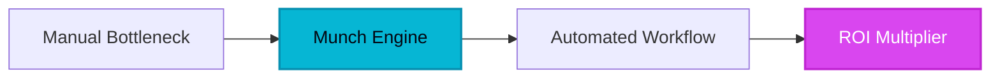

Harnessing the power of the attention economy has become the single most expensive endeavor for modern marketing departments. For years, the workflow was a grueling, manual slog: record a sixty-minute podcast, hand it to a junior editor, wait forty-eight hours for a rough cut, and hope—by some stroke of luck—that the chosen thirty-second clip resonates with the TikTok algorithm. This fragmentation of effort and outcome created a massive human bottleneck. Companies were sitting on mountains of long-form gold but lacked the machinery to refine it into the high-velocity currency of short-form video. Enter Munch, the AI-driven powerhouse that didn't just build a better editor; it built a brain for content repurposing.

## 1. The Genesis & Evolution: From Manual Splicing to Contextual Intelligence

In the legacy era of digital video, tools like Adobe Premiere and Final Cut Pro reigned supreme. They were powerful, but they were 'dumb.' They didn't know if a speaker was telling a joke, delivering a profound insight, or simply coughing. The genesis of Munch was born out of this specific void: the need for software that *understands* language and cultural trends. 

The founders of Munch recognized that the barrier to viral success wasn't the quality of the camera—it was the efficiency of the extraction. While legacy dinosaurs focused on more transitions and color grading, Munch pivoted toward context analysis. By integrating Large Language Models (LLMs) with visual tracking, they disrupted the market by offering a platform that could actually predict which segments of a video would perform best based on current social media trends. It transformed the editor from a manual laborer into a strategic curator.

## 2. Core Business Superpowers: Scaling Content Without Scaling Headcount

For the enterprise B2B strategist, Munch offers three distinct superpowers that translate directly to the bottom line:

*   **Predictive Contextual Intelligence:** Unlike basic 'silence removers,' Munch analyzes your video against real-time social media data. It identifies keywords and topics that are currently trending on platforms like Instagram and TikTok, ensuring your clips aren't just well-edited, but strategically relevant.
*   **Automated Smart-Cropping (9:16 Optimization):** The transition from 16:9 landscape to 9:16 portrait is usually a nightmare of keyframing. Munch’s AI tracks the speaker’s face and movements, keeping them perfectly centered in the vertical frame automatically. 
*   **End-to-End Content Pipeline:** Munch isn't just an extraction tool; it's a distribution hub. With high-quality auto-captioning in multiple languages and direct publishing to social platforms, it collapses the 'create-edit-post' cycle from days into minutes.

> [!NOTE]
> **Executive Takeaway:** "The future of content isn't about making more; it's about making what you already have work ten times harder. Munch is the engine for that leverage."

## 3. Hands-on Workshop: The 15-Minute Content Blueprint

Ready to turn your latest webinar into a month's worth of social content? Follow this blueprint:

1.  **The Ingestion Phase:** Upload your long-form video (YouTube link or raw file). Select your target platforms (e.g., TikTok, Instagram Reels) to let the AI know which algorithms to optimize for.
2.  **Contextual Analysis:** Allow Munch to scan the file. Within minutes, it will present a list of 'clips' ranked by a 'Viral Score.' Review these scores—they are based on current keyword trends and engagement patterns.
3.  **Brand Alignment:** Use the 'Snippet Editor' to apply your brand kit. Choose your fonts, colors, and caption styles. Munch’s auto-captions are remarkably accurate, but this is where you'll do a quick 2-minute pass to ensure technical jargon is perfect.
4.  **Omnichannel Deployment:** Once satisfied, use the built-in scheduler. You can push your clips directly to your social accounts or download them for manual upload. 

## 4. Critical Assessment & Trade-offs

No tool is a silver bullet. Here is our objective breakdown of where Munch shines and where it hits the ceiling:

| Feature | Strength | Limitation |
| :--- | :--- | :--- |
| **AI Analysis** | Superior context awareness and trend matching. | Can occasionally miss the nuance of dry, academic humor. |
| **Cropping** | Flawless face-tracking for 9:16 conversion. | Complex multi-person panels may require manual adjustment. |
| **Captions** | High-speed, multi-language support. | Technical industry jargon sometimes requires manual review. |
| **Pricing** | Massive ROI for mid-sized agencies. | Can become expensive for high-volume enterprise users. |
| **Editing** | Streamlined for speed and social. | Not a replacement for full-featured NLE software (Premiere). |

## 5. HeliaTech Final Verdict & Recommendation

At HELIA TECH, we evaluate software through the lens of **Content Velocity**. Does this tool help you move faster without sacrificing quality? Munch is a resounding 'Yes.' 

While traditionalists might argue for the 'hand-crafted' feel of manual editing, the data suggests that in the world of social media, volume and relevance trump cinematic perfection. Munch provides the contextual bridge that other AI tools lack. It is the ideal solution for B2B brands, podcasters, and marketing agencies who need to maintain a relentless social presence without burning out their creative teams.

**Executive Recommendation:** If you are producing more than two hours of video content per month, the time saved by Munch will pay for the subscription within the first thirty days. Stop sitting on your archive. Start munching it.

[Claim Your Free Munch Account ➔](/go/munch)
