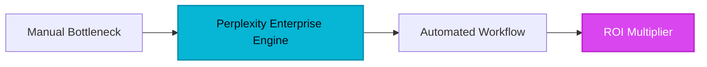

# Perplexity Enterprise: The End of Search and the Dawn of the Answer Engine for High-Stakes Teams

F**or decades, the search bar was a slot machine.** You entered a keyword, pulled the lever, and prayed the first page of Google wasn't a minefield of SEO-optimized blog spam and sponsored distractions. For the modern knowledge worker, this "search and rescue" mission for data consumed up to 20% of the workweek. But the paradigm has shifted. We have moved past the era of the "Search Engine" and entered the era of the "Answer Engine."

At the epicenter of this earthquake is **Perplexity Enterprise**. While the consumer world uses AI to write poems or generate images, the enterprise world is using Perplexity to dismantle the research bottleneck. It is no longer about finding a link; it is about synthesizing the truth.

## 1. The Genesis & Evolution: From Academic Curiosity to Corporate Necessity

Perplexity wasn't born in a marketing lab; it was forged in the fires of high-level engineering. Founded in 2022 by alumni from OpenAI, Meta, and Quora—including CEO Aravind Srinivas—the tool was built on a simple, radical premise: what if an LLM was tethered to the live internet with the rigor of an academic citation?

While legacy dinosaurs like Google scrambled to protect their ad-revenue-driven link economy, Perplexity took the opposite route. They prioritized the *answer*. By combining the conversational fluidity of a transformer model with a sophisticated real-time indexing engine, they created a tool that doesn't just guess—it researches. 

In 2024 and 2025, as "hallucination" became the buzzword of corporate fear, Perplexity Enterprise emerged as the antidote. It didn't just offer an AI chat; it offered a verifiable audit trail. This evolution from a niche developer tool to a multi-billion dollar enterprise staple marks the biggest shift in information retrieval since the birth of the crawler.

> [!NOTE]
> **Executive Takeaway:** "The mission is to build the world’s most transparent and useful information discovery platform. In a world of noise, we provide the signal with the receipts to back it up."

## 2. Core Business Superpowers: Why High-Velocity Teams are Migrating

Perplexity Enterprise isn't just "ChatGPT with Google search." It is a specialized research environment. Here are the three pillars that justify its seat at the executive table:

### A. Verifiable Real-Time Intelligence
Unlike standard LLMs with data cut-off dates, Perplexity lives in the *now*. For a B2B strategist, this means instant analysis of today's earnings calls, this morning's regulatory shifts, or the latest competitor pricing update. Every claim made by the AI is backed by an inline citation. You click the number, you see the source. It eliminates the "trust me" factor of AI.

### B. Model Agnosticism & Flexibility
One of Perplexity’s most underrated strengths is its lack of ego. In the Enterprise tier, users can toggle between the world's most powerful models—**GPT-4o, Claude 3.5 Sonnet, and Perplexity’s own proprietary models**. This allows teams to choose the 'brain' that best fits the task: Claude’s creative nuance for report drafting or GPT-4o’s analytical rigor for data synthesis.

### C. The Ironclad Privacy Moat
The primary barrier to AI adoption in the Fortune 500 is data leakage. Perplexity Enterprise solves this with a strict zero-training policy. Your internal queries, your uploaded PDFs, and your proprietary market research are never used to train the underlying models. It is a secure silo for your company’s intellectual property.

## 3. Hands-on Workshop: The 15-Minute Market Intelligence Blueprint

*How to use Perplexity Enterprise to conduct a deep-dive competitive analysis in a fraction of the traditional time.*

1.  **Step 1: Initialize the 'Collection'** – Create a shared Collection named "Q4 Competitor Intel." Invite your strategy team. This ensures all research history and uploaded source files are shared in a centralized, searchable workspace.
2.  **Step 2: The Multi-Step 'Pro Search'** – Toggle on **Pro Search**. Enter a complex query: *"Analyze the last three quarters of [Competitor X]'s revenue growth, specifically looking for shifts in their SaaS vs. Professional Services mix. Compare this to the current industry average for 2026."*
3.  **Step 3: Refine and Synthesize** – Perplexity will ask clarifying questions (e.g., "Which specific regions should I focus on?"). Answer them. The tool will then crawl dozens of sources—news, SEC filings, and press releases—to build a comprehensive table.
4.  **Step 4: Internal Knowledge Integration** – Upload your own internal sales reports (PDF/Excel) into the Collection. Ask: *"Based on the external market data found, where are the gaps in our own current product roadmap?"*
5.  **Step 5: Export to Execution** – Use the 'Copy to Markdown' or 'Share Link' feature to move this synthesis directly into your team’s Notion, Slack, or executive slide deck.

## 4. Critical Assessment & Trade-offs

| Feature | Strength | Limitation |
| :--- | :--- | :--- |
| **Search Accuracy** | Exceptional; uses multi-source verification and real-time indexing. | Occasionally over-relies on high-SEO news sites if primary sources are gated. |
| **Privacy** | SOC2 Type 2 compliance; data is never used for training. | Higher cost per seat compared to basic ChatGPT Team accounts. |
| **Model Variety** | Access to GPT-4o, Claude, and more in one UI. | Switching models can sometimes lead to inconsistent formatting across long threads. |
| **Collaboration** | Collections feature provides a 'Shared Brain' for teams. | Limited advanced project management or task-tracking integrations. |

## 5. HeliaTech Final Verdict & Recommendation

**Perplexity Enterprise is the single most important tool for the 'Information Class' in 2026.** 

If your team’s value is derived from the speed and accuracy of their insights—be it in law, finance, marketing, or engineering—you cannot afford to stay tethered to traditional search. While the pricing is premium, the ROI is found in the hundreds of hours saved on manual source verification and the mitigation of 'hallucination risk.'

**The Recommendation:** Deploy Perplexity Enterprise for your strategy, research, and executive teams immediately. It is the bridge between a world of fragmented data and a future of actionable intelligence.

[Claim Your Free Perplexity Enterprise Account ➔](/go/perplexity-enterprise)
