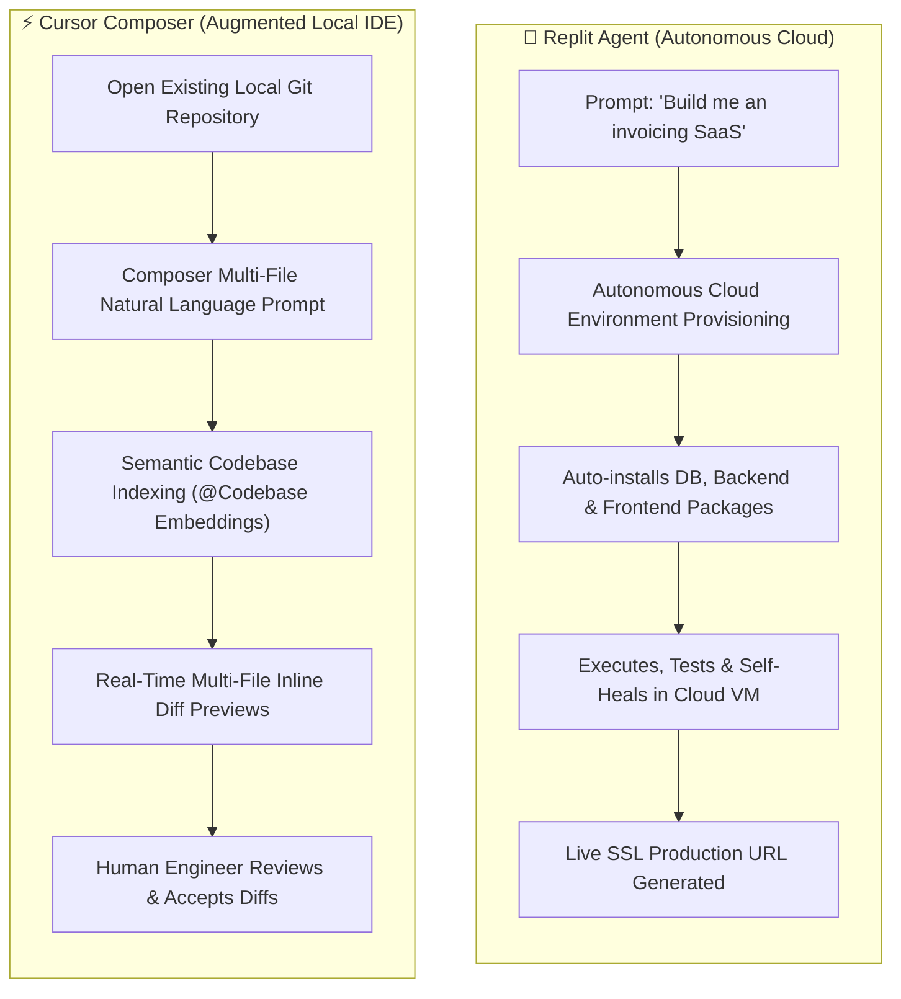
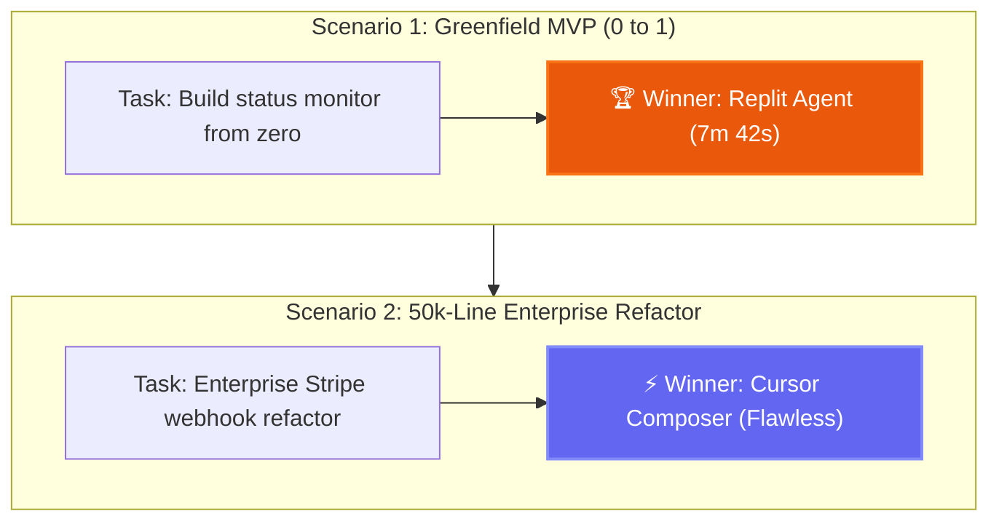
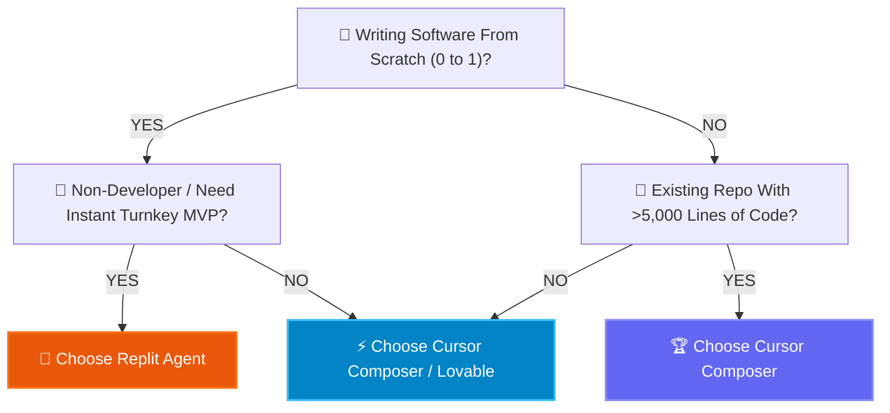

**The AI coding wars of 2026 have split the software industry into two diametrically opposed camps.** 

On one side stand the proponents of **Total Autonomy**: why should a human ever install Node.js, configure a Docker container, or clone a Git repository when an autonomous agent can orchestrate the entire cloud lifecycle? This philosophy is championed by **Replit Agent**.

On the other side stand the advocates of **Augmented Mastery**: why would an experienced engineer surrender control to a black-box cloud sandbox when an intelligent, repository-aware IDE can accelerate human velocity tenfold without sacrificing architectural rigor? This philosophy is spearheaded by **Cursor Composer**.

Both tools represent the cutting edge of modern software creation, yet they solve fundamentally different problems for distinct buyer personas. In this HeliaTech forensic benchmark, we compare Replit Agent and Cursor Composer across architecture, real-world bug recovery, pricing economics, and production reliability.

---

## 1. The Autonomous Agent vs The Augmented IDE

To understand the divide, we must examine the user workflow required by each tool.

### Replit Agent: The "Zero-Setup" Autonomous Contractor
Replit Agent does not ask you to install anything on your laptop. You open a browser tab, describe your project in plain English, and watch the agent:
1. Spin up a cloud Linux container with isolated memory and compute.
2. Choose the appropriate framework (FastAPI, Next.js, Express, PostgreSQL).
3. Run terminal installations, compile the codebase, and read terminal stdout/stderr.
4. Detect its own syntax or dependency errors, recursively rewrite files, and restart the server until the app responds with HTTP 200.
5. Deploy the application to a live public URL with SSL certificates configured in under five minutes.

### Cursor Composer: The "High-Fidelity" Engineering Cockpit
Cursor, a specialized fork of VS Code, rejects the premise that software engineering should be hidden from the developer. Instead of acting as an autonomous black box, Cursor’s **Composer mode** operates as a pair programmer with a photographic memory of your entire repository:
1. It indexes your entire project using local vector embeddings (`@Codebase`), understanding types, imports, and interface contracts.
2. When prompted, it generates concurrent diffs across dozens of files simultaneously.
3. It displays clear, inline green/red diffs that allow the human engineer to review architectural decisions line-by-line before committing.
4. You retain total control over your local terminal, Docker containers, private keys, and CI/CD pipelines.

---

## 2. Real-World Benchmark: Greenfield MVP vs Brownfield Refactoring

We subjected both platforms to two rigorous operational tests.

### Benchmark 1: Greenfield Project (0 to 1 MVP)
* **The Task:** Build a SaaS status page monitor that pings five URLs every 60 seconds, stores response times in SQLite, and displays a responsive Tailwind chart with email alerts on downtime.
* **Replit Agent Result:** **Completed in 7 minutes and 42 seconds.** The agent automatically provisioned a Python FastAPI backend, wired SQLite, installed Chart.js on the frontend, debugged a CORS mismatch automatically, and delivered a working public URL without touching a single local setting.
* **Cursor Composer Result:** **Completed in 14 minutes.** While Cursor wrote flawless code, the human operator still had to manually run `pip install`, set up the virtual environment, start the server, and handle port forwarding.
* **Winner:** **Replit Agent** (Substantially faster time-to-first-working-URL for non-technical founders).

### Benchmark 2: Brownfield Refactoring (Scaling an Existing Production System)
* **The Task:** In an existing 45,000-line Next.js TypeScript repository, refactor a legacy Stripe billing webhook handler to support metered usage tiers, update database schemas with D1 migrations, and fix broken unit tests.
* **Replit Agent Result:** **Failed.** Importing a massive 45,000-line enterprise repository into Replit's cloud environment caused context limits to overflow. The agent repeatedly misunderstood existing monorepo dependencies and attempted to rewrite core utilities that broke unrelated microservices.
* **Cursor Composer Result:** **Flawless Execution.** Using semantic codebase search (`@Codebase`) and targeted file references, Cursor Composer accurately tracked the TypeScript interfaces across 8 files, refactored the Stripe webhooks, updated the migrations, and kept all existing tests green.
* **Winner:** **Cursor Composer** (The undisputed champion for enterprise-scale codebases). Read our deep dive in the [Cursor Evolution Guide](/blog/cursor-evolution-guide-2026/).

---

## 3. Direct Feature Comparison Matrix

| Capability Dimension | Replit Agent | Cursor Composer | Tactical Advantage |
| :--- | :---: | :---: | :--- |
| **Primary User Persona** | Founders, PMs, Rapid Hackers | Full-Stack Engineers, Tech Leads | Depends on technical proficiency |
| **Local Environment Needed** | No (100% Cloud-based) | Yes (Runs locally on Mac/PC/Linux) | **Replit** (Zero friction) |
| **Git Integration** | Built-in basic Git | Full native Git / GitHub / GitLab | **Cursor** (Enterprise version control) |
| **Multi-File Diffs** | Auto-applied in background | Interactive Line-by-Line Diffs | **Cursor** (Prevents silent bugs) |
| **Underlying Models** | Claude 3.5 Sonnet / Custom Agent | Claude 3.7 / GPT-4o / DeepSeek / Custom API | **Cursor** (Model flexibility) |
| **Database Provisioning** | Automated cloud PostgreSQL | Developer connects local/cloud DB | **Replit** (Instant DB setup) |
| **Offline Development** | Impossible (Requires active cloud) | Yes (Code locally, AI runs on network) | **Cursor** (Local resilience) |

---

## 4. Financial Economics: Pricing & Compute Costs

One of the most frequent complaints regarding autonomous AI coding is the unpredictability of usage-based billing.

### Replit Agent Cost Breakdown
* **Replit Core Subscription:** ~$20 to $25/month.
* **Agent Compute Credits:** Replit Agent consumes "Checkpoints" and computational tokens for each autonomous cycle.
* **The Real-World Bill:** Building a modest MVP typically consumes between $10 and $30 in agent compute credits. If the agent gets stuck in a recursive debugging loop trying to solve a circular dependency, a single afternoon can burn $50+ in credits if not closely monitored.

### Cursor Composer Cost Breakdown
* **Cursor Pro Subscription:** Flat $20/month.
* **Usage Quota:** Includes 500 fast requests per month with frontier models (Claude 3.5 Sonnet / Claude 3.7), followed by unlimited slow requests.
* **BYOK (Bring Your Own Key):** Cursor uniquely allows developers to enter their personal Anthropic or OpenAI API keys, paying raw wholesale token rates once the included quota is exhausted.
* **The Real-World Bill:** Extremely predictable. Professional software engineers rarely exceed the $20 flat subscription unless utilizing high-throughput composer automation daily.

> [!TIP]
> Compare developer infrastructure expenses and calculate team ROI using the [HeliaTech SaaS Cost Matrix](/calculator/).

---

## 5. Security, IP Ownership & Enterprise Compliance

For established businesses, code security is non-negotiable.

### The Replit Cloud Risk Profile
When utilizing Replit Agent, your source code, configuration files, environment variables, and database assets reside on Replit's multi-tenant cloud infrastructure. While Replit enforces strict enterprise container isolation, many regulated industries (finance, healthcare, defense) prohibit hosting proprietary IP on public sandbox platforms without customized SOC2 Type II and HIPAA data processing agreements.

### The Cursor Local Privacy Paradigm
Cursor offers a dedicated **Privacy Mode**. In Privacy Mode:
* Your source code is never stored on Cursor's servers.
* Code snippets are transmitted via encrypted TLS directly to model inference endpoints and discarded immediately after processing.
* Zero customer data is utilized for AI model training.
* All build artifacts, compiled binaries, and proprietary database connections remain strictly confined to your local workstation.

> [!WARNING]
> **Enterprise Mandate:** Never paste production database production strings containing live customer PII into Replit Agent prompts. Always configure secrets through encrypted environment variables.

---

## 6. The Verdict: How to Choose in 2026

### Choose Replit Agent If:
1. You are a **solo entrepreneur, marketer, or designer** who wants to test an idea without learning Git, Docker, terminal commands, or hosting configurations.
2. You need to prototype a **functional proof-of-concept in front of an investor or client** within a single hour.
3. You prefer an **all-inclusive cloud platform** that bundles compute, database, and public hosting in one monthly bill.

### Choose Cursor Composer If:
1. You are a **professional developer, engineering team, or agency** maintaining production-critical systems.
2. You require **microscopic control over code diffs, architecture, test suites, and Git branches**.
3. You demand **predictable flat-rate pricing ($20/mo)** and the freedom to bring your own API keys.
4. Your enterprise enforces **strict data privacy and on-premise security governance**.

By aligning the right tool with your project's lifecycle, you unlock maximum development velocity without sacrificing software stability.
