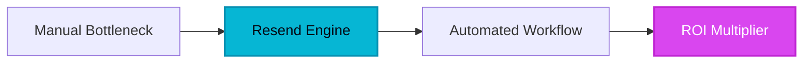

<b>E</b>very software engineer who has ever wrestled with building transactional emails knows the soul-crushing despair of ancient HTML tables, inline CSS hacks, and Outlook rendering bugs. For decades, integrating email into a modern web application meant dealing with legacy dinosaurs whose APIs felt like they were engineered in the late 1990s, offering bloated dashboards, Byzantine documentation, and documentation that read like a legal contract.

Before Resend entered the market, engineering teams lost countless sprints fighting with fragmented SMTP servers and broken markup. The human bottleneck wasn't just writing backend logic; it was bridging the chasm between modern frontend frameworks like React and the archaic world of email clients. Resend arrived to rewrite the rules, providing an email API and delivery platform built specifically for developers who demand clean design, instant feedback loops, and bulletproof deliverability.

> [!NOTE]
> **Executive Takeaway:** "We didn't just want to build another SMTP relay. We wanted to give developers the exact tool we wished we had: an email platform that feels like it belongs in the modern JavaScript and React ecosystem." — Resend Engineering Philosophy

## 1. The Genesis & Evolution: Dislodging the Dinosaurs

When Zeno Rocha and the founding team set out to build Resend, the email infrastructure market was stagnant. Incumbents like SendGrid, Mailgun, and Amazon SES dominated the landscape, but their user experience was tailored for enterprise compliance officers and legacy IT administrators rather than modern product engineers. Documentation was dense, onboarding required navigating labyrinthine UI screens just to send a test message, and styling emails meant reverting to 2004-era web development practices.

Resend was born from a simple thesis: email is code, and it should be treated with the same modern tooling, version control, and component-driven architecture as the rest of a web application. By stripping away the bureaucratic cruft of legacy platforms and leaning heavily into the JavaScript/TypeScript ecosystem, Resend quickly captured the mindshare of forward-thinking startups and enterprise engineering teams alike. It turned email from a dreaded chore into a delightful, programmatic experience.

## 2. Core Business Superpowers

For engineering leaders and CTOs, adopting Resend translates into immediate ROI by shrinking maintenance overhead and eliminating the hidden costs of poor deliverability. Here are the core pillars that drive enterprise efficiency:

* **Native React Component Templating:** Write your emails using standard React components via React Email. Say goodbye to inline CSS hacks and hello to reusable buttons, containers, and typography that render flawlessly across desktop, mobile, and webmail clients.
* **Modern API Architecture & SDKs:** A pristine, well-documented REST API accompanied by official, type-safe SDKs for Node.js, Python, Ruby, and PHP. Integration takes minutes, not weeks, drastically reducing time-to-market for new features.
* **Guided Domain Authentication:** Onboarding includes crystal-clear instructions for setting up SPF, DKIM, and DMARC records. This proactive stance on domain reputation drastically minimizes the risk of your transactional messages landing in the spam folder.
* **Real-Time Visibility Dashboard:** A blazing-fast UI providing instant insights into delivery status, open rates, click tracking, and comprehensive event logs without the sluggish load times characteristic of legacy tools.

> [!TIP]
> **HeliaTech Benchmark Access:** Test `Resend` with our verified enterprise trial link at [/go/resend](/go/resend).

## 3. Hands-on Workshop (15-Minute Blueprint)

Integrating Resend into your production workflow requires minimal friction. Follow this executive blueprint to transition your application from a legacy relay to Resend's high-velocity platform:

1. **Account Provisioning & Domain Verification:** Navigate to the Resend dashboard via our exclusive partnership link, create your organization, and add your sending domain. Follow the guided prompt to input your DNS provider's SPF and DKIM CNAME records.
2. **API Key Generation:** Generate a restricted production API key with targeted sending permissions. Store this securely in your environment variables (`RESEND_API_KEY`).
3. **SDK Integration:** Install the official package in your backend environment (e.g., `npm install resend` for Node.js applications).
4. **Templating with React:** Construct your email layouts using React Email components, ensuring responsive design out of the box.
5. **Dispatch & Monitor:** Wire up your backend routing logic to trigger the Resend send function upon user actions (such as password resets or invoice generation), and monitor delivery live in the real-time dashboard logs.

## 4. Critical Assessment & Trade-offs

No enterprise tool is without compromises. To make an informed architectural decision, review how Resend stacks up against industry alternatives in our objective assessment table:

| Evaluation Metric | Resend | Legacy Incumbents (SendGrid / Mailgun) | Amazon SES |
| :--- | :--- | :--- | :--- |
| **Developer Experience** | Exceptional (React-first, modern SDKs) | Moderate to Poor (Dated documentation) | Low (Raw API, complex AWS IAM setup) |
| **Dashboard UI** | Fast, clean, real-time analytics | Cluttered, enterprise-heavy interfaces | Functional, highly technical console |
| **Free Tier Volume** | Moderate volume suited for growth | Generous legacy tiers | Extremely high volume at pennies per thousand |
| **Ecosystem Maturity** | Rapidly expanding, modern standard | Decade-old incumbent infrastructure | Massive cloud infrastructure backbone |

## 5. HeliaTech Final Verdict & Recommendation

Resend represents a generational leap forward in developer tooling. By bridging the gap between frontend component design and backend email delivery, it eliminates friction points that have plagued engineering teams for decades. While its free tier and advanced enterprise feature sets are tailored for modern agile teams rather than traditional high-volume bulk mailers, its unmatched developer ergonomics make it the definitive choice for modern SaaS products.

**Executive Recommendation:** If your engineering team values velocity, clean architecture, and pristine inbox placement, migrating your transactional infrastructure to Resend is a high-yield decision that pays for itself in saved developer hours.

  <h3>Ready to Modernize Your Email Stack?</h3>
  
Join thousands of high-growth engineering teams building with Resend.

  <a href="https://resend.com/?via=heliatech" style="background: #2563eb; color: #fff; padding: 12px 24px; border-radius: 6px; text-decoration: none; font-weight: bold;">Claim Your Free Resend Account ➔</a>

