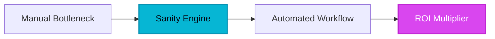

For over a decade, digital enterprises have been trapped in an architectural purgatory. Traditional content management systems promised drag-and-drop simplicity, yet delivered monolithic databases, rigid page builders, and brittle frontends that buckled under the weight of modern omnichannel distribution. When businesses needed to push data simultaneously to web apps, native mobile views, IoT interfaces, and AI agents, legacy dinosaurs forced developers to hack together custom middleware. The human bottleneck was clear: developers spent countless hours wrestling with inflexible schemas, while marketers remained shackled to bloated WYSIWYG interfaces that broke layout integrity at the slightest change.

Then came the paradigm shift of composable content infrastructure. Instead of treating text and images as flat HTML blobs trapped inside database rows, modern engineering demanded that content be handled as pristine, version-controlled JSON data. Enter Sanity—a headless CMS engineered from the ground up to behave less like a static blogging tool and more like a real-time data lake for digital enterprises.

## 1. The Genesis & Evolution: How Sanity Dismantled Monolithic CMSs

Founded by Magnus Hillestad and Even Westvang, Sanity was born out of a profound frustration with the state of web publishing. Having built digital agencies and bespoke software solutions, the founders realized that content management had fundamentally failed developers. Existing solutions forced teams to adapt their software architectures to fit the opinions of rigid, database-locked publishing platforms.

Hillestad and Westvang asked a radical question: What if content *is* data? 

By treating content fragments as discrete JSON documents living inside a high-throughput, low-latency datastore known as the Content Lake, they eliminated the separation between application data and content workflows. Instead of locking users into a proprietary, closed-source admin panel, they open-sourced the editing studio itself. Built entirely on React, Sanity Studio gave engineering teams the power to code their own editing environments, tailoring workflows to exact business logic. This code-first approach disrupted legacy dinosaurs by proving that content infrastructure could be as flexible, scalable, and version-controllable as application codebases written in Next.js or Remix.

> [!NOTE]
> **Executive Takeaway:** "Content is not just text on a static web page; it is foundational business data that must stream seamlessly across every digital touchpoint without friction."

## 2. Core Business Superpowers: Why Engineering Leaders Choose Sanity

For enterprise organizations managing thousands of digital assets across multiple geographies, Sanity delivers quantifiable operational ROI through several standout capabilities:

* **Code-First Content Modeling:** Engineers can define data schemas using plain JavaScript or TypeScript. This means content models map perfectly to application types, drastically reducing the impedance mismatch between backend structures and frontend presentation layers.
* **Real-Time Collaboration Engine:** Powered by a low-latency Content Lake and GROQ (Graph-Relational Object Queries), multiple editors can co-edit documents simultaneously, seeing cursor movements and live updates in real time without locking conflicts.
* **Fully Customizable React Studio (Sanity Studio):** Because the editing interface is open-source and React-based, development teams can build custom input components, inline previews, and validation rules that guide content creators toward error-free publishing.
* **Omnichannel Distribution Powerhouse:** Decoupled architecture combined with robust webhooks, plugins, and lightning-fast APIs ensures that a single update instantly propagates across web applications, mobile platforms, and digital kiosks.



> [!TIP]
> **HeliaTech Benchmark Access:** Test `Sanity` with our verified enterprise trial link at [/go/sanity](/go/sanity).

## 3. Hands-on Workshop: The 15-Minute Sanity Implementation Blueprint

Implementing structured content infrastructure doesn't require a complete infrastructure rewrite. Follow this executive blueprint to spin up your first structured content pipeline.

### Step 1: Initialize Your Project Workspace
Fire up your terminal and initialize a fresh Sanity project using the official CLI utility. This command bootstraps both your backend dataset configuration and your local React studio environment.

```bash
npm create sanity@latest -- --project-name enterprise-hub --dataset production
```

### Step 2: Define Your Structured Content Schema
Navigate to your project directory and open the schema configuration. Instead of dealing with clunky database tables, define a clean document schema in TypeScript or JavaScript. For instance, creating an enterprise product schema looks like this:

```javascript
export default {
  name: 'product',
  title: 'Enterprise Product',
  type: 'document',
  fields: [
    {
      name: 'title',
      title: 'Product Title',
      type: 'string',
      validation: Rule => Rule.required()
    },
    {
      name: 'slug',
      title: 'Slug',
      type: 'slug',
      options: { source: 'title', maxLength: 96 }
    },
    {
      name: 'marketSegment',
      title: 'Market Segment',
      type: 'string',
      options: {
        list: [
          { title: 'Enterprise', value: 'enterprise' },
          { title: 'Mid-Market', value: 'mid-market' },
          { title: 'Startup', value: 'startup' }
        ]
      }
    }
  ]
}
```

### Step 3: Query Data via GROQ
Once your schema is deployed to the Content Lake, query your structured JSON data instantly from your frontend application using GROQ. Fetching active enterprise products is as simple as executing a lightweight query:

```groq
*[_type == "product" && marketSegment == "enterprise"] {
  title,
  "slug": slug.current
}
```

## 4. Critical Assessment & Trade-offs

Every powerful technical architecture comes with deliberate engineering trade-offs. Here is how Sanity stacks up against alternative content strategies.

| Feature / Dimension | Sanity | Traditional CMS (e.g., WordPress) | Headless Alternatives (e.g., Contentful) |
| :--- | :--- | :--- | :--- |
| **Content Modeling** | Code-first, highly flexible JSON schemas | Rigid database tables and post types | API-driven UI schema creation |
| **Editing Studio UX** | Fully open-source, React-customizable | Monolithic WYSIWYG page builders | SaaS-locked proprietary UI panels |
| **Query Language** | Powerful GROQ & GraphQL support | Standard SQL database queries | Restricted REST and GraphQL APIs |
| **Learning Curve** | Steep for non-technical editors | Low for basic users, high for custom scale | Moderate across all user personas |
| **Enterprise Scaling** | Rapid document scaling; tiered pricing | Requires heavy infrastructure tuning | Strict API call and seat-based pricing |

## 5. HeliaTech Final Verdict & Recommendation

Sanity is not merely a content management system; it is a foundational upgrade for engineering and content teams that treat digital experiences as core business products. While non-technical creators may experience a brief learning curve when transitioning away from traditional WYSIWYG page builders, the velocity gains unlocked by structured JSON content and a customizable React studio are unmatched in the current B2B software landscape.

For engineering leaders building high-performance web applications in Next.js, Remix, or modern mobile frameworks, Sanity eliminates database bloat and streamlines omnichannel delivery. 

**HeliaTech Executive Rating:** 4.8 / 5 — Essential for modern, developer-driven enterprise digital stacks.
