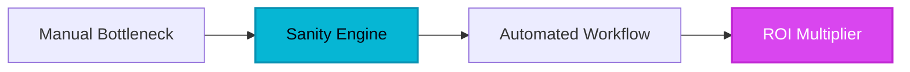

### Introduction

> [!NOTE]
> **Executive Takeaway:** "In modern digital architecture, content is no longer a static page; it is a dynamic, structured API payload waiting to be rendered anywhere." — HELIA TECH Enterprise Engineering Report

For decades, digital publishing lived under the thumb of rigid database schemas and clunky, monolithic content management systems. Engineering teams spent countless hours wrestling with bloated template engines, forced to squeeze diverse omnichannel data into restrictive database tables. Content creators, meanwhile, fought a daily battle against fragile WYSIWYG editors that inevitably corrupted formatting across mobile apps, smart displays, and web portals. The human bottleneck was unmistakable: developers were bottlenecked by endless content adjustments, while marketing teams were handcuffed to inflexible deployment cycles.

Enter Sanity. By treating content as pure, structured JSON data, this composable content platform decoupled the authoring environment from presentation layers entirely. It transformed content pipelines from legacy bottlenecks into high-velocity engines, giving developers complete modeling freedom while offering non-technical stakeholders an intuitive writing workspace.

## 1. The Genesis & Evolution

Founded by Magnus Hillestad, Even Westvang, and Øystein Amundsen, Sanity was born from a frustrating enterprise reality. The founders watched engineering teams repeatedly reinvent the wheel, building custom, brittle CMS solutions just to support multi-channel digital strategies. Legacy systems like WordPress or Drupal were engineered for an era of simple webpage publishing, completely ill-equipped for modern Jamstack architectures, mobile apps, and IoT endpoints.

The spark behind Sanity was simple yet radical: what if a CMS was treated purely as a real-time database for structured content, paired with an open-source, fully customizable editing environment? Instead of imposing a rigid administrative UI, the creators built Sanity Studio—a React application that developers could configure and extend using plain JavaScript and TypeScript schemas.

This approach disrupted legacy dinosaurs by turning content modeling into code. Engineering teams no longer adapted their applications to fit a CMS database; instead, they shaped the CMS schema to mirror their exact domain models. By introducing GROQ (Graph-Relational Object Queries), Sanity gave developers the expressive power of graph databases combined with the ease of JSON, bypassing the performance and payload limitations of traditional GraphQL or REST APIs.

## 2. Core Business Superpowers

For enterprise technical leads and CTOs, adopting a platform isn't about chasing the latest framework trend—it is about accelerating time-to-market and lowering total cost of ownership. Sanity delivers exceptional business value through several foundational pillars:

* **Unmatched Content Modeling Flexibility:** By defining schemas in TypeScript or JavaScript, developers can map out complex enterprise relationships, nested objects, and localized fields without database migrations or wrestling with third-party plugins.
* **Real-Time Multi-User Collaboration:** Similar to Google Docs, Sanity Studio supports live presence, concurrent editing, and instant history tracking. Content operations teams can draft, review, and refine global campaigns together without running into painful database locking or overwrite conflicts.
* **GROQ Data Fetching Efficiency:** Sanity's proprietary query language enables teams to shape, filter, and project data on the fly directly from the backend. This slashes frontend payload sizes, eliminates over-fetching, and significantly improves client-side performance across web and mobile touchpoints.
* **Customizable React-Based UI:** The Sanity Studio is not a closed box. Engineering teams can inject custom React components, validation rules, and third-party previews directly into the editor dashboard, tailoring the authoring experience to exact business workflows.



> [!TIP]
> **HeliaTech Benchmark Access:** Test `Sanity` with our verified enterprise trial link at [/go/sanity](/go/sanity).

## 3. Hands-on Workshop (15-Minute Blueprint)

To see how Sanity transforms daily developer workflows, let us walk through a production-grade implementation blueprint designed to take your team from zero to a live, structured content pipeline.

### Step 1: Initialize Your Project Workspace
Fire up your terminal and initialize the Sanity CLI to scaffold a brand new workspace locally. Run the setup wizard to connect your terminal to your cloud project account:

```bash
npm create sanity@latest
```

Choose your preferred project name, select the clean project template, and let the CLI provision your dataset in the cloud. 

### Step 2: Define Your Structured Content Schema
Navigate into your project directory and open the schema directory. Instead of clicking around a web dashboard, you define your content structures with code. Create a `post.js` schema file to model an enterprise article:

```javascript
export default {
  name: 'post',
  title: 'Blog Post',
  type: 'document',
  fields: [
    {
      name: 'title',
      title: 'Title',
      type: 'string',
      validation: Rule => Rule.required()
    },
    {
      name: 'slug',
      title: 'Slug',
      type: 'slug',
      options: { source: 'title', maxLength: 96 }
    },
    {
      name: 'body',
      title: 'Body Content',
      type: 'array',
      of: [{ type: 'block' }]
    }
  ]
}
```

### Step 3: Launch Sanity Studio Locally
Start your local development server to test your new schema configuration in the customizable React studio interface:

```bash
npm run dev
```

Open `http://localhost:3333` in your browser. You will immediately see your newly minted 'Blog Post' document type ready for content entry, complete with automatic validation rules and slug generation.

### Step 4: Query Data with GROQ
Fetch your structured content efficiently from any frontend framework using a GROQ query. The following query extracts published posts, projecting precisely the fields required for your UI:

```groq
*[_type == "post" && defined(slug.current)] {
  title,
  "slug": slug.current,
  body
}
```

## 4. Critical Assessment & Trade-offs

While Sanity represents a massive leap forward for composable content architectures, enterprise evaluation requires an objective look at both its strengths and unavoidable limitations.

| Evaluation Metric | Sanity Advantage | Enterprise Limitation / Trade-off | Verdict |
| :--- | :--- | :--- | :--- |
| **Content Modeling** | Expressive JS/TS schemas allow infinite data nesting. | Requires developer intervention for any structural updates. | Exceptional for custom domains. |
| **Editing Experience** | Real-time collaboration and fully brandable React UI. | Steeper learning curve for editors used to rigid traditional CMS. | Requires brief team onboarding. |
| **Query Performance** | GROQ enables powerful filtering and data projection. | Developers must learn GROQ alongside SQL or GraphQL. | High payoff after initial learning curve. |
| **Cost & Scaling** | Generous free tier handles MVPs and early projects effortlessly. | Scaling into higher enterprise tiers can become costly. | Budget carefully for high-volume traffic. |

## 5. HeliaTech Final Verdict & Recommendation

Sanity is not merely a headless CMS; it is a powerful developer tool that bridges the historical divide between engineering logic and content operations. By eliminating rigid database constraints and replacing them with composable, code-first schemas, Sanity empowers engineering teams to build lightning-fast, multi-channel applications while granting content creators a fluid, collaborative workspace.

For enterprise teams modernizing their tech stack, moving away from legacy monoliths, or building bespoke digital experiences across web, mobile, and IoT, Sanity is an elite-tier investment. While non-technical editors will face a brief transition period and enterprise scaling requires careful budget planning, the velocity gains and architectural freedom are unmatched.

Ready to transform your content pipeline? [Claim Your Free Sanity Account ➔](https://www.sanity.io/?ref=heliatech)
