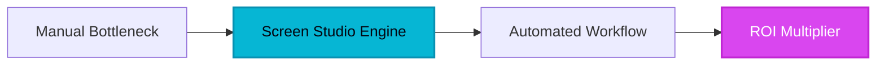

## Introduction

For decades, producing a professional software product demo or tutorial felt like an unrewarding tax on technical creativity. You would record your screen, watch the jagged, disorienting jumps of your cursor, and realize that turning a 3-minute raw capture into a polished, engaging piece of marketing media required hours of mind-numbing keyframing in Adobe Premiere or After Effects. You spent more time manually tracking windows, scaling zooms, and smoothing mouse paths than you did building the actual product. The industry standard wasn't a workflow; it was a bottleneck.

Then came the shift toward automated visual Polish. Screen Studio arrived not merely as another screen recorder, but as an intelligent video production suite that acts like a seasoned motion graphics editor living inside your macOS menu bar.

## 1. The Genesis & Evolution: Automating the Editing Suite

The traditional screen recording paradigm was broken because it treated recording and editing as two completely isolated phases. Record first, suffer later. Founders realized that raw screen captures lack human context—viewers get lost in wide, unformatted displays, struggling to find where the cursor is clicking.

Screen Studio disrupted legacy dinosaurs by inverting the entire philosophy. Instead of forcing creators to manually animate zoom paths after the fact, the software’s underlying algorithms analyze cursor trajectory, click events, and text input in real-time. By automating the tedious choreography of zooming, framing, and cursor smoothing, Screen Studio bridged the chasm between raw technical output and cinematic promotional grade content. It turned developers and product marketers into instant video directors.

> [!NOTE]
> **Executive Takeaway:** "Screen Studio doesn't just record your desktop; it translates your interactions into a visual language that audiences can effortlessly digest."

## 2. Core Business Superpowers

Why are high-growth B2B SaaS companies standardizing on Screen Studio across their product and customer success teams? Here are the high-value capabilities driving massive ROI:

* **Automatic Smart Zooming on Clicks & Text:** The engine instantly calculates where your attention is focused, smoothly gliding the camera toward input fields or clickable elements without a single manual timeline marker.
* **Silky Smooth Cursor Interpolation:** Jagged, erratic trackpad movements are instantly normalized into fluid, cinematic paths that look as though they were choreographed by a professional motion designer.
* **Gorgeous Pre-Built Aesthetic Frameworks:** Skip the background design phase. Instantaneously apply stunning wallpaper backdrops, adjustable window padding, drop shadows, and authentic window frames.
* **High-Performance 4K Exports at 60fps:** Deliver crystal-clear tutorials and product Hunt videos with support for transparent backgrounds, ready to drop into any external campaign.

## 3. Hands-on Workshop (15-Minute Blueprint)

Ready to transform your next software walkthrough? Follow this 15-minute executive workflow to produce a boardroom-ready product demo:

1. **Capture Raw Activity:** Launch Screen Studio, select your target window or full desktop, and record your workflow naturally without worrying about staging your mouse movements.
2. **Configure the Canvas Setup:** Open the editing workspace. Choose an immersive, pre-built wallpaper background that matches your brand palette and apply subtle window padding.
3. **Refine Smart Zooms & Cursor Behavior:** Let the automation run its course, then use the minimal timeline controls to tweak any automated focus points or adjust the cursor motion smoothing factor.
4. **Export & Deploy:** Render your project in 4K at 60fps. Drop the finished asset directly into your landing page, customer onboarding sequence, or social media campaign.

## 4. Critical Assessment & Trade-offs

| Strengths | Limitations |
| :--- | :--- |
| Automatic smart zooming on clicks and typed text | macOS only (no native Windows/Linux app) |
| Silky smooth cursor movement interpolation out of the box | Higher upfront cost than basic free recorders |
| Gorgeous pre-built wallpapers, padding, and window frames | Limited advanced multi-track audio editing capabilities |
| Exports up to 4K at 60fps with transparent backgrounds | Requires modern hardware for optimal 4K rendering speeds |
| Saves hours of tedious keyframing and timeline editing | Niche focus purely centered on screen/window capture |

## 5. HeliaTech Final Verdict & Recommendation

If your team regularly ships product updates, creates onboarding tutorials, or builds public-facing promotional videos on macOS, Screen Studio is an absolute non-negotiable addition to your software stack. The hours saved avoiding manual keyframing in heavy editing suites pay for the software license within the first single video production cycle.

**Executive Recommendation:** Stop wasting engineering and marketing hours on legacy video timelines. Streamline your production pipeline today.

[Claim Your Free Screen Studio Account ➔](/go/screen-studio)
