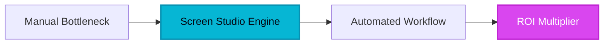

F**or years, the professional screen recording landscape was a wasteland of mediocrity.** If you wanted a product demo that looked halfway decent, you were forced into a Faustian bargain: either settle for the jittery, uninspiring raw output of QuickTime or spend six hours in Adobe Premiere Pro keyframing zoom-ins and smoothing out erratic mouse movements. This friction wasn't just a nuisance; it was a bottleneck for the entire B2B ecosystem. Thousands of brilliant software features died in obscurity simply because their creators couldn't showcase them with the elegance they deserved. The 'human bottleneck' of video editing meant that by the time a demo was polished, the software had already moved on to the next version.

## 1. The Genesis & Evolution: The End of the 'Raw Capture' Era

Screen Studio didn't just enter the market; it redefined the category. Created by Adam Pietrasiak, the tool was born from a singular, frustrating realization: capturing a screen is easy, but making it *watchable* is incredibly hard. Before Screen Studio, the 'professional' look—characterized by smooth, cinematic pans and perfectly timed zooms—was the exclusive domain of high-budget marketing agencies.

By leveraging the native power of macOS and a proprietary 'action-recognition' engine, Screen Studio disrupted the legacy dinosaurs like Camtasia. It moved the intelligence from the user’s manual labor to the software’s internal logic. It wasn't just a recorder; it was an automated cinematographer. In the hyper-competitive SaaS landscape of 2026, where attention is the scarcest commodity, Screen Studio became the secret weapon for founders who needed to look like a billion-dollar company before they had a billion-dollar team.

## 2. Core Business Superpowers: Why Enterprise Teams are Migrating

Screen Studio provides a suite of capabilities that fundamentally shift the ROI of video content creation:

*   **Automatic Zoom-to-Action Logic:** The software analyzes your clicks and keyboard inputs in real-time. After you finish recording, it automatically generates smooth, cinematic zooms on the areas where the action happened. This eliminates the need for manual keyframing entirely.
*   **Post-Capture [Cursor](/reviews/cursor) Smoothing:** Even the most experienced presenters have 'jittery' mouse movements. Screen Studio’s AI replaces your raw cursor path with a mathematically perfect, eased curve. The result is a level of polish that feels almost hypnotic to the viewer.
*   **Dynamic Backgrounds & Framing:** Instead of a dull, full-screen rectangle, Screen Studio places your capture within aesthetic, customizable backgrounds with adjustable padding and rounded corners. It instantly transforms a technical walkthrough into a high-end marketing asset.
*   **Integrated Selfie-Cam with AI Removal:** You can record your face simultaneously, and the tool will automatically place you in a professional circular overlay, removing your background without the need for a green screen.

> [!NOTE]
> **Executive Takeaway:** "Screen Studio is the first tool that understands that a screen recording is not just a document of what happened, but a story of how a product feels to solve a problem. It turns developers into directors."

> [!TIP]
> **HeliaTech Benchmark Access:** Test `Screen Studio` with our verified enterprise trial link at [/go/screen-studio](/go/screen-studio).

## 3. Hands-on Workshop: The 15-Minute Blueprint to a Viral Demo

Ready to elevate your product storytelling? Follow this executive blueprint to create your first high-conversion video.

### Step 1: The Clean Slate
Open Screen Studio and select your recording area. Pro tip: Use the 'Window' capture mode rather than the full desktop to keep the aspect ratio consistent. Ensure your macOS wallpaper is clean or use the built-in background replacement feature later.

### Step 2: The Action Sequence
Perform your workflow at a natural pace. Don't worry about 'perfect' mouse movements. Click deliberately on the buttons you want the AI to highlight. If you make a mistake, don't stop; just pause for three seconds and repeat the action. You can easily trim the 'dead air' later.

### Step 3: The AI Refinement
Once you hit stop, Screen Studio generates the preview. This is where the magic happens. On the right-hand sidebar, adjust the 'Zoom' intensity. If the AI missed a spot, simply click the timeline and add a manual zoom point. Adjust the '[Cursor](/reviews/cursor) Size' to 1.5x for better visibility on mobile devices.

### Step 4: Exporting for Impact
Choose your preset. For LinkedIn or X (Twitter), use the 4K Desktop preset. For TikTok or YouTube Shorts, use the 'Vertical' layout—Screen Studio will automatically reposition the content to ensure the action stays centered in the 9:16 frame.

## 4. Critical Assessment & Trade-offs

While Screen Studio is a powerhouse, it is not a universal solution. Here is our objective breakdown:

| Feature | Strength | Limitation |
| :--- | :--- | :--- |
| **Platform** | Highly optimized for Apple Silicon (M1/M2/M3). | Strictly macOS only; no Windows support. |
| **Editing** | Unmatched speed for single-clip demos. | Limited multi-clip timeline capabilities. |
| **Pricing** | One-time payment (Pay-once-own-forever). | Requires a subscription for ongoing updates. |
| **Performance** | Instant rendering on modern Macs. | Can be resource-heavy on older Intel-based Macs. |

## 5. HeliaTech Final Verdict & Recommendation

**The Verdict:** Screen Studio is the 'iPhone moment' for the screen recording industry. It has effectively lowered the floor for professional video production while raising the ceiling for what a solo founder can achieve. 

If you are an enterprise strategist, a product manager, or a content creator operating within the macOS ecosystem, this isn't just a 'nice-to-have'—it is a competitive necessity. The time saved in post-production alone pays for the license within the first three recordings. We recommend Screen Studio as the gold standard for software demonstrations in 2026.

**Final Recommendation:** Stop sending boring, raw screen captures to your clients and investors. Switch to Screen Studio and start telling your product’s story with the cinematic gravity it deserves.

[Claim Your Free Screen Studio Account ➔](https://screen.studio/?via=heliatech)
