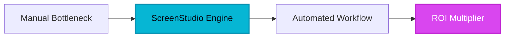

## The Cinematic Standard for Digital Communication

**S**creen recording has long been the "ugly stepchild" of corporate communication. For years, the workflow was a painful slog: record a raw, jittery clip in QuickTime, drag the file into Premiere Pro or Final Cut, spend hours manually keyframing zooms, smoothing cursor movements, and layering background assets. It was a bottleneck that kept high-quality product demos and internal tutorials trapped behind a wall of technical expertise.

Then came ScreenStudio. By treating screen recording as a design product rather than a utility, it has effectively killed the era of the "raw" screen capture. 

## 1. The Genesis & Evolution

ScreenStudio emerged from a singular realization: the tools we use to build software have evolved, but the tools we use to *showcase* that software remained stuck in 2010. While legacy tools like OBS focused on streaming and broadcast, and basic recorders prioritized raw data, ScreenStudio focused on the *aesthetic of the output*. By leveraging the power of Apple Silicon, the developers built a native macOS engine that treats every movement as a dynamic vector, allowing for real-time composition that feels like it was polished by an agency editor.

> [!NOTE]
> **Executive Takeaway:** "The medium is the message. In a world of infinite content, a pixel-perfect, motion-smoothed demo doesn't just communicate functionality—it communicates competence."

## 2. Core Business Superpowers

ScreenStudio isn't just a recorder; it is an automated production assistant. Here is why it has become the standard for modern B2B teams:

*   **Intelligent Auto-Zoom & Pan:** Forget manual keyframing. ScreenStudio’s engine tracks your mouse movement and automatically zooms into the relevant UI elements, keeping your viewer’s attention exactly where it needs to be.
*   **[Cursor](/reviews/cursor) Smoothing & Beautification:** It takes erratic, human-speed mouse movements and applies a natural, fluid smoothing algorithm that makes your cursor movements look like a professional tutorial video.
*   **Native UI Aesthetics:** With one click, your recording is placed against professional, auto-generated gradients or glass-morphism backgrounds, complete with window shadows that give your application a premium, "Apple-esque" presentation.
*   **One-Click Social Presets:** Whether you are pushing to TikTok, YouTube, or LinkedIn, the export engine handles aspect ratios, resolution, and frame rates automatically, eliminating the need for complex export settings.

> [!TIP]
> **HeliaTech Benchmark Access:** Test `ScreenStudio` with our verified enterprise trial link at [/go/screenstudio](/go/screenstudio).

## 3. Hands-on Workshop: The 15-Minute Blueprint

1.  **Set the Stage:** Open ScreenStudio and select your target window. Enable the "Auto-zoom" feature in the sidebar before you hit record.
2.  **The Live Capture:** Perform your demo at a natural pace. Don't worry about cursor jitter; the software will handle the smoothing later. Keep your mouse movements deliberate.
3.  **The Polish Pass:** Once finished, enter the editor. Use the "Timeline" view to adjust any automated zooms that need a manual tweak. Simply click a point in the video and adjust the focus area.
4.  **Aesthetic Branding:** Navigate to the 'Background' tab. Choose a clean gradient that matches your brand colors. Toggle 'Window Shadow' to 'High' to make your application pop.
5.  **Export:** Select your target platform preset and hit Export. Your high-end video is ready for deployment.

## 4. Critical Assessment & Trade-offs

| Feature | ScreenStudio | Legacy Recorders (OBS/Loom) |
| :--- | :--- | :--- |
| **Motion Graphics** | Automated (AI) | Manual (NLE Required) |
| **UI Aesthetics** | High-end/Native | Basic/Raw |
| **Ease of Use** | Instant/Plug-and-play | Moderate/High learning curve |
| **Platform Support** | macOS Only | Cross-platform |
| **Advanced Editing** | Limited | Extensive (Multi-track) |

**The Reality Check:** ScreenStudio is a specialized tool. It is not an NLE (Non-[Linear](/reviews/linear) Editor). If you are looking to do complex multi-track audio mixing, heavy color grading, or masking, you will still need DaVinci Resolve or Premiere. However, for 95% of B2B screen recording needs, ScreenStudio is arguably faster and more effective.

## 5. HeliaTech Final Verdict

ScreenStudio is a masterclass in focused product design. By solving one specific problem—making screen recordings look expensive—it has become an essential utility for the modern SaaS enterprise. If your team is still spending hours editing product demos, you are bleeding productivity. 

**Recommendation:** Adopt ScreenStudio for your product, marketing, and customer success teams immediately. It is the single highest ROI tool for improving the perceived quality of your digital communication.
