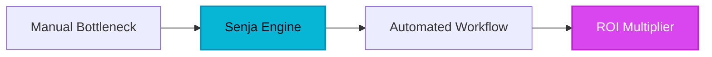

T**rust is the most expensive commodity in the digital age.** For years, marketing teams have been trapped in a manual, high-friction cycle of chasing customers for quotes, screenshotting LinkedIn posts, and begging developers to update testimonial carousels. This 'Trust Gap'—the distance between a customer's success and a prospect's realization of that success—has historically been filled with clunky, slow-loading widgets and pixelated screenshots that kill conversion rates. Before the rise of modern social proof automation, managing reputation was a fragmented chore that lived in spreadsheets and Slack channels, often forgotten until a product launch loomed.

## 1. The Genesis & Evolution: Killing the 'Screenshot' Era

Senja didn't just enter the market; it identified a fundamental human bottleneck: friction. Founders Wilson Bright and Olly Meakings realized that the reason most companies lacked social proof wasn't a lack of happy customers, but a lack of an easy way for those customers to speak up. Legacy dinosaurs in the review space focused on SEO and star ratings for local businesses, leaving SaaS, creators, and B2B enterprises with tools that felt like they were built in 2005.

Senja disrupted this by prioritizing the user experience of the *reviewer*. By removing the 'login wall' and offering a sleek, mobile-first recording interface, they transformed the testimonial from a favor into a 30-second interaction. In doing so, they moved social proof from a static asset to a dynamic, high-velocity marketing lever that integrates directly into the modern tech stack.

> [!NOTE]
> **Executive Takeaway:** "Social proof is no longer a 'nice to have' sidebar; it is the fundamental architecture of the modern sales funnel. If you aren't automating trust, you're leaking revenue."

## 2. Core Business Superpowers

### The 'Zero-Friction' Collection Engine
Senja’s primary superpower is its ability to extract high-quality video and text testimonials without forcing the customer to create an account or navigate a complex UI. The platform provides a dedicated 'Wall of Love' or a collection link that works seamlessly on any device. This reduction in friction leads to a 3x higher response rate compared to traditional email requests.

### The Visual Studio: Repurposing as a Strategy
Most testimonials die on a landing page. Senja's built-in 'Studio' allows marketing teams to turn a plain text review into a high-converting social media asset in seconds. With pre-designed templates, you can export reviews as Instagram stories, LinkedIn posts, or high-resolution images for pitch decks, effectively turning a single review into a multi-channel campaign.

### Performance-First Widgets
In an era where Google's Core Web Vitals dictate search rankings, heavy third-party scripts are a liability. Senja’s widgets are engineered for speed. They load asynchronously and are optimized for minimal impact on page load times, ensuring that your social proof boosts conversions without tanking your SEO performance.

## 3. Hands-on Workshop: The 15-Minute Trust Blueprint

Ready to turn your reputation into a revenue engine? Follow this rapid-deployment guide to get Senja running in under a quarter-hour.

### Step 1: The Multi-Platform Import (3 Minutes)
Don't start from zero. Use Senja’s one-click importer to pull in existing reviews from Google, G2, Capterra, or Trustpilot. This instantly populates your dashboard and gives you a library of assets to work with.

### Step 2: Crafting the Frictionless Form (4 Minutes)
Create a 'Collection Form.' Keep it simple: one video prompt and one text prompt. Customize the colors to match your brand. Pro tip: Add a 'Reward' or 'Thank You' message to incentivize the submission.

### Step 3: Automate the Ask (5 Minutes)
Integrate Senja with your CRM or email tool (like Rewardful, [Zapier](/reviews/zapier), or Lemon Squeezy). Set a trigger so that 7 days after a successful purchase or project completion, the Senja collection link is automatically sent to the client.

### Step 4: Deploy the 'Wall of Love' (3 Minutes)
Select your best imported and new reviews. Choose a widget style (Masonry, Carousel, or Heatmap) and copy the single line of code into your website’s header. Watch as your landing page transforms from a pitch into a community-backed solution.

## 4. Critical Assessment & Trade-offs

While Senja is a market leader in agility, it is important to weigh its capabilities against your specific enterprise needs.

| Feature | Strength | Limitation |
| :--- | :--- | :--- |
| **Performance** | Ultra-fast loading; zero impact on Core Web Vitals. | Custom CSS requires advanced knowledge for pixel-perfection. |
| **Automation** | Deep integrations with [Zapier](/reviews/zapier) and native SaaS tools. | Advanced triggers are locked behind the Business tier. |
| **Branding** | Clean, modern UI that fits most SaaS aesthetics. | Free tier includes visible 'Powered by Senja' branding. |
| **Video** | No-login recording is a game-changer for conversion. | Limited video editing tools within the platform itself. |
| **Ease of Use** | Setup to deployment in under 10 minutes. | Granular permission settings for large teams could be deeper. |

## 5. HeliaTech Final Verdict & Recommendation

Senja is not just a testimonial tool; it is a **conversion optimization engine**. For B2B companies and creators who need to move fast, it eliminates the technical debt of building custom social proof sections and the administrative nightmare of manual collection. 

**The Executive Recommendation:** If your business relies on trust to close deals (which is every business in 2026), Senja is the most efficient ROI-positive tool you can add to your stack this year. Stop letting your best customer stories disappear into the void of old emails. Centralize them, beautify them, and deploy them where they matter most: at the point of sale.

[Claim Your Free Senja Account ➔](/go/senja)
