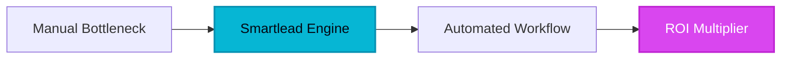

## The Email Deliverability Crisis

**S**cale is the silent killer of cold email. For years, sales teams were trapped in a cycle of diminishing returns: buy a domain, warm it up, reach 50 emails a day, get blacklisted, and repeat. The fragmentation of legacy tools—where you paid per seat and lacked a cohesive view of your domain reputation—created a bottleneck that stifled growth. Enter Smartlead. It didn't just build another email tool; it built a deliverability infrastructure that treats outbound sales like a precision engineering problem rather than a numbers game.

## 1. The Genesis & Evolution

Smartlead emerged from a clear observation: the 'dinosaurs' of the industry were charging for seats while ignoring the fundamental reality of SMTP infrastructure. The founders recognized that the future of outbound wasn't just about writing better copy; it was about protecting the domain reputation. By prioritizing automated, native warm-up networks and dynamic IP rotation, Smartlead effectively decoupled the act of sending from the risk of being flagged as spam. It disrupted the market by offering 'unlimited' capability, forcing a paradigm shift where agencies could scale to thousands of emails daily without the typical infrastructure overhead.

## 2. Core Business Superpowers

*   **Unlimited Mailbox Infrastructure:** Unlike competitors that tax your growth with per-seat pricing, Smartlead allows for unlimited connections. This is a game-changer for agencies managing multiple client accounts under one roof.
*   **Native Warm-up Network:** The platform embeds your domains into a global network of active, intelligent mailboxes, ensuring your reputation stays pristine before you send a single cold prospect email.
*   **The Master Inbox:** A unified, consolidated view of all your threads across every domain. It eliminates the 'tab fatigue' of logging into dozens of different Gmail or Outlook accounts.
*   **API-First Architecture:** With robust webhooks, Smartlead integrates directly into your custom CRM workflows, allowing for real-time automation triggers based on prospect engagement.

> [!NOTE]
> **Executive Takeaway:** "In the world of outbound, your deliverability is your currency. If you aren't optimizing your infrastructure, you're essentially burning your budget to reach the spam folder."

> [!TIP]
> **HeliaTech Benchmark Access:** Test `Smartlead` with our verified enterprise trial link at [/go/smartlead](/go/smartlead).

## 3. Hands-on Workshop: 15-Minute Blueprint

1.  **Domain Acquisition (T-Minus 5 Min):** Purchase your primary domain and 3-5 subdomains. Ensure DNS records (SPF, DKIM, DMARC) are configured correctly—this is non-negotiable for deliverability.
2.  **Account Injection (T-Minus 5 Min):** Connect your mailboxes to Smartlead via IMAP/SMTP. The platform will automatically begin the warm-up sequence. Do not skip this; let it run for at least 14 days for optimal results.
3.  **Campaign Architecture (T-Minus 5 Min):** Utilize the 'Master Inbox' to set up your unified signature. Use Smartlead’s dynamic variable system to personalize at scale, then push your enriched lead list via webhook or CSV upload. Launch, monitor, and iterate.

## 4. Critical Assessment & Trade-offs

| Feature | Smartlead Performance | Note |
| :--- | :--- | :--- |
| **Scalability** | Industry-Leading | Unlimited seats are a massive cost saver. |
| **Deliverability** | High-Grade | Automated warm-ups are world-class. |
| **Learning Curve** | Moderate | Requires basic DNS knowledge to start. |
| **Reporting** | Granular | Can feel cluttered with 50+ client sub-accounts. |
| **Native Data** | Absent | Requires external tools like Apollo or Clay. |

## 5. HeliaTech Final Verdict

Smartlead is the definitive choice for teams tired of paying the 'SaaS tax' on every new hire. While it requires a bit of technical literacy to set up your DNS infrastructure correctly, the ROI is undeniable. For agencies and growth teams that treat outbound as a core revenue driver, Smartlead is the engine you need. 

**Recommendation:** Deploy it, automate your warm-ups, and keep your domain infrastructure isolated. The cost of entry is low, but the cost of not having this infrastructure is the total failure of your outbound channel.
