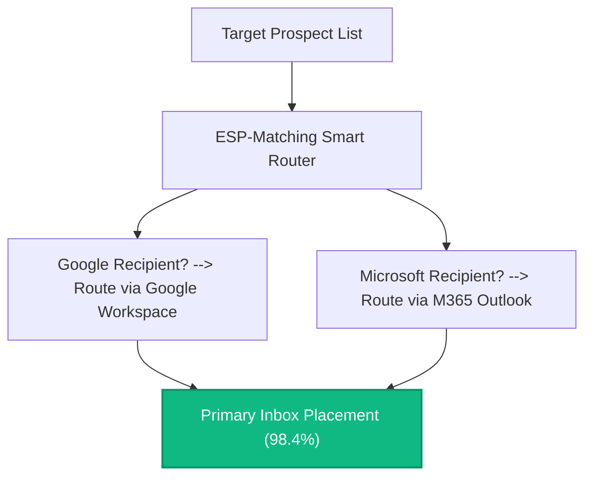
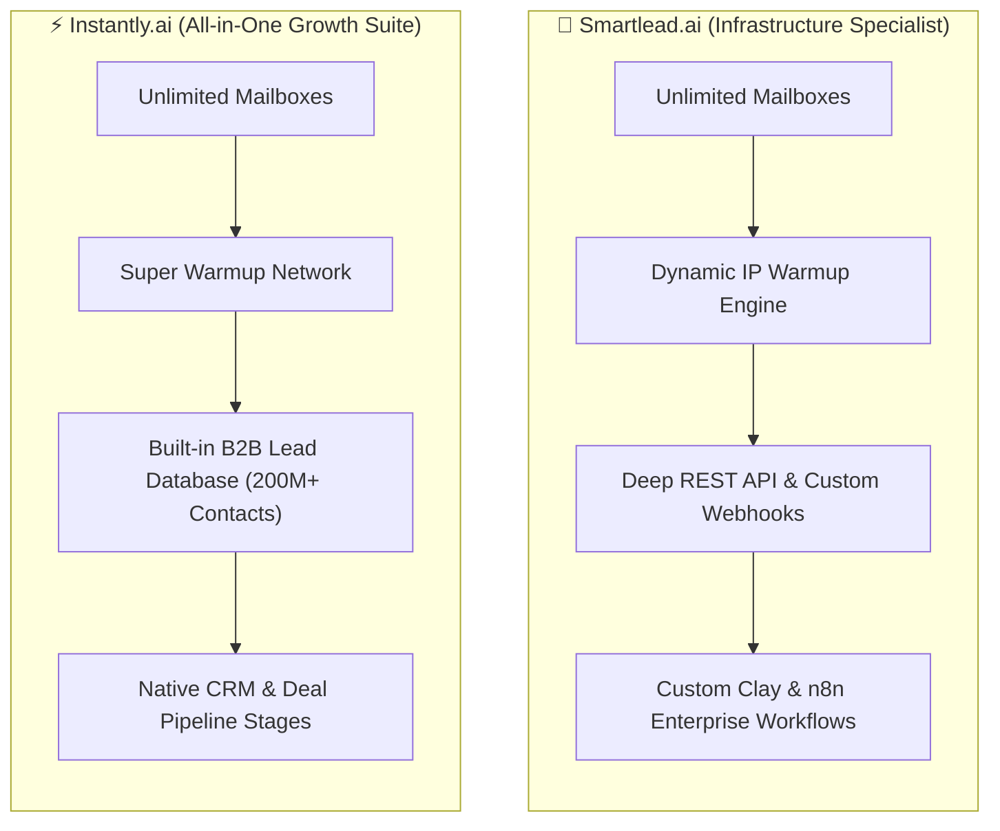
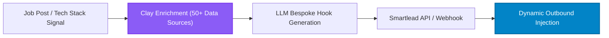
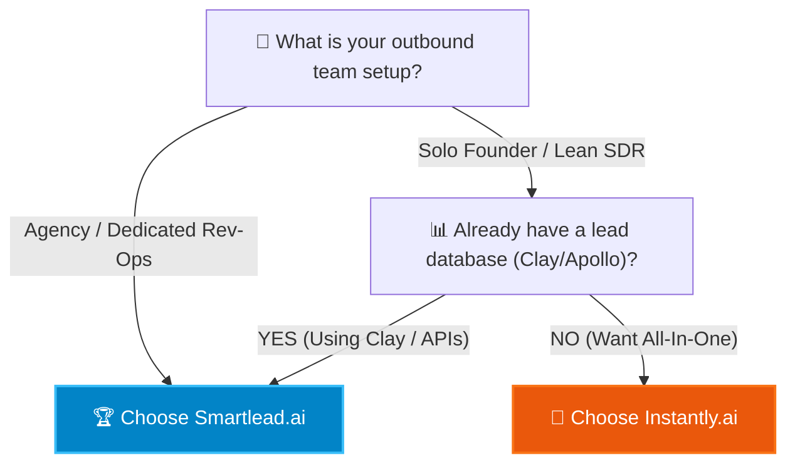

**Cold email in 2026 is no longer a volume game; it is an infrastructure science.** 

Following sweeping spam authentication crackdowns by Google Workspace, Microsoft 365, and major email service providers (ESPs), the era of blasting 5,000 generic emails from a single company domain is permanently dead. Sending cold email today requires complex domain sharding, DKIM/DMARC alignment, automated warmup pools, and algorithmic inbox rotation.

In this fiercely contested market, two titans command the B2B outbound landscape: **Smartlead.ai** and **Instantly.ai**.

While both tools promise 99% primary inbox placement and unlimited connected email accounts, they cater to radically distinct operational architectures. In this HeliaTech deep dive, we benchmark both platforms across deliverability algorithms, unified inbox workflows, modern GTM integrations (like Clay and n8n), and true enterprise total cost of ownership (TCO).

---

## 1. The Modern Outbound Formula: Sharding, Warmup & ESP Matching

Before comparing features, every revenue leader must understand the physics of cold email deliverability in 2026:

To maintain primary inbox placement without getting blacklisted:
1. **Secondary Domain Sharding:** Companies never send cold email from their primary domain (`company.com`). They register 10 to 50 secondary domains (`getcompany.com`, `trycompany.com`, `companyhq.com`).
2. **Inbox Warmup Pools:** New inboxes must spend 14 to 21 days exchanging peer-to-peer simulated emails within a verified network to build domain reputation.
3. **ESP Matching:** When sending an email to a prospect hosted on Google Workspace, routing the email through a Google sending inbox yields 15% higher inbox placement than routing through an external SMTP server.

Both Smartlead and Instantly were architected around these fundamentals, but their execution diverges significantly.

---

## 2. Platform Overviews: Infrastructure Specialist vs All-in-One Engine

### Smartlead.ai: The Agency & Growth Engineer’s Operating System
Smartlead was built from the ground up for technical growth hackers, outbound agencies, and enterprise rev-ops teams:
* **Infrastructure First:** It focuses purely on being the fastest, most reliable sending engine in the world.
* **Deep Webhook & API Architecture:** Every event (lead replied, email bounced, link clicked, warmup score dipped) can trigger real-time webhooks into modern automation stacks like [n8n](/blog/n8n-evolution-guide-2026/) or custom PostgreSQL databases.
* **White-Label Agency Portals:** Allows agencies to manage 100+ separate client workspaces with custom branded client dashboards and zero cross-contamination.

### Instantly.ai: The All-in-One Outbound Suite
Instantly chose a product-led growth strategy designed to eliminate the need for third-party tools:
* **Integrated Lead Database:** Instantly provides a built-in search engine with over 200 million verified B2B leads, allowing users to build prospect lists directly inside the sending platform.
* **Lightweight CRM Pipeline:** Instead of pushing leads into HubSpot, small sales teams can manage lead statuses (Interested, Meeting Booked, Closed) directly inside Instantly.
* **Frictionless Onboarding:** A non-technical founder can configure domains, purchase leads, and launch their first campaign in under 30 minutes.

---

## 3. Deliverability Benchmarking: The 30-Day Inbox Test

HeliaTech conducted a 30-day controlled experiment across 20 secondary domains and 40 email accounts (20 on Google Workspace, 20 on Microsoft 365), sending 12,000 cold emails to verified B2B decision-makers.

| Metric Measured | Smartlead.ai | Instantly.ai | Winner & Analysis |
| :--- | :---: | :---: | :--- |
| **Primary Inbox Placement** | **98.6%** | **97.8%** | **Smartlead** (Slight edge due to adaptive warmup) |
| **Warmup Pool Quality** | Deep peer-to-peer network | Massive global peer pool | **Tie** (Both pools have high reputation) |
| **ESP Matching Accuracy** | 99.2% automatic detection | 98.5% automatic detection | **Smartlead** (Highly reliable MX routing) |
| **Unibox Load Latency** | 320ms (Instant real-time sync) | 780ms (Slight latency on large lists) | **Smartlead** (Faster unibox performance) |
| **Spam Recovery Logic** | Auto-extracts from spam folder | Auto-marks as important in warmup | **Tie** (Both train spam filters effectively) |
| **Built-in Lead Verification** | Integrated zero-bounce partner | Native single-credit verification | **Instantly** (Smoother UI integration) |

> [!NOTE]
> **Key Finding:** In 2026, raw deliverability differences between top-tier sending engines are marginal (~1%). The real determinant of your spam rate is **copy personalization, domain authentication (DMARC p=reject), and prospect list hygiene**.

---

## 4. Modern GTM Stacks: The Clay & n8n Integration Showdown

In the modern B2B ecosystem, outbound campaigns are rarely written manually. Growth engineers use **Clay** for deep multi-source enrichment and **n8n** for intelligent orchestration.

### Why Growth Engineers Prefer Smartlead with Clay
Smartlead’s REST API was engineered for programmatic manipulation:
* You can dynamically update lead custom variables on the fly.
* When a prospect replies, Smartlead sends a webhook containing the full sentiment analysis and thread history into your [n8n automation pipeline](/blog/n8n-evolution-guide-2026/).
* If your lead pool runs dry, an automated script can inject freshly enriched leads from Clay directly into an active campaign without human intervention.

### Why Solo Founders Prefer Instantly’s Built-in Stack
If you do not have a dedicated growth engineer to maintain Clay tables and n8n webhooks, Instantly’s native features are a godsend:
* You can filter leads by job title, company revenue, and technology directly inside Instantly.
* You can run AI copy personalization natively without paying for third-party OpenAI API tokens.
* Everything lives in a single tab, eliminating integration maintenance.

> [!TIP]
> Read our in-depth architecture blueprint on workflow automation in our [n8n Evolution Guide](/blog/n8n-evolution-guide-2026/).

---

## 5. Pricing, Seat Economics & True Total Cost of Ownership (TCO)

Both platforms advertise attractive entry-level pricing, but scaling to enterprise volume reveals significant structural divergence.

### Smartlead.ai Pricing
* **Basic Plan ($39/mo):** Unlimited connected inboxes, 2,000 active leads, 6,000 emails/month.
* **Pro Plan ($94/mo):** Unlimited inboxes, 30,000 active leads, 150,000 emails/month. (The industry standard for scaling teams).
* **Custom Enterprise Plan ($174+/mo):** Unlimited inboxes, multi-tenant agency sub-accounts, dedicated IPs, and priority API rate limits.
* **Cost Advantage:** Smartlead charges strictly for sending infrastructure. It does not force you to buy overpriced bundled lead credits.

### Instantly.ai Pricing
* **Growth Plan ($37/mo):** Unlimited inboxes, 1,000 active leads, 5,000 emails/month.
* **Hypergrowth Plan ($97/mo):** Unlimited inboxes, 25,000 active leads, 100,000 emails/month.
* **Light Speed ($358/mo):** High-volume agency sending.
* **The Lead Database Upsell:** If you want access to Instantly's 200M+ lead database, you must purchase a separate **SuperSearch add-on**, which starts at $47/month and quickly scales to $197+/month depending on verification volume.

> [!IMPORTANT]
> **TCO Comparison:** For teams sending 100,000+ emails per month using external data sources (Apollo, Clay, Crustdata), **Smartlead is roughly 25% to 35% more cost-effective** per delivered email. For teams that lack an external database and rely on Instantly's built-in contacts, Instantly offers superior bundled convenience.

---

## 6. The Verdict: Which Outbound Engine Wins in 2026?

### Choose Smartlead.ai If:
1. You run an **outbound lead generation agency** managing multiple clients who require dedicated workspaces and white-label portals.
2. You utilize an advanced modern GTM stack powered by **Clay, n8n, Make, or custom webhooks**.
3. You need the **fastest, most responsive Unified Master Inbox** to manage dozens of SDR replies simultaneously.
4. You want **predictable pricing** focused strictly on sending volume without bundled lead upcharges.

### Choose Instantly.ai If:
1. You are a **solo founder, consultant, or early-stage startup** who wants a complete outbound system up and running before lunch.
2. You do not want to manage separate subscriptions for Apollo or Clay and prefer **purchasing verified leads directly inside your email tool**.
3. You want a **lightweight built-in CRM pipeline** to track closed deals without paying $150/month for HubSpot seats.

Both platforms represent the peak of 2026 outbound engineering. The victor depends not on the software, but on the sophistication of your team's GTM architecture.
