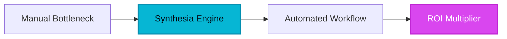

F**or decades, the corporate video production cycle was a graveyard of productivity.** If a Chief Learning Officer wanted to update a compliance video, they faced a logistical nightmare: booking a studio, hiring an actor, setting up lighting, and spending weeks in post-production. If a single line of the script changed six months later, the entire process had to be repeated. This friction didn't just cost money; it ensured that institutional knowledge remained trapped in dry, unread PDFs. Then came Synthesia.

Synthesia didn't just iterate on video editing; it fundamentally re-engineered how humans communicate at scale. By decoupling the 'messenger' from the 'message' through generative AI, they have effectively turned video production into a software problem rather than a hardware one.

## 1. The Genesis & Evolution: From Academic Theory to Enterprise Dominance

Synthesia was founded in 2017 by a team of AI researchers and entrepreneurs, including Victor Riparbelli and Steffen Tjerrild, alongside world-renowned vision scientists from UCL and TUM. Their goal was audacious: to make video production as easy as writing an email. While the early internet was fascinated with the 'deepfake' potential of synthetic media, Synthesia took a different path—the path of enterprise utility.

They realized that the $135 billion corporate training market was starving for a way to create localized, engaging content without the overhead of physical film crews. By focusing on hyper-realistic lip-syncing and ethical AI (using only consented actors), Synthesia moved from a novelty tool to a mission-critical component of the modern tech stack. Today, they have disrupted legacy dinosaurs in the L&D space, proving that a digital avatar can be more effective than a bored human presenter on a low-budget webcam.

## 2. Core Business Superpowers

Synthesia’s value proposition is built on four pillars that solve specific, high-cost enterprise pain points:

*   **Hyper-Scale Localization:** In a global economy, translating training content is usually the most expensive part of a rollout. Synthesia allows users to toggle between 140+ languages and accents instantly. The AI doesn't just translate the text; it adjusts the avatar's lip movements to match the phonemes of the target language.
*   **The 'Edit-Once' Lifecycle:** Unlike traditional video, a Synthesia project is dynamic. If a product feature changes, you simply edit the text in the script, hit generate, and a new video is ready in minutes. This 'living video' approach ensures content never becomes obsolete.
*   **Enterprise-Grade Security & Compliance:** Unlike consumer-grade AI tools, Synthesia is built for the Fortune 500. With SOC 2 Type II compliance, SSO, and a rigorous content moderation layer that prevents the creation of deepfakes or harmful content, it meets the strict requirements of IT procurement departments.
*   **SCORM & LMS Native Export:** For L&D professionals, the ability to export videos as SCORM packages means seamless integration into platforms like Workday, Cornerstone, or SAP Litmos, complete with tracking and completion data.

> [!NOTE]
> **Executive Takeaway:** "Synthesia represents the shift from 'captured' media to 'computed' media. In the enterprise, efficiency isn't just about speed—it's about the ability to scale human connection without scaling human costs."

## 3. Hands-on Workshop: The 15-Minute Blueprint

Transforming a static SOP into a professional video is simpler than you think. Follow this executive blueprint to build your first asset today:

### Step 1: The Script Architecture
Don't write a novel. Use Synthesia’s built-in AI script assistant to condense your technical documentation into conversational bullet points. Aim for 150 words per minute of video.

### Step 2: Avatar & Persona Selection
Choose an avatar that matches your brand's 'voice.' For internal training, a friendly, casual avatar works best. For sales enablement, choose a more formal, authoritative persona. You can even create a 'Custom Avatar' of your CEO for high-stakes internal comms.

### Step 3: Visual Staging
Synthesia uses a slide-based interface. Upload your brand's PowerPoint or Keynote slides as backgrounds. Use the 'Gestures' feature to make the avatar nod, point to the screen, or raise eyebrows at key moments to maintain viewer engagement.

### Step 4: Multi-Language Deployment
Once your master video in English is approved, use the 'Duplicate and Translate' feature. Within seconds, you can have versions for your teams in Tokyo, Berlin, and Sao Paulo, all featuring the same visual assets but localized audio and lip-syncing.

## 4. Critical Assessment & Trade-offs

While Synthesia is the market leader, it is important to understand where the technology currently stands.

| Feature | Strength | Limitation |
| :--- | :--- | :--- |
| **Lip-Sync Accuracy** | Best-in-class; virtually indistinguishable from reality in 1080p. | Can occasionally struggle with highly technical medical or legal jargon. |
| **Speed of Production** | Draft to final render in under 10 minutes. | High-volume teams may hit 'credit' limits on lower-tier plans. |
| **Ease of Use** | Intuitive drag-and-drop interface. | Advanced video editors might find the lack of a multi-track timeline limiting. |
| **Avatar Realism** | Excellent for instructional content. | Still lacks the 'emotional range' for high-drama or complex acting roles. |

## 5. HeliaTech Final Verdict & Recommendation

Synthesia is no longer a 'nice-to-have' experimental tool; it is a strategic asset for any organization that values speed and global reach. If your team is still spending thousands on external production houses for internal training or basic sales explainers, you are burning capital.

**The Executive Recommendation:** Start by migrating your most frequently updated training module (e.g., Compliance or Product Onboarding) to Synthesia. The time saved on the first update alone will justify the annual subscription cost. For enterprise leaders, the SOC 2 compliance makes this the only viable choice for secure, scalable generative video.

[Claim Your Free Synthesia Account ➔](/go/synthesia)
