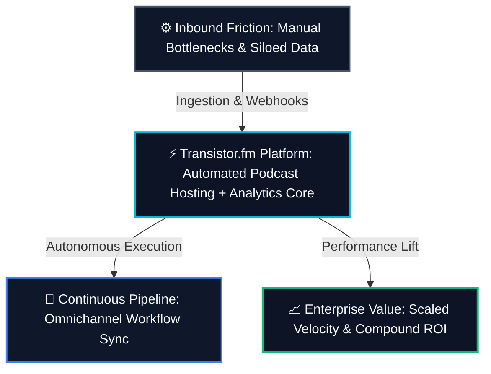

**T**he corporate audio landscape has fundamentally shifted. What started as a casual medium for indie creators has evolved into a powerhouse B2B distribution channel. Yet, for years, launching a professional podcast network or an internal company update feed felt like wrestling with archaic infrastructure. Fragmented hosting dashboards, punishing per-show subscription fees, and an absolute lack of enterprise-grade access controls forced marketing teams and communications leads into endless operational friction. The human bottleneck wasn't the recording equipment or the editing workflow—it was the fragile, clunky machinery required to push audio files to the masses securely and reliably.

Enter Transistor.fm. Built from the ground up to solve the architectural flaws of legacy hosting dinosaurs, it provides a streamlined, high-performance command center for brands, creators, and multi-show networks.

---

## 1. The Genesis & Evolution

The podcasting space was long dominated by legacy hosts operating on 2010s-era architectures that penalized growth. If a brand wanted to run multiple product shows, internal training feeds, and public marketing podcasts, they were forced to pay a separate, compounding base fee for every single show. It was a tax on corporate creativity.

Recognizing this broken paradigm, founders Jon Buda and Justin Jackson set out to build something modern, scalable, and radically fair. They envisioned a platform where professional creators and enterprises could host multiple podcasts under a single umbrella account without arbitrary financial friction. Transistor.fm was engineered to prioritize what matters most to modern organizations: clean multi-show management, bulletproof RSS distribution, and granular subscriber analytics. By bypassing the bloat of early-generation platforms, they created a lean, enterprise-ready engine that now powers thousands of top-tier brand and indie networks worldwide.

---

## 2. Core Business Superpowers

For B2B strategists and enterprise tech leads, Transistor.fm delivers distinct operational advantages that instantly translate into saved hours and fortified data security.

### Multi-Show Architecture Without Show-Count Penalties
Unlike legacy platforms that bill you per individual podcast feed, Transistor.fm allows you to host unlimited shows on higher tiers. Whether your marketing department launches a weekly industry roundtable, your HR team spins up an internal culture podcast, or your product group builds a technical deep-dive series, you manage them all from one centralized dashboard without incurring punishing base fees for every new RSS feed.

### Enterprise-Grade Private RSS Feeds
For internal company updates, board communications, or exclusive paid memberships, security is non-negotiable. Transistor.fm provides native private podcasting infrastructure. You can easily manage subscriber lists, authenticate members, and distribute secure, unlisted RSS feeds directly to employee or customer podcast apps without needing third-party membership plugins or clunky workarounds.

### Granular Analytics & Subscriber Insights
Knowing that an episode was downloaded is no longer enough for modern enterprises. Transistor.fm’s advanced analytics dashboard tracks downloads over time, identifies which podcast apps (Apple Podcasts, Spotify, Overcast) your audience prefers, and maps out geographic listener distribution. This data allows marketing teams to measure campaign ROI with absolute mathematical precision.

### Automated Multi-Directory Syndication & Dynamic Embeds
Time is capital. Transistor.fm streamlines distribution with one-click submissions to Apple Podcasts, Spotify, and Amazon Music. Furthermore, their embeddable multi-episode web players automatically update the moment you publish a new release, ensuring your corporate blog or landing page always showcases your freshest content without manual code adjustments.

> [!NOTE]
> **Executive Takeaway:** "Transistor.fm removed the friction from our multi-show network strategy. We manage internal communications and public marketing feeds under one roof with absolute data clarity."

---

> [!TIP]
> **HeliaTech Benchmark Access:** Test `Transistor.fm` with our verified enterprise trial link at [/go/transistor-fm](/go/transistor-fm).

## 3. Hands-on Workshop (15-Minute Blueprint)

Deploying a professional podcast feed shouldn't require an IT ticket. Follow this tactical 15-minute blueprint to get your show live and syndicating across the globe today.

### Step 1: Account Setup and Show Architecture
1. Navigate to [Transistor.fm](https://transistor.fm/?via=heliatech) and initiate your 14-day trial.
2. Click **"Add a New Podcast"**.
3. Input your show title, high-resolution cover art (3000x3000px), author name, and official brand description.
4. Select your primary podcast category and language settings.

### Step 2: Upload Your Pilot Episode
1. Prepare your final mixed audio file (.mp3 format, ideally encoded at 128kbps or 192kbps stereo).
2. Click **"Episodes" -> "New Episode"**.
3. Fill out the episode title, detailed show notes (incorporating relevant Markdown formatting and hyperlinks), and episode number.
4. Upload your audio file and set your publication schedule (publish immediately or schedule for a future date).

### Step 3: Configure Global Distribution
1. Navigate to your show's **"Distribution"** tab.
2. Copy your master RSS feed link.
3. Submit your RSS link directly to Apple Podcasts Connect and Spotify for Podcasters for initial directory approval. Once approved, subsequent episodes published on Transistor.fm will syndicate automatically.

### Step 4: Embed the Player on Your Corporate Site
1. Go to the **"Website & Embeds"** section of your dashboard.
2. Choose between the single-episode player or the multi-episode playlist player.
3. Copy the clean HTML iframe snippet and paste it directly into your company's CMS, landing page, or blog post.

---

## 4. Critical Assessment & Trade-offs

Objective evaluation is essential for enterprise tech selection. Here is how Transistor.fm stacks up across its capabilities and limitations:

| Feature / Metric | Assessment | Impact on B2B Users |
| :--- | :--- | :--- |
| **Unlimited Shows (Higher Tiers)** | Excellent | Drastically reduces administrative overhead and subscription bloat for multi-brand companies. |
| **Private Podcasting** | Robust | Enables secure internal communication and subscriber-only content delivery without custom code. |
| **Analytics Dashboard** | Comprehensive | Tracks app distribution and historical download trends for precise ROI measurement. |
| **Free Tier Availability** | Limitation | No permanent free tier; relies on a 14-day trial, which may deter casual hobbyists. |
| **Download Tier Caps** | Trade-off | Lower tiers have strict monthly download caps, requiring fast-growing shows to monitor traffic thresholds. |
| **In-App Audio Editing** | Limitation | Lacks advanced multitrack audio editing tools, requiring external DAWs like Audition or Descript. |

---

## 5. HeliaTech Final Verdict & Recommendation

Transistor.fm is a masterclass in purposeful SaaS design. By stripping away legacy complexities and focusing intensely on multi-show architecture, rock-solid private RSS feeds, and clean analytics, it stands as the premier podcast hosting platform for modern enterprises, agencies, and professional creators. 

While hobbyists testing the waters might balk at the lack of a permanent free tier, B2B teams and network operators will find that the time saved, the security of private feeds, and the clarity of subscriber data offer an immediate, undeniable return on investment.

If your organization is ready to scale its audio strategy without drowning in operational clutter, Transistor.fm is the definitive platform of choice.

**Executive Action:** [Claim your free Transistor.fm account today via HeliaTech](https://transistor.fm/?via=heliatech) and deploy your enterprise podcast network with total confidence.
