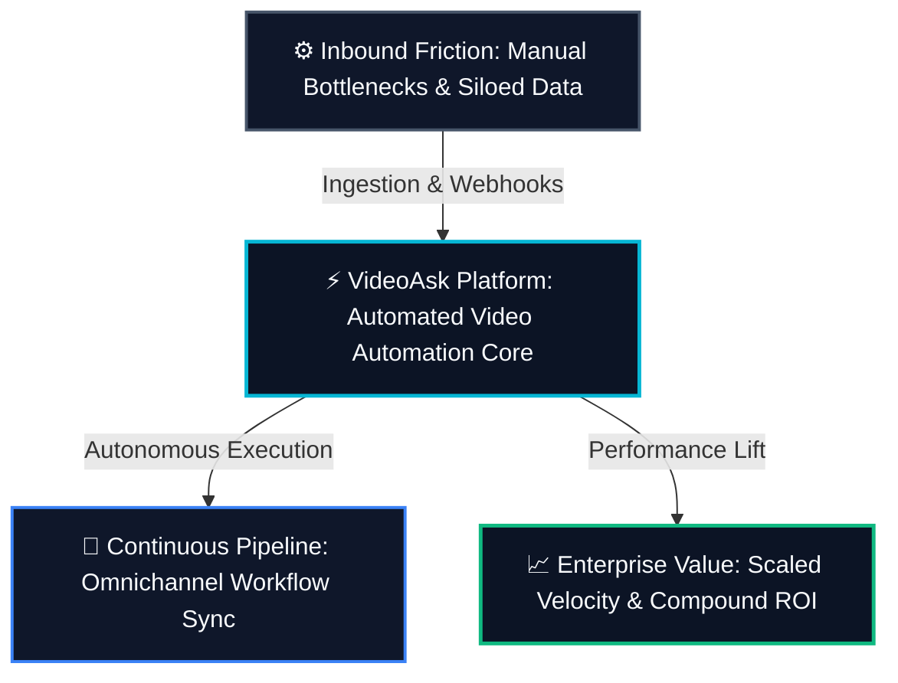

## The Death of the Static Form

**W**e live in an era of digital fatigue. Your prospects are drowning in a sea of sterile, text-based lead forms that feel more like administrative hurdles than opportunities for connection. For years, B2B companies have treated customers like data points, funneling them through rigid, soul-crushing surveys that bleed conversion rates dry. Enter VideoAsk, the disruptor that finally brings the human element back to the digital frontier.

## 1. The Genesis & Evolution

Born from the Typeform ecosystem, VideoAsk was sparked by a simple realization: the most effective sales happen face-to-face, yet our software stack was designed to hide behind a screen. The founders sought to bridge the gap between asynchronous convenience and the trust-building power of video. By moving away from legacy, form-first architectures, they created a platform that treats a lead capture not as a transaction, but as a conversation.

## 2. Core Business Superpowers

VideoAsk isn't just a video player; it is an intelligent routing engine. Here is how it shifts the needle for high-growth enterprises:

*   **Intelligent Branching Logic:** Route users based on their specific responses. If a prospect answers a question with 'budget concerns,' steer them toward a pricing case study. If they say 'ready to buy,' route them to a booking link.
*   **Asynchronous Efficiency:** No more 'Zoom fatigue.' Record your pitch once, and let the software handle the qualification, sentiment analysis, and scheduling while your team sleeps.
*   **Native Ecosystem Integration:** With deep hooks into HubSpot, Salesforce, and Calendly, the data captured in a VideoAsk doesn't sit in a silo—it flows directly into your CRM, updating lead scores in real-time.

> [!NOTE]
> **Executive Takeaway:** "The future of B2B isn't just about automation; it's about automating the parts of the business that make it feel human, not robotic." — Helia Tech Editorial

> [!TIP]
> **HeliaTech Benchmark Access:** Test `VideoAsk` with our verified enterprise trial link at [/go/videoask](/go/videoask).

## 3. Hands-on Workshop: The 15-Minute Blueprint

Ready to transform your lead funnel? Follow this structure to deploy your first smart funnel:

1.  **Define the Goal (3 mins):** Determine if you are qualifying leads, collecting testimonials, or offering asynchronous support.
2.  **Script the 'Hook' (4 mins):** Record a 30-second video addressing the user's pain point directly. Keep it conversational.
3.  **Map the Branches (5 mins):** Use the flow builder to create two distinct paths: one for 'Interested' (connects to Calendly) and one for 'Need more info' (leads to a resource download).
4.  **Embed & Deploy (3 mins):** Grab the widget snippet and place it on your high-traffic landing pages. 

## 4. Critical Assessment & Trade-offs

| Feature | Strength | Limitation |
| :--- | :--- | :--- |
| **Logic Engine** | Industry-leading branching | Can get complex to map at scale |
| **Integration** | Seamless with Typeform/CRMs | Requires higher tiers for full API access |
| **Pricing** | Flexible entry points | Aggressive jumps based on processing minutes |
| **Branding** | Professional interface | 'Powered by' badge is intrusive on lower tiers |

## 5. HeliaTech Final Verdict & Recommendation

VideoAsk is the definitive tool for companies tired of the 'conversion rate plateau.' While the pricing model forces a move to enterprise tiers as you scale, the ROI—measured in higher lead quality and reduced sales cycle duration—is undeniable. If you are a B2B organization looking to humanize your digital touchpoints, VideoAsk is not an expense; it is a competitive necessity. 

**Start your transformation today.**
