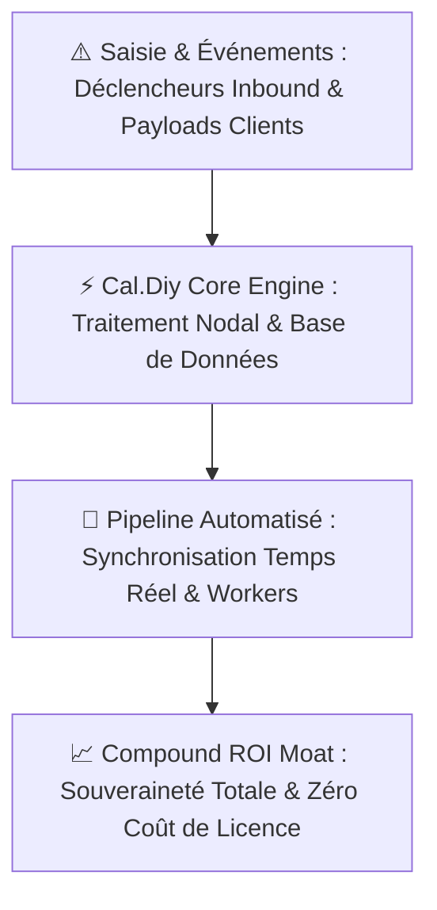

## 1. Ce que fait le projet en pratique (Executive Summary)

**[calcom/cal.com](https://github.com/calcom/cal.diy)** résout un problème structurel majeur pour les développeurs et fondateurs de SaaS : **Scheduling infrastructure for absolutely everyone.**.

Plutôt que de repartir d'une page blanche ou de payer des abonnements mensuels récurrents auprès de prestataires tiers, ce projet fournit une solution clé en main auto-hébergeable bâtie sur une stack moderne : **TypeScript**.

### Pour qui ce projet est-il conçu ?
* **Fondateurs Techniques & Indie Hackers :** Qui souhaitent déployer une infrastructure robuste en quelques commandes sans sacrifier leur trésorerie initiale.
* **Agences & Développeurs SaaS :** Nécessitant un contrôle souverain sur leurs données, leurs files d'attente et leurs protocoles de sécurité.
* **Équipes Engineering en Quête d'Alternative Open-Source :** Qui refusent le verrouillage propriétaire des éditeurs SaaS traditionnels.

---

## 2. Schéma d'Architecture & Flux Opérationnel

Notre nouveau composant vectoriel natif restitue le flux de traitement de l'infrastructure de `Cal.Diy` :

---

## 3. Analyse d'Ingénierie : Forces Techniques & Considérations Opérationnelles

L'analyse HeliaTech repose sur des métriques factuelles extraites du dépôt GitHub pour éclairer les choix d'architecture des équipes techniques.

| Dimension Analysée | Statut Détecté | Analyse HeliaTech |
| :--- | :---: | :--- |
| **Popularité & Traction** | `⭐ 50,168 stars` | Adoption communautaire de premier plan validée par 15,671 forks. |
| **Maintenance Active** | `Récente` | Dépôt activement mis à jour par l'équipe de mainteneurs. |
| **Conteneurisation Docker** | `Prêt pour Docker ✅` | Déploiement simplifié via conteneurs isolés. |
| **Robustesse & Tests** | `Suites de tests détectées ✅` | Couverture de tests garantissant la stabilité des builds. |
| **Cadre Juridique** | `MIT License` | Flexibilité maximale pour l'écosystème développeur. |

### 🚀 Forces Majeures de l'Architecture
1. **Adoption & Écosystème de Référence :** Avec plus de **50 000 étoiles** sur GitHub, Cal.com s'impose comme le standard open-source mondial de la prise de rendez-vous et de la gestion d'agendas.
2. **Architecture TypeScript Moderne :** Conçu en TypeScript avec une séparation claire des API, des webhooks et des intégrations calendriers (Google Calendar, Outlook, CalDAV).
3. **Souveraineté des Données :** Permet aux entreprises sous contraintes strictes (RGPD, HIPAA, données de santé) d'héberger l'intégralité de leurs réunions et métadonnées sur leur propre cloud privé.

### ⚙️ Considérations Opérationnelles & Déploiement en Production
1. **Périmètre de Maintenance en Auto-Hébergement :** Déployer son propre cluster de synchronisation calendaire requiert une gestion soignée des tokens OAuth, des webhooks de synchronisation et des files de rappel.
2. **Gestion des Évolutions d'API Externes :** Les fournisseurs d'agenda (Microsoft, Google, Apple) mettent fréquemment à jour leurs protocoles d'autorisation, nécessitant le suivi régulier des releases.
3. **La Voie Managée Recommandée :** Pour les équipes qui recherchent la puissance de l'API Cal.com avec une disponibilité garantie de 99.99% et un support SLA dédié, la solution officielle **[Cal.com Cloud & Enterprise](/go/cal-com)** est le choix le plus efficient.

---

## 4. Le Verdict Décideur : Auto-Hébergement vs Solution Cloud Managée

* **Optez pour l'Auto-Hébergement ([Voir le repo GitHub](https://github.com/calcom/cal.diy)) si :** Vous disposez d'une équipe d'ingénieurs dédiée et que vos obligations de conformité nécessitent une rétention de données 100% sur site.
* **Optez pour la Version Cloud Officielle ([Cal.com Enterprise](/go/cal-com)) si :** Vous voulez déployer en production en 5 minutes avec toutes les intégrations clés en main, sans aucune charge d'exploitation sur vos serveurs.
