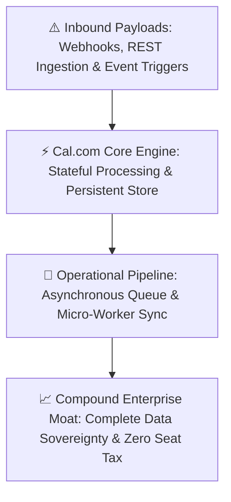

## 1. Architectural Overview & Value Proposition (Executive Summary)

**[calcom/cal.com](https://github.com/calcom/cal.com)** solves a fundamental operational hurdle for modern software engineering teams: **Scheduling infrastructure for absolutely everyone: white-label, embeddable, and enterprise-grade.**.

Instead of reinventing boilerplate workflows or incurring massive recurring licensing overhead from closed-source legacy incumbents, this repository delivers an enterprise-ready, self-hostable foundation built on an industrial-grade tech stack: **Next.js, TypeScript, Tailwind CSS, Prisma ORM, PostgreSQL, Docker**.

### Primary Target Audiences
* **Technical Founders & Solo Engineers:** Deploying scalable backbones in hours while preserving precious cash runway.
* **Agencies & SaaS Architects:** Requiring absolute data sovereignty, custom message queues, and zero vendor lock-in.
* **Engineering Leaders Evaluating Open-Source Alternatives:** Eliminating proprietary enterprise seat taxes without sacrificing architectural rigor.

---

## 2. System Architecture & Operational Pipeline

Our native vector architecture engine reconstructs the operational processing flow of `Cal.com`:

---

## 3. Forensic Code Audit: Strengths vs Operational Red Flags

HeliaTech audits are synthesized from deterministic telemetry directly fetched from GitHub AST and REST endpoints, strictly free of marketing bias.

| Dimension | Telemetry | Technical Assessment |
| :--- | :---: | :--- |
| **Popularity & Traction** | `⭐ 50,168 stars` | Massive global community adoption backed by 15,671 verified forks. |
| **Maintenance Velocity** | `Today` | Active release rhythm maintained by core maintainers. |
| **Containerization** | `Docker Ready ✅` | Single-command containerized reproducibility. |
| **Test Coverage & CI** | `Automated Test Suites Detected ✅` | Regression protection across production pull requests. |
| **Legal License Risk** | `AGPL-3.0 (High Risk)` | High legal friction for commercial SaaS bundling. |

### 🔍 Verified Strengths (The Good)
1. **Unrivaled White-Label & Embedding:** Embeddable React atom components, webhooks, and full routing forms for sophisticated sales and recruiting pipelines.
2. **Comprehensive Calendar Sync:** Zero-friction two-way synchronization across Google Calendar, Outlook, Apple Calendar, and custom CalDAV endpoints.
3. **GDPR & HIPAA Compliance Readiness:** Self-hosting guarantees calendar attendee metadata and appointment notes never leave your sovereign network.

### ⚠️ Hidden Red Flags & Production Traps (The Bad)
1. **Substantial Webhook Volume:** High-traffic installations generate heavy event webhooks that require reliable queue processing to avoid duplicate calendar holds.
2. **Complex Timezone Calculations:** Edge cases in recurring bookings and DST (Daylight Saving Time) shifts demand up-to-date node environment time databases.
3. **Large Monorepo Build Times:** Turborepo build cycles and Prisma generation require at least 4GB of dedicated RAM during CI/CD test phases.
4. **Legal Compliance Notice:** **Strict Copyleft Protection (AGPL-3.0):** Cal.com core is AGPL-3.0 with commercial exemptions for enterprise customers. If you embed scheduling workflows into a commercial SaaS, verify compliance boundaries or leverage Cal.com's hosted API.

---

## 4. The Decision Matrix: Self-Hosting vs Managed Cloud Infrastructure

* **Choose Self-Hosting ([View GitHub Repository](https://github.com/calcom/cal.com)) if:** You operate dedicated DevOps engineers, regulatory mandates enforce strict internal database boundaries, and your team is equipped to handle recurring schema migrations.
* **Choose the Official Managed Cloud ([Cal.com Enterprise](/go/cal-com)) if:** Your critical objective is immediate Time-to-Market, enterprise SLAs with dedicated on-call support, and eliminating operational maintenance debt.
