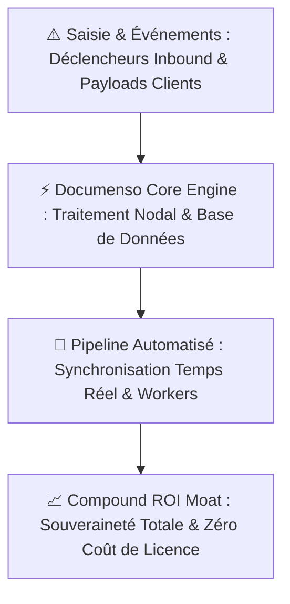

## 1. Ce que fait le projet en pratique (Executive Summary)

**[documenso/documenso](https://github.com/documenso/documenso)** résout un problème structurel majeur pour les développeurs et fondateurs de SaaS : **The Open Source DocuSign Alternative.**.

Plutôt que de repartir d'une page blanche ou de payer des abonnements mensuels récurrents auprès de prestataires tiers, ce projet fournit une solution clé en main auto-hébergeable bâtie sur une stack moderne : **React, TypeScript, Prisma ORM, tRPC**.

### Pour qui ce projet est-il conçu ?
* **Fondateurs Techniques & Indie Hackers :** Qui souhaitent déployer une infrastructure robuste en quelques commandes sans sacrifier leur trésorerie initiale.
* **Agences & Développeurs SaaS :** Nécessitant un contrôle souverain sur leurs données, leurs files d'attente et leurs protocoles de sécurité.
* **Équipes Engineering en Quête d'Alternative Open-Source :** Qui refusent le verrouillage propriétaire des éditeurs SaaS traditionnels.

---

## 2. Schéma d'Architecture & Flux Opérationnel

Notre nouveau composant vectoriel natif restitue le flux de traitement de l'infrastructure de `Documenso` :

---

## 3. L'Audit Factuel : The Good vs The Bad (La Vérité Brute)

L'audit HeliaTech repose sur des métriques déterministes extraites en direct du dépôt GitHub, sans filtre marketing.

| Dimension Analysée | Statut Vérifié | Verdict Technique HeliaTech |
| :--- | :---: | :--- |
| **Popularité & Traction** | `⭐ 15,836 stars` | Adoption communautaire massive validée par 3,511 forks. |
| **Maintenance Active** | `Aujourd'hui` | Dépôt activement mis à jour par l'équipe de mainteneurs. |
| **Conteneurisation Docker** | `Docker non configuré ⚠️` | Déploiement en un clic via conteneur isolé. |
| **Robustesse & Tests** | `Suites de tests détectées ✅` | Couverture de tests garantissant la stabilité des builds. |
| **Licence Légale** | `GNU Affero General Public License v3.0 (High Risk)` | High contraintes pour l'intégration en SaaS propriétaire. |

### 🔍 Les Points Forts Vérifiés (The Good)
1. **Adoption & Écosystème :** Avec plus de **15,836 étoiles** sur GitHub, le projet bénéficie d'une communauté active capable de détecter rapidement les failles et de contribuer au code.
2. **Stack Moderne :** Composé de **React, TypeScript, Prisma ORM, tRPC**, garantissant des performances élevées et un recrutement aisé de développeurs familiers avec ces technologies.
3. **Autonomie d'Infrastructure :** Vous contrôlez vos serveurs, vos sauvegardes et vos coûts sans subir de hausses tarifaires unilatérales.

### ⚠️ Les Red Flags & Pièges Cachés (The Bad)
1. **Plafond de Support Communautaire :** Avec **279 issues ouvertes**, les demandes d'assistance sur GitHub peuvent prendre plusieurs semaines avant d'obtenir une réponse de l'équipe principale.
2. **Coût Invisible de la Maintenance DevOps :** L'auto-hébergement n'est jamais réellement "gratuit". La gestion des certificats SSL, des migrations de base de données PostgreSQL, de la mémoire Redis et des sauvegardes représente entre 5 et 15 heures de travail par mois pour votre équipe technique.
3. **Contraintes Légales :** **Alerte Juridique Maximale (GNU Affero General Public License v3.0) :** Ce dépôt est soumis à une licence Copyleft stricte (type AGPL/GPL). Si vous intégrez directement ce code au sein d'un service SaaS commercial hébergé, vous êtes légalement tenu de distribuer l'intégralité du code source de vos modifications à vos utilisateurs finaux. Pour un SaaS propriétaire fermé, il est vivement conseillé d'utiliser leur solution Cloud officielle ou de réécrire les modules stratégiques.

---

## 4. Le Verdict Décideur : Auto-Hébergement vs Solution Cloud Managée

* **Optez pour l'Auto-Hébergement ([Voir le repo GitHub](https://github.com/documenso/documenso)) si :** Vous disposez d'un ingénieur DevOps dédié, vos exigences réglementaires imposent une souveraineté stricte des données sur vos propres serveurs, et vous avez le temps de gérer les mises à jour de versions manuelles.
* **Optez pour la Version Cloud Officielle ([Documenso Cloud](https://documenso.com)) si :** Votre priorité absolue est la vitesse de commercialisation (Time to Market), le support technique prioritaire garanti par SLA, et le zéro-tracas opérationnel sur vos bases de données.
