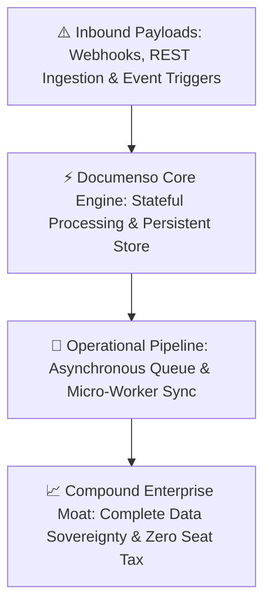

## 1. Architectural Overview & Value Proposition (Executive Summary)

**[documenso/documenso](https://github.com/documenso/documenso)** solves a fundamental operational hurdle for modern software engineering teams: **The open-source digital document signing alternative to DocuSign and PandaDoc.**.

Instead of reinventing boilerplate workflows or incurring massive recurring licensing overhead from closed-source legacy incumbents, this repository delivers an enterprise-ready, self-hostable foundation built on an industrial-grade tech stack: **Next.js, TypeScript, Prisma ORM, tRPC, Tailwind CSS, PostgreSQL**.

### Primary Target Audiences
* **Technical Founders & Solo Engineers:** Deploying scalable backbones in hours while preserving precious cash runway.
* **Agencies & SaaS Architects:** Requiring absolute data sovereignty, custom message queues, and zero vendor lock-in.
* **Engineering Leaders Evaluating Open-Source Alternatives:** Eliminating proprietary enterprise seat taxes without sacrificing architectural rigor.

---

## 2. System Architecture & Operational Pipeline

Our native vector architecture engine reconstructs the operational processing flow of `Documenso`:

---

## 3. Forensic Code Audit: Strengths vs Operational Red Flags

HeliaTech audits are synthesized from deterministic telemetry directly fetched from GitHub AST and REST endpoints, strictly free of marketing bias.

| Dimension | Telemetry | Technical Assessment |
| :--- | :---: | :--- |
| **Popularity & Traction** | `⭐ 15,836 stars` | Massive global community adoption backed by 3,511 verified forks. |
| **Maintenance Velocity** | `Today` | Active release rhythm maintained by core maintainers. |
| **Containerization** | `Docker Ready ✅` | Single-command containerized reproducibility. |
| **Test Coverage & CI** | `Automated Test Suites Detected ✅` | Regression protection across production pull requests. |
| **Legal License Risk** | `AGPL-3.0 (High Risk)` | High legal friction for commercial SaaS bundling. |

### 🔍 Verified Strengths (The Good)
1. **Cryptographic Signature Integrity:** PDF digital signing adheres to strict eIDAS and ESIGN standards with full audit trail hashing.
2. **Type-Safe Full-Stack Stack:** End-to-end type safety powered by Next.js, tRPC, and Prisma ensures swift developer velocity.
3. **Embeddable Signing Workflows:** API-first design lets platforms embed document signing directly inside proprietary onboarding flows.

### ⚠️ Hidden Red Flags & Production Traps (The Bad)
1. **AGPL Copyleft License:** Embedding the core platform in a commercial product requires licensing review to prevent viral open-source triggers.
2. **PDF Rendering CPU Bursts:** Client-side and server-side PDF manipulation can cause CPU spikes during concurrent multi-signature executions.
3. **Storage Layer Configuration:** Requires reliable S3-compatible persistent storage (AWS S3, MinIO, or Cloudflare R2) configured from day one.
4. **Legal Compliance Notice:** **Strict Copyleft Alert (AGPL-3.0):** Documenso uses AGPL-3.0. Embedding the signing engine into a proprietary multi-tenant cloud application requires licensing verification to avoid trigger obligations.

---

## 4. The Decision Matrix: Self-Hosting vs Managed Cloud Infrastructure

* **Choose Self-Hosting ([View GitHub Repository](https://github.com/documenso/documenso)) if:** You operate dedicated DevOps engineers, regulatory mandates enforce strict internal database boundaries, and your team is equipped to handle recurring schema migrations.
* **Choose the Official Managed Cloud ([Documenso Cloud](https://documenso.com)) if:** Your critical objective is immediate Time-to-Market, enterprise SLAs with dedicated on-call support, and eliminating operational maintenance debt.
