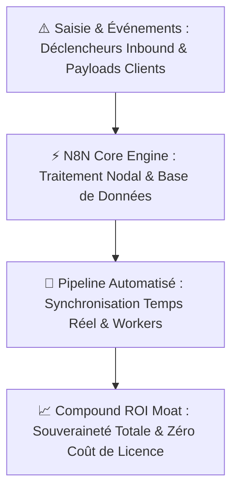

## 1. Ce que fait le projet en pratique (Executive Summary)

**[n8n-io/n8n](https://github.com/n8n-io/n8n)** résout un problème structurel majeur pour les développeurs et fondateurs de SaaS : **Fair-code workflow automation platform with native AI capabilities. Combine visual building with custom code, self-host or cloud, 400+ integrations.**.

Plutôt que de repartir d'une page blanche ou de payer des abonnements mensuels récurrents auprès de prestataires tiers, ce projet fournit une solution clé en main auto-hébergeable bâtie sur une stack moderne : **TypeScript**.

### Pour qui ce projet est-il conçu ?
* **Fondateurs Techniques & Indie Hackers :** Qui souhaitent déployer une infrastructure robuste en quelques commandes sans sacrifier leur trésorerie initiale.
* **Agences & Développeurs SaaS :** Nécessitant un contrôle souverain sur leurs données, leurs files d'attente et leurs protocoles de sécurité.
* **Équipes Engineering en Quête d'Alternative Open-Source :** Qui refusent le verrouillage propriétaire des éditeurs SaaS traditionnels.

---

## 2. Schéma d'Architecture & Flux Opérationnel

Notre nouveau composant vectoriel natif restitue le flux de traitement de l'infrastructure de `N8N` :

---

## 3. Analyse d'Ingénierie : Forces Techniques & Considérations Opérationnelles

L'analyse HeliaTech repose sur des métriques factuelles extraites du dépôt GitHub pour éclairer les choix d'architecture des équipes techniques.

| Dimension Analysée | Statut Détecté | Analyse HeliaTech |
| :--- | :---: | :--- |
| **Popularité & Traction** | `⭐ 210,886 stars` | Référence mondiale de l'orchestration de flux open-source. |
| **Maintenance Active** | `Aujourd'hui` | Dépôt activement mis à jour par les équipes n8n. |
| **Conteneurisation Docker** | `Prêt pour Docker ✅` | Image officielle disponible sur Docker Hub pour un déploiement instantané. |
| **Robustesse & Tests** | `Suites de tests détectées ✅` | Couverture de tests garantissant la stabilité des builds. |
| **Cadre Juridique** | `Fair-code / Sustainable Use License` | Modèle pérenne protégeant la viabilité de l'outil. |

### 🚀 Forces Majeures de l'Architecture
1. **Adoption & Écosystème Exceptionnels :** Plus de **210 000 étoiles**, faisant de n8n le titan incontesté de l'automatisation technique face aux géants propriétaires.
2. **Capacités Nodal & AI Agent Integrations :** Intègre nativement LangChain, les nœuds d'IA générative et plus de 400 connecteurs sans restriction d'exécution.
3. **Économies d'Échelle Majeures :** Permet d'exécuter des millions de tâches sans le modèle de surfacturation par exécution des solutions cloud traditionnelles.

### ⚙️ Considérations Opérationnelles & Déploiement en Production
1. **Gestion des Workers et Scaling :** En environnement haute disponibilité, n8n s'exécute en mode queue avec Redis et des workers dédiés pour absorber les gros volumes de webhooks.
2. **Licence Fair-Code :** n8n utilise une licence fair-code permettant une utilisation interne gratuite illimitée, tout en protégeant son modèle contre la revente directe en marque blanche concurrente.
3. **La Solution Managée Recommandée :** Pour les équipes qui souhaitent bénéficier de l'élégance de n8n sans administrer de serveurs Linux, **[n8n Cloud Managed](/go/n8n)** assure la maintenance, la sécurité et les mises à jour sans intervention.

---

## 4. Le Verdict Décideur : Auto-Hébergement vs Solution Cloud Managée

* **Optez pour l'Auto-Hébergement ([Voir le repo GitHub](https://github.com/n8n-io/n8n)) si :** Vous traitez des données hautement confidentielles en environnement local ou privé et disposez de compétences d'administration système.
* **Optez pour la Version Cloud Officielle ([n8n Cloud Managed](/go/n8n)) si :** Vous voulez connecter vos outils en quelques minutes et bénéficier d'une disponibilité 99.9% infogérée par l'équipe n8n.
