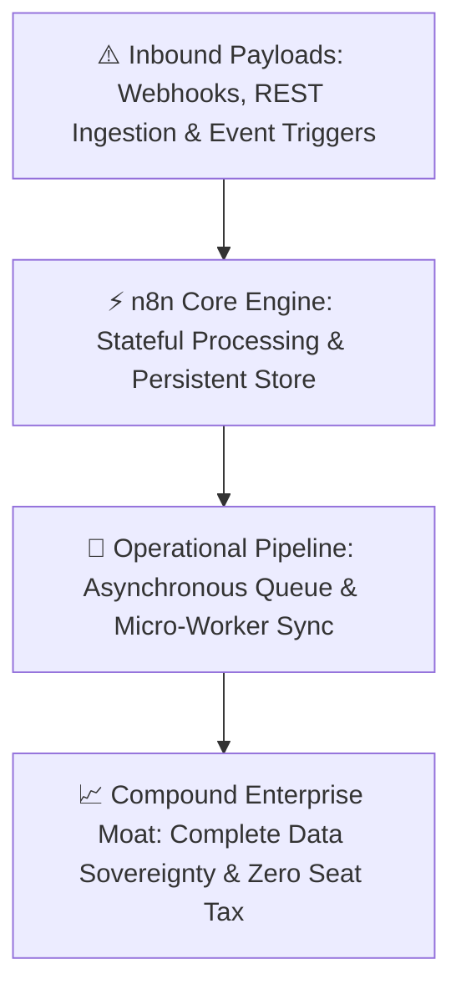

## 1. Architectural Overview & Value Proposition (Executive Summary)

**[n8n-io/n8n](https://github.com/n8n-io/n8n)** solves a fundamental operational hurdle for modern software engineering teams: **Fair-code workflow automation platform with native AI agent orchestration and 400+ nodes.**.

Instead of reinventing boilerplate workflows or incurring massive recurring licensing overhead from closed-source legacy incumbents, this repository delivers an enterprise-ready, self-hostable foundation built on an industrial-grade tech stack: **Node.js, TypeScript, Vue.js, PostgreSQL, Redis, Docker**.

### Primary Target Audiences
* **Technical Founders & Solo Engineers:** Deploying scalable backbones in hours while preserving precious cash runway.
* **Agencies & SaaS Architects:** Requiring absolute data sovereignty, custom message queues, and zero vendor lock-in.
* **Engineering Leaders Evaluating Open-Source Alternatives:** Eliminating proprietary enterprise seat taxes without sacrificing architectural rigor.

---

## 2. System Architecture & Operational Pipeline

Our native vector architecture engine reconstructs the operational processing flow of `n8n`:

---

## 3. Forensic Code Audit: Strengths vs Operational Red Flags

HeliaTech audits are synthesized from deterministic telemetry directly fetched from GitHub AST and REST endpoints, strictly free of marketing bias.

| Dimension | Telemetry | Technical Assessment |
| :--- | :---: | :--- |
| **Popularity & Traction** | `⭐ 210,886 stars` | Massive global community adoption backed by 61,556 verified forks. |
| **Maintenance Velocity** | `Today` | Active release rhythm maintained by core maintainers. |
| **Containerization** | `Docker Ready ✅` | Single-command containerized reproducibility. |
| **Test Coverage & CI** | `Automated Test Suites Detected ✅` | Regression protection across production pull requests. |
| **Legal License Risk** | `Sustainable Use License / Fair-Code (Medium Risk)` | Medium legal friction for commercial SaaS bundling. |

### 🔍 Verified Strengths (The Good)
1. **Native AI Agent Building:** Integrates LangChain, vector stores, OpenAI/Anthropic models, and custom tools directly within visual flowchart canvases.
2. **400+ Enterprise Connectors:** Pre-built nodes covering CRM, ERP, databases, messaging, and cloud providers with granular error triggers.
3. **Massive Community Ecosystem:** Over 210,000 GitHub stars make it the dominant open-source workflow automation platform globally.

### ⚠️ Hidden Red Flags & Production Traps (The Bad)
1. **Execution History DB Bloat:** Without strict workflow execution data pruning, PostgreSQL tables can swell into hundreds of gigabytes within months.
2. **Worker Mode Scaling Overhead:** Scaling beyond single-process execution requires Redis queue configuration and multi-worker container orchestration.
3. **Fair-Code Commercial Boundary:** Requires strict legal review if planning to resell automated workflows as an external commercial offering.
4. **Legal Compliance Notice:** **Fair-Code Commercial Policy:** n8n is free for internal company use and self-hosting. However, you cannot offer n8n as a hosted service or commercial white-label iPaaS to third parties without an enterprise license from n8n GmbH.

---

## 4. The Decision Matrix: Self-Hosting vs Managed Cloud Infrastructure

* **Choose Self-Hosting ([View GitHub Repository](https://github.com/n8n-io/n8n)) if:** You operate dedicated DevOps engineers, regulatory mandates enforce strict internal database boundaries, and your team is equipped to handle recurring schema migrations.
* **Choose the Official Managed Cloud ([n8n Cloud Managed](/go/n8n)) if:** Your critical objective is immediate Time-to-Market, enterprise SLAs with dedicated on-call support, and eliminating operational maintenance debt.
