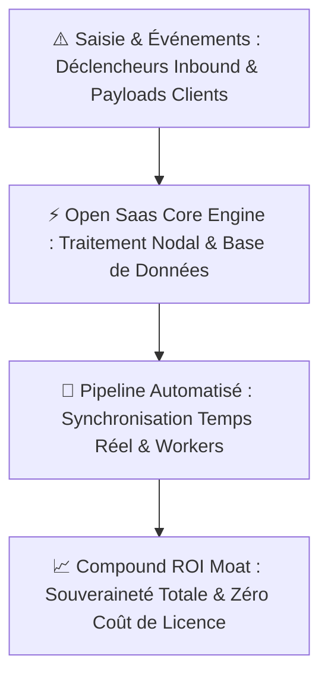

## 1. Ce que fait le projet en pratique (Executive Summary)

**[wasp-lang/open-saas](https://github.com/wasp-lang/open-saas)** résout un problème structurel majeur pour les développeurs et fondateurs de SaaS : **A 100% free modern JS SaaS boilerplate (React, NodeJS, Prisma). Full-featured: Auth (email, google, github, slack, MS), Email sending, Background jobs, Landing page, Payments (Stri**.

Plutôt que de repartir d'une page blanche ou de payer des abonnements mensuels récurrents auprès de prestataires tiers, ce projet fournit une solution clé en main auto-hébergeable bâtie sur une stack moderne : **TypeScript**.

### Pour qui ce projet est-il conçu ?
* **Fondateurs Techniques & Indie Hackers :** Qui souhaitent déployer une infrastructure robuste en quelques commandes sans sacrifier leur trésorerie initiale.
* **Agences & Développeurs SaaS :** Nécessitant un contrôle souverain sur leurs données, leurs files d'attente et leurs protocoles de sécurité.
* **Équipes Engineering en Quête d'Alternative Open-Source :** Qui refusent le verrouillage propriétaire des éditeurs SaaS traditionnels.

---

## 2. Schéma d'Architecture & Flux Opérationnel

Notre nouveau composant vectoriel natif restitue le flux de traitement de l'infrastructure de `Open Saas` :

---

## 3. Analyse d'Ingénierie : Forces Techniques & Considérations Opérationnelles

L'analyse HeliaTech repose sur des métriques factuelles extraites du dépôt GitHub pour éclairer les choix d'architecture des équipes techniques.

| Dimension Analysée | Statut Détecté | Analyse HeliaTech |
| :--- | :---: | :--- |
| **Popularité & Traction** | `⭐ 16,362 stars` | Modèle de référence pour le lancement rapide de SaaS React/Node. |
| **Maintenance Active** | `Récente` | Dépôt activement mis à jour par l'équipe Wasp. |
| **Conteneurisation Docker** | `Prêt pour Docker ✅` | Déploiement simplifié via conteneurs isolés. |
| **Robustesse & Tests** | `Suites de tests détectées ✅` | Couverture de tests garantissant la stabilité des builds. |
| **Cadre Juridique** | `MIT License` | Licence permissive totale sans restriction commerciale. |

### 🚀 Forces Majeures de l'Architecture
1. **Accélération du Time-to-Market :** Fournit un template fullstack complet avec authentification, paiements Stripe, emails transactionnels et dashboard admin pré-intégrés.
2. **Stack Moderne & Typée :** Construit sur React, Node.js, Prisma et le compilateur Wasp pour une cohérence TypeScript de bout en bout.
3. **Zéro Redevance Propriétaire :** Licence 100% libre permettant de bâtir des micro-SaaS ou des logiciels d'entreprise sans royalties.

### ⚙️ Considérations Opérationnelles & Déploiement en Production
1. **Écosystème Wasp Framework :** Utilise le DSL Wasp pour orchestrer les entités, les routes et l'authentification, ce qui simplifie grandement le code mais demande une brève prise en main du framework.
2. **Choix des Fournisseurs de Services :** En production, il est recommandé de coupler le template à des services managés fiables (Postgres sur Supabase ou Neon, emails via Resend).
3. **La Documentation Officielle :** Le template est maintenu avec soin par l'équipe fondatrice sur **[Open SaaS Official](https://opensaas.sh)**, garantissant des mises à jour régulières de sécurité.

---

## 4. Le Verdict Décideur : Auto-Hébergement vs Solution Managée

* **Optez pour le Template Open-Source ([Voir le repo GitHub](https://github.com/wasp-lang/open-saas)) si :** Vous voulez lancer un MVP en quelques jours avec une architecture moderne déjà câblée.
* **Consultez la Documentation Wasp ([Wasp Official](https://opensaas.sh)) si :** Vous souhaitez comprendre les primitives de configuration et étendre le squelette vers des besoins d'entreprise complexes.
