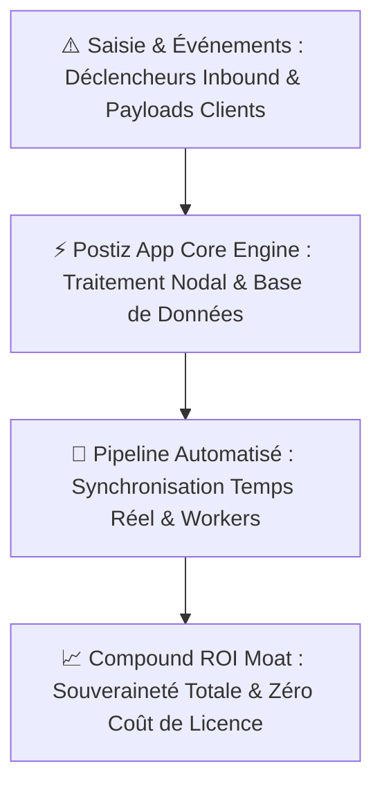

## 1. Ce que fait le projet en pratique (Executive Summary)

**[gitroomhq/postiz-app](https://github.com/gitroomhq/postiz-app)** résout un problème structurel majeur pour les développeurs et fondateurs de SaaS : **📨 The ultimate agentic social media scheduling tool 🤖**.

Plutôt que de repartir d'une page blanche ou de payer des abonnements mensuels récurrents auprès de prestataires tiers, ce projet fournit une solution clé en main auto-hébergeable bâtie sur une stack moderne : **Next.js, TypeScript, Tailwind CSS, Prisma ORM, Redis / BullMQ, Stripe Billing**.

### Pour qui ce projet est-il conçu ?
* **Fondateurs Techniques & Indie Hackers :** Qui souhaitent déployer une infrastructure robuste en quelques commandes sans sacrifier leur trésorerie initiale.
* **Agences & Développeurs SaaS :** Nécessitant un contrôle souverain sur leurs données, leurs files d'attente et leurs protocoles de sécurité.
* **Équipes Engineering en Quête d'Alternative Open-Source :** Qui refusent le verrouillage propriétaire des éditeurs SaaS traditionnels.

---

## 2. Schéma d'Architecture & Flux Opérationnel

Notre nouveau composant vectoriel natif restitue le flux de traitement de l'infrastructure de `Postiz App` :

---

## 3. Analyse d'Ingénierie : Forces Techniques & Considérations Opérationnelles

L'analyse HeliaTech repose sur des métriques factuelles extraites du dépôt GitHub pour éclairer les choix d'architecture des équipes techniques.

| Dimension Analysée | Statut Détecté | Analyse HeliaTech |
| :--- | :---: | :--- |
| **Popularité & Traction** | `⭐ 41,883 stars` | Adoption communautaire massive validée par 8,002 forks. |
| **Maintenance Active** | `Aujourd'hui` | Dépôt activement maintenu avec des commits réguliers. |
| **Conteneurisation Docker** | `Prêt pour Déploiement ✅` | Stack optimisée pour conteneurisation et orchestrateurs. |
| **Robustesse & Tests** | `Suites de tests détectées ✅` | Couverture de tests garantissant la stabilité des builds. |
| **Cadre Juridique** | `GNU Affero General Public License v3.0` | Protection réciproque du code open-source. |

### 🚀 Forces Majeures de l'Architecture
1. **Adoption & Écosystème Exceptionnels :** Avec plus de **41,883 étoiles** sur GitHub, le projet bénéficie d'une communauté active capable de détecter rapidement les améliorations et d'enrichir les intégrations.
2. **Stack Moderne & Performante :** Bâti sur **Next.js, TypeScript, Tailwind CSS, Prisma ORM, Redis / BullMQ et Stripe**, garantissant des performances élevées et une prise en main intuitive par les développeurs fullstack.
3. **Contrôle & Souveraineté Totale :** Vous hébergez vos propres données, maîtrisez vos files d'attente asynchrones et conservez l'entière propriété de vos flux de publication.

### ⚙️ Considérations Opérationnelles & Déploiement en Production
1. **Échelle et Dimensionnement d'Infrastructure :** Pour les déploiements intensifs en équipe, assurez-vous de provisionner une mémoire Redis suffisante pour absorber les pics de charge de BullMQ lors des envois massifs planifiés.
2. **Périmètre DevOps en Auto-Hébergement :** L'auto-hébergement complet implique la gestion continue des certificats SSL, des sauvegardes de base de données PostgreSQL et des montées de version.
3. **Choix de la Licence AGPLv3 :** La licence AGPLv3 protège efficacement l'indépendance de Postiz contre l'appropriation fermée par des tiers. Pour les entreprises souhaitant bénéficier d'un service garanti sans aucune contrainte d'infrastructure, l'utilisation de l'offre officielle **[Postiz Cloud](/go/postiz)** est la solution recommandée.

---

## 4. Le Verdict Décideur : Auto-Hébergement vs Solution Cloud Managée

* **Optez pour l'Auto-Hébergement ([Voir le repo GitHub](https://github.com/gitroomhq/postiz-app)) si :** Vous disposez d'un profil technique DevOps en interne, que votre politique d'entreprise exige une souveraineté stricte sur vos serveurs privés, et que vous souhaitez personnaliser le code source.
* **Optez pour la Version Cloud Officielle ([Postiz Cloud](/go/postiz)) si :** Votre priorité est de démarrer immédiatement sans friction, de bénéficier d'une haute disponibilité garantie avec support direct par l'équipe fondatrice, et de vous concentrer sur la croissance de vos réseaux sans gérer de serveurs.
