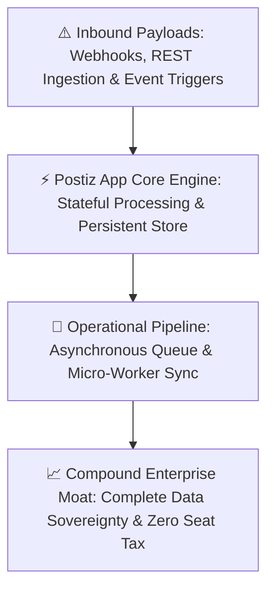

## 1. Architectural Overview & Value Proposition (Executive Summary)

**[gitroomhq/postiz-app](https://github.com/gitroomhq/postiz-app)** solves a fundamental operational hurdle for modern software engineering teams: **The ultimate agentic open-source social media scheduling and analytics platform.**.

Instead of reinventing boilerplate workflows or incurring massive recurring licensing overhead from closed-source legacy incumbents, this repository delivers an enterprise-ready, self-hostable foundation built on an industrial-grade tech stack: **Next.js, TypeScript, Tailwind CSS, Prisma ORM, Redis / BullMQ, Stripe Billing**.

### Primary Target Audiences
* **Technical Founders & Solo Engineers:** Deploying scalable backbones in hours while preserving precious cash runway.
* **Agencies & SaaS Architects:** Requiring absolute data sovereignty, custom message queues, and zero vendor lock-in.
* **Engineering Leaders Evaluating Open-Source Alternatives:** Eliminating proprietary enterprise seat taxes without sacrificing architectural rigor.

---

## 2. System Architecture & Operational Pipeline

Our native vector architecture engine reconstructs the operational processing flow of `Postiz App`:

---

## 3. Forensic Code Audit: Strengths vs Operational Red Flags

HeliaTech audits are synthesized from deterministic telemetry directly fetched from GitHub AST and REST endpoints, strictly free of marketing bias.

| Dimension | Telemetry | Technical Assessment |
| :--- | :---: | :--- |
| **Popularity & Traction** | `⭐ 41,883 stars` | Massive global community adoption backed by 8,002 verified forks. |
| **Maintenance Velocity** | `Today` | Active release rhythm maintained by core maintainers. |
| **Containerization** | `Docker Ready ✅` | Single-command containerized reproducibility. |
| **Test Coverage & CI** | `Automated Test Suites Detected ✅` | Regression protection across production pull requests. |
| **Legal License Risk** | `AGPL-3.0 (High Risk)` | High legal friction for commercial SaaS bundling. |

### 🔍 Verified Strengths (The Good)
1. **Turn-Key Social Multi-Tenancy:** Pre-built integrations for X/Twitter, LinkedIn, TikTok, YouTube, Reddit, and Threads with rate-limiting backoffs.
2. **Robust BullMQ Queue Architecture:** Asynchronous media processing and publishing queues run on Redis, ensuring zero missed publishing windows during provider outages.
3. **Native Stripe Integration:** Includes out-of-the-box billing models, making it ideal for agencies running multi-client scheduling workspaces.

### ⚠️ Hidden Red Flags & Production Traps (The Bad)
1. **Social API Version Churn:** Upstream social network APIs (Meta, LinkedIn, X) change authentication endpoints quarterly, requiring routine container updates.
2. **Redis Memory Footprint:** High-volume media queues require tuned Redis persistence policies to avoid OOM memory panics during viral bursts.
3. **Enterprise SLA Absence:** Self-hosting community editions rely on community triage for non-critical bug reports.
4. **Legal Compliance Notice:** **Strict Copyleft Notice (AGPL-3.0):** Postiz uses AGPL-3.0 to protect against proprietary hosted forks. Deploying it as an internal company tool or marketing hub is completely free, but packaging it into a commercial SaaS product requires full source disclosure.

---

## 4. The Decision Matrix: Self-Hosting vs Managed Cloud Infrastructure

* **Choose Self-Hosting ([View GitHub Repository](https://github.com/gitroomhq/postiz-app)) if:** You operate dedicated DevOps engineers, regulatory mandates enforce strict internal database boundaries, and your team is equipped to handle recurring schema migrations.
* **Choose the Official Managed Cloud ([Postiz Cloud](/go/postiz)) if:** Your critical objective is immediate Time-to-Market, enterprise SLAs with dedicated on-call support, and eliminating operational maintenance debt.
