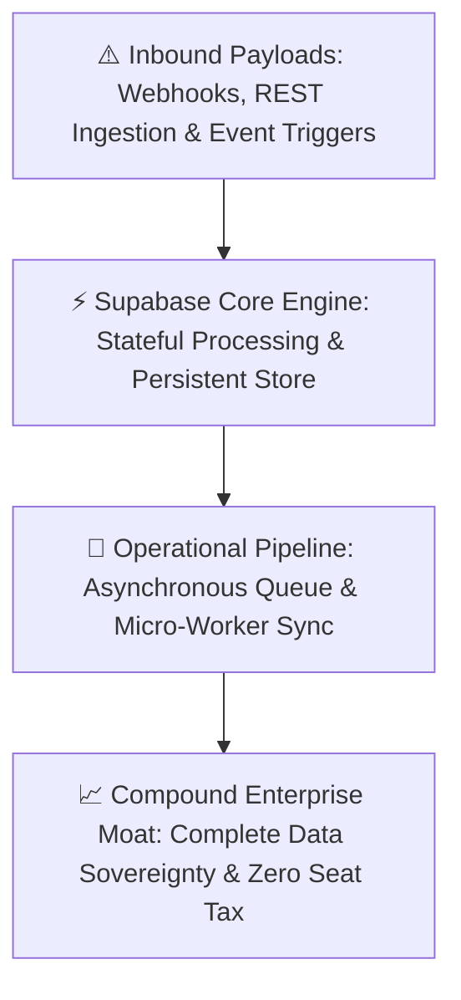

## 1. Architectural Overview & Value Proposition (Executive Summary)

**[supabase/supabase](https://github.com/supabase/supabase)** solves a fundamental operational hurdle for modern software engineering teams: **The open-source Firebase alternative with enterprise Postgres, Realtime, Auth, and Storage.**.

Instead of reinventing boilerplate workflows or incurring massive recurring licensing overhead from closed-source legacy incumbents, this repository delivers an enterprise-ready, self-hostable foundation built on an industrial-grade tech stack: **PostgreSQL, Go, Elixir, TypeScript, Docker, Kong Gateway**.

### Primary Target Audiences
* **Technical Founders & Solo Engineers:** Deploying scalable backbones in hours while preserving precious cash runway.
* **Agencies & SaaS Architects:** Requiring absolute data sovereignty, custom message queues, and zero vendor lock-in.
* **Engineering Leaders Evaluating Open-Source Alternatives:** Eliminating proprietary enterprise seat taxes without sacrificing architectural rigor.

---

## 2. System Architecture & Operational Pipeline

Our native vector architecture engine reconstructs the operational processing flow of `Supabase`:

---

## 3. Forensic Code Audit: Strengths vs Operational Red Flags

HeliaTech audits are synthesized from deterministic telemetry directly fetched from GitHub AST and REST endpoints, strictly free of marketing bias.

| Dimension | Telemetry | Technical Assessment |
| :--- | :---: | :--- |
| **Popularity & Traction** | `⭐ 115,126 stars` | Massive global community adoption backed by 15,148 verified forks. |
| **Maintenance Velocity** | `Today` | Active release rhythm maintained by core maintainers. |
| **Containerization** | `Docker Ready ✅` | Single-command containerized reproducibility. |
| **Test Coverage & CI** | `Automated Test Suites Detected ✅` | Regression protection across production pull requests. |
| **Legal License Risk** | `Apache License 2.0 (Low Risk)` | Low legal friction for commercial SaaS bundling. |

### 🔍 Verified Strengths (The Good)
1. **Pure PostgreSQL Foundation:** No proprietary lock-in. Full support for pgvector, Row-Level Security (RLS), triggers, and standard SQL tooling.
2. **Unified Polyglot Architecture:** Combines Go (GoTrue auth), Elixir (Realtime websockets), Kong (API gateway), and PostgREST into a coherent developer platform.
3. **Zero Licensing Restrictions:** Permissive licensing guarantees complete freedom to build proprietary enterprise applications on top.

### ⚠️ Hidden Red Flags & Production Traps (The Bad)
1. **High Self-Hosting Complexity:** The full Supabase self-hosted suite comprises 10+ Docker containers, requiring disciplined Kubernetes or Docker Compose management.
2. **WAL Storage & Disk IOPS Requirements:** High-throughput Postgres setups require dedicated SSD storage and calibrated IOPS to prevent replication lag.
3. **Supabase Studio Versioning:** Managing edge functions, migrations, and local studio dashboards requires continuous maintenance compared to the fully-managed cloud.
4. **Legal Compliance Notice:** **Permissive Commercial Freedom (Apache 2.0):** Supabase's core components are distributed under Apache 2.0, allowing commercial SaaS builders to modify, embed, and self-host without open-sourcing proprietary software.

---

## 4. The Decision Matrix: Self-Hosting vs Managed Cloud Infrastructure

* **Choose Self-Hosting ([View GitHub Repository](https://github.com/supabase/supabase)) if:** You operate dedicated DevOps engineers, regulatory mandates enforce strict internal database boundaries, and your team is equipped to handle recurring schema migrations.
* **Choose the Official Managed Cloud ([Supabase Cloud](/go/supabase)) if:** Your critical objective is immediate Time-to-Market, enterprise SLAs with dedicated on-call support, and eliminating operational maintenance debt.
