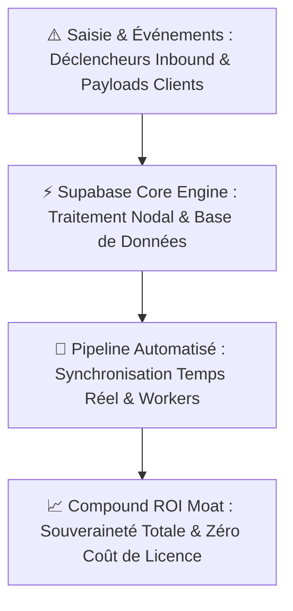

## 1. Ce que fait le projet en pratique (Executive Summary)

**[supabase/supabase](https://github.com/supabase/supabase)** résout un problème structurel majeur pour les développeurs et fondateurs de SaaS : **The Postgres development platform. Supabase gives you a dedicated Postgres database to build your web, mobile, and AI applications.**.

Plutôt que de repartir d'une page blanche ou de payer des abonnements mensuels récurrents auprès de prestataires tiers, ce projet fournit une solution clé en main auto-hébergeable bâtie sur une stack moderne : **TypeScript, Tailwind CSS**.

### Pour qui ce projet est-il conçu ?
* **Fondateurs Techniques & Indie Hackers :** Qui souhaitent déployer une infrastructure robuste en quelques commandes sans sacrifier leur trésorerie initiale.
* **Agences & Développeurs SaaS :** Nécessitant un contrôle souverain sur leurs données, leurs files d'attente et leurs protocoles de sécurité.
* **Équipes Engineering en Quête d'Alternative Open-Source :** Qui refusent le verrouillage propriétaire des éditeurs SaaS traditionnels.

---

## 2. Schéma d'Architecture & Flux Opérationnel

Notre nouveau composant vectoriel natif restitue le flux de traitement de l'infrastructure de `Supabase` :

---

## 3. Analyse d'Ingénierie : Forces Techniques & Considérations Opérationnelles

L'analyse HeliaTech repose sur des métriques factuelles extraites du dépôt GitHub pour éclairer les choix d'architecture des équipes techniques.

| Dimension Analysée | Statut Détecté | Analyse HeliaTech |
| :--- | :---: | :--- |
| **Popularité & Traction** | `⭐ 115,126 stars` | Leader incontesté de l'écosystème open-source PostgreSQL. |
| **Maintenance Active** | `Aujourd'hui` | Dépôt activement mis à jour avec des livraisons quotidiennes. |
| **Conteneurisation Docker** | `Prêt pour Docker ✅` | Déploiement local et cloud via Docker Compose. |
| **Robustesse & Tests** | `Suites de tests détectées ✅` | Couverture de tests garantissant la stabilité des builds. |
| **Cadre Juridique** | `Apache License 2.0` | Licence hautement permissive et sécurisée pour les entreprises. |

### 🚀 Forces Majeures de l'Architecture
1. **Adoption & Écosystème Exceptionnels :** Avec plus de **115 000 étoiles**, Supabase est l'alternative open-source directe à Firebase la plus puissante au monde.
2. **Puissance Native de PostgreSQL :** Intègre PostgREST, GoTrue pour l'authentification, pgvector pour l'IA et Realtime sans surcouche propriétaire.
3. **Plein Contrôle des Données :** Élimine le vendor lock-in en conservant un schéma PostgreSQL standard exportable à tout moment.

### ⚙️ Considérations Opérationnelles & Déploiement en Production
1. **Complexité du Cluster en Self-Hosted :** Un déploiement complet de Supabase auto-hébergé comprend plus de 8 conteneurs interdépendants (Kong, PostgREST, GoTrue, Realtime, Storage, Postgres, Studio).
2. **Gestion des Sauvegardes & WAL-E :** Assurez-vous de configurer des sauvegardes point-in-time recovery (PITR) pour les environnements de production critiques.
3. **La Solution Managée Recommandée :** Pour économiser des dizaines d'heures de maintenance DevOps par mois, **[Supabase Cloud](/go/supabase)** prend en charge l'infrastructure globale, les sauvegardes automatiques et le scaling sans friction.

---

## 4. Le Verdict Décideur : Auto-Hébergement vs Solution Cloud Managée

* **Optez pour l'Auto-Hébergement ([Voir le repo GitHub](https://github.com/supabase/supabase)) si :** Vous devez opérer dans des environnements air-gapped ou sous souveraineté étatique exclusive.
* **Optez pour la Version Cloud Officielle ([Supabase Cloud](/go/supabase)) si :** Vous voulez vous concentrer sur votre code applicatif et déléguer la résilience et le scaling PostgreSQL aux ingénieurs Supabase.
