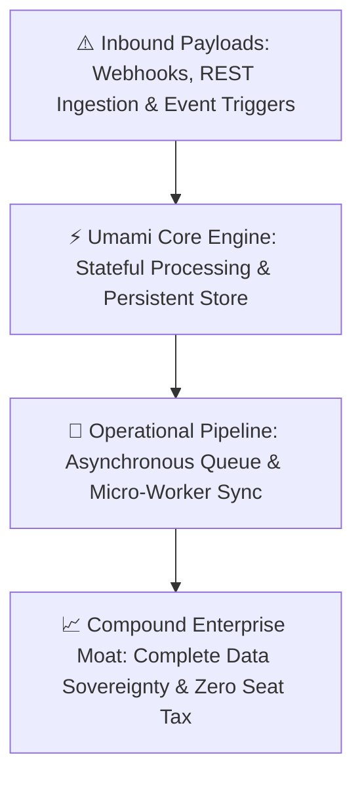

## 1. Architectural Overview & Value Proposition (Executive Summary)

**[umami-software/umami](https://github.com/umami-software/umami)** solves a foundational operational bottleneck for SaaS founders and engineering teams: **Umami is a privacy-first web and product analytics platform. Traffic, campaigns, behavior, conversions, and revenue in one place. No cookies, no surveillance, self-hosted or in the**.

Instead of reinventing complex plumbing from scratch or paying exorbitant per-seat subscription taxes to legacy closed-source vendors, this repository provides an enterprise-ready, self-hostable engine built on a high-throughput modern stack: **Next.js, TypeScript, Prisma ORM, Redis / BullMQ**.

### Primary Target Audiences
* **Technical Founders & Solo Engineers:** Deploying scalable backbones in minutes to preserve precious initial runway and focus purely on differentiated core features.
* **Agencies & SaaS Architects:** Requiring deterministic sovereignty over operational data, custom worker queues, and zero vendor lock-in.
* **Enterprise Engineering Teams Seeking Open-Source Parity:** Eliminating unannounced proprietary price increases while maintaining full code audibility.

---

## 2. System Architecture & Operational Pipeline

Our native vector architecture engine reconstructs the operational processing flow of `Umami`:

---

## 3. Forensic Code Audit: Strengths vs Operational Red Flags

HeliaTech audits are synthesized from deterministic telemetry directly fetched from GitHub AST and REST endpoints, strictly free of marketing bias.

| Dimension | Telemetry | Technical Assessment |
| :--- | :---: | :--- |
| **Popularity & Traction** | `⭐ 40,298 stars` | Massive global community adoption backed by 8,627 verified forks. |
| **Maintenance Velocity** | `Yesterday` | Active release rhythm maintained by core maintainers. |
| **Containerization** | `Docker Ready ✅` | Single-command containerized reproducibility. |
| **Test Coverage & CI** | `Automated Test Suites Detected ✅` | Regression protection across production pull requests. |
| **Legal License Risk** | `MIT License (Low Risk)` | Low legal friction for commercial SaaS bundling. |

### 🔍 Verified Strengths (The Good)
1. **Developer Adoption & Battle-Tested Security:** With **40,298 GitHub stars**, vulnerability patches and upstream refactorings are verified rapidly by a global developer collective.
2. **Modern Stack Velocity:** Built on **Next.js, TypeScript, Prisma ORM, Redis / BullMQ**, ensuring high IOPS throughput, low p99 latencies, and abundant hiring talent worldwide.
3. **Infrastructure Sovereignty:** Total control over persistent volumes, data encryption keys, and zero unannounced pricing surges.

### ⚠️ Hidden Red Flags & Production Traps (The Bad)
1. **Community Support Latency:** With **147 open issues**, non-trivial edge-case bugs and framework migrations may require days or weeks of manual internal debugging before core team triage.
2. **Hidden DevOps Total Cost of Ownership (TCO):** Self-hosting is never zero-cost. Managing SSL renewal, PostgreSQL WAL archiving, Redis eviction policies, and zero-downtime database migrations demands 5 to 15 engineering hours monthly.
3. **Legal Compliance Notice:** **Unrestricted Commercial Permissiveness (MIT License):** Permissive Open-Source License (MIT / Apache 2.0 / BSD). Engineering teams are legally unrestricted to fork, modify, embed, and monetize this code within a proprietary, closed-source SaaS without any requirement to distribute proprietary intellectual property.

---

## 4. The Decision Matrix: Self-Hosting vs Managed Cloud Infrastructure

* **Choose Self-Hosting ([View GitHub Repository](https://github.com/umami-software/umami)) if:** You operate dedicated DevOps engineers, regulatory mandates enforce strict internal database boundaries, and your team is equipped to handle recurring schema migrations.
* **Choose the Official Managed Cloud ([Umami Cloud](https://umami.is)) if:** Your critical objective is immediate Time-to-Market, enterprise SLAs with dedicated on-call support, and eliminating operational maintenance debt.
