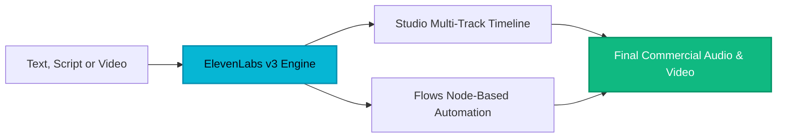

## Executive Summary: The Unified Audio AI Standard

ElevenLabs has transformed from a groundbreaking text-to-speech model into a complete, enterprise-grade generative audio ecosystem. Today, it powers three interconnected product suites:

1. **ElevenCreative:** A single platform to generate, edit, and localize voiceovers, music, sound effects, and video.
2. **ElevenAgents:** Intelligent, conversational voice agents that answer business phone calls, qualify leads, and book appointments 24/7 without code.
3. **ElevenAPI:** High-throughput developer infrastructure trusted by Meta, Stripe, Perplexity, and Cisco for sub-500ms streaming audio.

Trusted by over 1,000,000 creators, startups, and enterprises including Disney, Duolingo, Revolut, and Klarna, ElevenLabs sets the benchmark for natural, human-sounding synthetic voice in 2026.

---

## 1. Deep Dive: ElevenCreative (Studio, Flows & Multimedia)

### Text to Speech v3 & Expressive Mode
ElevenLabs v3 is the most expressive text-to-speech model available. Beyond realistic cadence, breathing, and emotional inflection across 70+ languages, v3 introduces **Audio Tags** via Expressive Mode. You can inject emotional markers directly into text:
* `[laughs]` to add natural chuckle and warmth
* `[whispers]` for intimate, suspenseful narration
* `[sighs]` to convey dramatic exhaustion or relief

### Studio: Full Production Workspace
Studio provides a complete multi-track timeline editor directly in the browser:
* Dedicated tracks for video footage, AI narration, music soundtracks, sound effects, and auto-styled captions.
* **Actor Mode:** Record your own voice as an acoustic reference; the model mimics your exact rhythm and emotional inflection using the target voice.
* **GenFM:** Turn manuscripts or uploaded documents into dynamic, multi-speaker AI podcast episodes.

### Flows: Visual Node-Based Pipelines
Flows operates as an infinite canvas where you chain video, image, voice, music, and lip-sync models together. For performance marketing agencies, Flows allows swapping hooks, background music, or languages across hundreds of creative variations for rapid A/B testing without rebuilding projects manually.

### Commercial Music & Sound Effects
* **ElevenMusic:** Describe any mood, tempo, or genre to generate studio-grade tracks with or without vocals, cleared for broad commercial use.
* **Sound Effects:** Generate natural Foley, transitions, and environmental loops from simple text descriptions.

---

## 2. Deep Dive: ElevenAgents (The 24/7 AI Receptionist)

For small businesses, healthcare practices, real estate brokers, and agencies, **every missed phone call is lost revenue**. Traditional answering services take flat messages, while full-time receptionists cannot cover evenings, weekends, or peak overflow.

**ElevenAgents solves this without writing a single line of code:**

* **Autonomous Inbound Answering:** Answers calls within two rings with natural human-sounding conversation, eliminating awkward pauses.
* **Direct Calendar Booking:** Integrates natively with Google Calendar, Outlook, and Calendly to schedule consultations and appointments during the call.
* **Trained on Your Business Knowledge:** Upload your website URL, PDF brochures, pricing sheets, or FAQs. The agent answers inquiries accurately and adheres to strict business policies.
* **Intelligent Escalation:** Transfers complex calls to your mobile phone or team members with complete contextual summaries.
* **WhatsApp & Multi-Channel Support:** Deploys across voice phone lines and WhatsApp messaging simultaneously.

---

## 3. Deep Dive: ElevenAPI & Developer Ecosystem

For technical teams, ElevenAPI delivers production-grade audio infrastructure:
* **Sub-500ms Streaming:** Low-latency chunked audio streaming for responsive voice interfaces.
* **Scribe Speech-to-Text:** Transcribes audio across 99 languages at 20-50x real-time speed with speaker diarization and word-level timestamps.
* **Vibe-Coding Compatibility:** Seamlessly integrates with tools like Cursor, Lovable, Replit, and v0.
* **Enterprise Compliance:** SOC 2 Type II, HIPAA, GDPR, EU and India data residency options, and Zero Retention mode.

---

## Pricing & Plan Architecture

| Plan | Price | Monthly Quota | Key Capabilities |
| :--- | :--- | :--- | :--- |
| **Free** | $0/mo | 10,000 chars | Non-commercial exploration, default voices |
| **Starter** | $5/mo | 30,000 chars | Commercial license, instant cloning, Studio timeline |
| **Creator** | $22/mo | 100,000 chars | Professional Voice Cloning, Flows canvas, high fidelity |
| **Pro / Scale** | $99 - $330/mo | Up to 2M chars | Full ElevenAgents phone answering, 44.1kHz WAV, API scale |

---

## The Verdict: Why ElevenLabs Dominates

Whether you need broadcast-grade voiceovers for YouTube, automated marketing variations with Flows, a 24/7 AI receptionist to answer your business phone, or real-time voice infrastructure for your software, ElevenLabs provides the most cohesive and lifelike audio platform in the world.

* **Acoustic Quality & Emotional Range:** 9.9 / 10
* **Product Breadth (Creative + Agents + API):** 9.8 / 10
* **Commercial Viability & ROI:** 9.6 / 10
* **HeliaTech Accreditation:** **Industry Gold Standard 2026 (Score: 9.9/10)**.

> **Official Verified Access:** Test ElevenLabs, claim partner benefits, and explore ElevenCreative & ElevenAgents through our verified partner link at [/go/elevenlabs](/go/elevenlabs).
